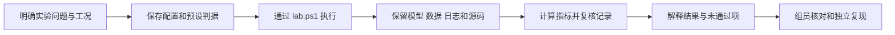

# 用 Agent 执行和核对实验

本页供组员使用自然语言提出实验任务，并检查 Agent 的配置、执行和解释。模型操作通过项目脚本完成，实验结论需要对应实际数据。

## 建立任务上下文

在项目目录开始工作，让 Agent 读取 [README](../README.md)、[项目指令](../AGENTS.md) 和所选模型说明：[RLC](experiments.md) 或 [Boost](boost-experiments.md)。

一个可执行任务至少要明确模型、参数或事件、保持不变的条件、采集内容和评价指标。采用现有基准配置时，指出配置名称；采用默认值时，让 Agent 列出实际使用的值。条件有歧义时先补齐，再运行。

## 从配置到结果

实验执行前确定分析窗口与判据。完成后先查看执行和数据是否有效，再解释指标是否达标；条件修改后保存新的配置和运行记录。

## 任务示例

### 运行 RLC 基准

> 按 rlc_baseline.json 运行基准实验，核对 I 与 Va1 的稳态 RMS。列出实际参数、采集窗口、解析参考、每项误差和判据，给出结果目录与 verify 状态。

### 扫描 RLC 输入电阻

> 使用教学 RLC 模型，把 Rin 设为 1、5、10 Ω，其余条件采用 rlc_sweep.json。分别保存原始数据，比较电流和节点电压 RMS，并按对应拓扑解释差异。

### 运行 Boost 参考阶跃

> 按 boost_reference_step.json，在仿真 0.5 s 把参考从 50 V 改为 60 V。采集输出电压、输入电流、实际参考和输入电压，计算稳态误差、超调和调节时间。核对 events.json 的实际事件检测区间，生成报告并执行 verify。

### 比较 Boost 跟踪与抗扰动

> 按 Boost 教程运行基准、参考阶跃、输入跌落和输入升高四份配置。逐项列出事件、性能判据及记录复算结果；未通过时保留原判据，说明具体越限值，并给出全部实际报告路径。

### 分析已有记录

> 读取 results 中指定的实验目录，先确认模型、工况、软件环境和记录状态。核对原始数据与指标，重建报告后再次 verify；解释结论适用的模型、激励与观察窗口。

### 定位执行问题

> 我执行的命令是〈完整命令〉，结果目录是〈实际目录〉。请从日志中的首次错误定位编译、加载、采集或分析问题，核对相应配置和本地 API。修复后用同一配置另建运行，比较处理前后的记录。

## 接收结果时核对

| 要核对的问题 | Agent 应提供的证据 |
|---|---|
| 执行了什么任务 | 实际配置、命令与模型副本 |
| 波形来自哪里 | 原始 CSV、信号名称、单位和时间范围 |
| 指标能否重算 | 分析窗口、公式、归一化分母和判据 |
| 事件是否按要求生效 | 实际参考／输入信号、检测区间和分辨率 |
| 全部工况是否列出 | 每项状态、实际数值和报告路径 |
| 记录是否一致 | verify 的 record_status 与问题列表 |
| 实验是否达标 | experiment_status、未通过判据和越限值 |
| 是否发生异常 | 失败阶段、首次错误、清理结果和日志 |

区分数值观察、理论解释和待验证判断。例如，某组 Rin 工况的 RMS 随电阻变化，需要对应这组数据；推广到其他频率或模型时需建立相应实验。

超出支持模型或事件范围的任务，先按 [模型接入方法](model-integration.md) 完成适配和验证。人员复现按 [交接流程](handoff.md) 记录。
