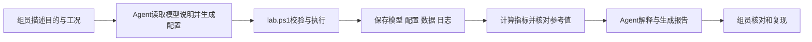

# Agent 工作流与提问方式

本项目让组员使用自然语言提出教学实验任务，由 Agent 整理实验配置、调用项目脚本并解释结果。本文帮助组员提出可执行任务，也说明怎样核对 Agent 的产出。

## 建立项目上下文

在 Codex 中打开 `lab-workflow`，让 Agent 先读取 [README](../README.md)、[AGENTS.md](../AGENTS.md) 和 [实验说明](experiments.md)。项目指导文件记录运行入口、模型范围和结果要求。

OpenAI 官方说明：Codex 会读取项目路径上的 `AGENTS.md` 指导，目录层级决定指令的组合顺序。组员应从本项目根目录开始，并让 Agent 列出已读取的项目指导文件；修改指导文件后，应在新运行或会话中确认其生效。[OpenAI：Custom instructions with AGENTS.md](https://learn.chatgpt.com/docs/agent-configuration/agents-md)

## 一次任务怎样执行

实验配置把参数、单位、信号和采集设置固定下来。项目脚本执行实际的模型操作、仿真和计算；Agent 根据这些文件整理说明。在讨论结论时，组员应能找到原始数据和对应的指标计算依据。

## 提出足够明确的任务

一个任务至少包含：使用哪个教学模型、研究哪个参数或工况、比较什么结果。已有配置能提供默认值；Agent 采用默认值时应将其写入实际配置和说明。

**基准实验**

> 使用 rlc_baseline.json 运行一次基准实验，核对 Va1 与 I 的稳态 RMS，列出判据、实际数值、原始数据和报告路径。

**参数扫描**

> 使用本项目教学 RLC 模型，把 Rin 设为 1、5、10 Ω；保持其余条件与基准配置一致。保存各工况数据，比较节点电压和源电流 RMS，解释与解析参考值的关系。

**只分析已有结果**

> 读取 results 中这次实验的目录，核对数据和指标，重新生成比较报告。请先说明目录对应的参数、软件版本和运行状态。

**定位失败**

> 这次运行在加载阶段失败。请读取日志和配置，定位失败位置并给出可检查的原因。修复后保留新旧两次记录。

## 接收结果时核对什么

| 组员要核对的内容 | Agent 应给出的依据 |
|---|---|
| 是否执行了所要求的实验 | 实际配置、模型副本及命令记录 |
| 是否拿到了真实波形 | 原始 CSV、采集信号、时间范围与单位 |
| 指标是否可以重算 | 稳态区间、公式、计算文件和阈值 |
| 结论是否覆盖全部工况 | 每项工况状态及汇总表 |
| 改动能否追溯 | 本次代码版本摘要与运行清单 |
| 是否遇到异常 | 失败阶段、异常信息和日志位置 |

Agent 应将数值观察、理论解释与进一步验证建议分别写清。例如，“Rin 增大时这三个工况的电流 RMS 下降”需要对应采集数据；把该现象推广到其他频率或其他电路之前，应建立相应实验。

## 需要新增课题模型时

组员先提供研究问题、模型来源、被控对象、要改变的参数和评价指标。随后安排模型检查、基准实验和参考值核对，将验证通过的模型加入项目说明与配置范围。首个课题模型可以沿用本版数据记录和报告结构，并重新制定该课题的判据。

日常入口见 [首次实验](first-experiment.md)。交接方式见 [交接验收](handoff.md)。
