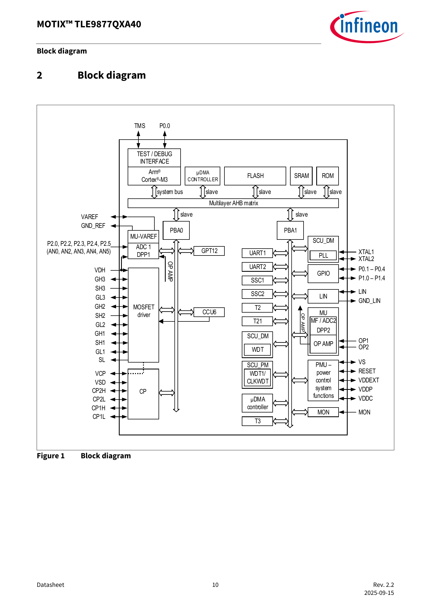
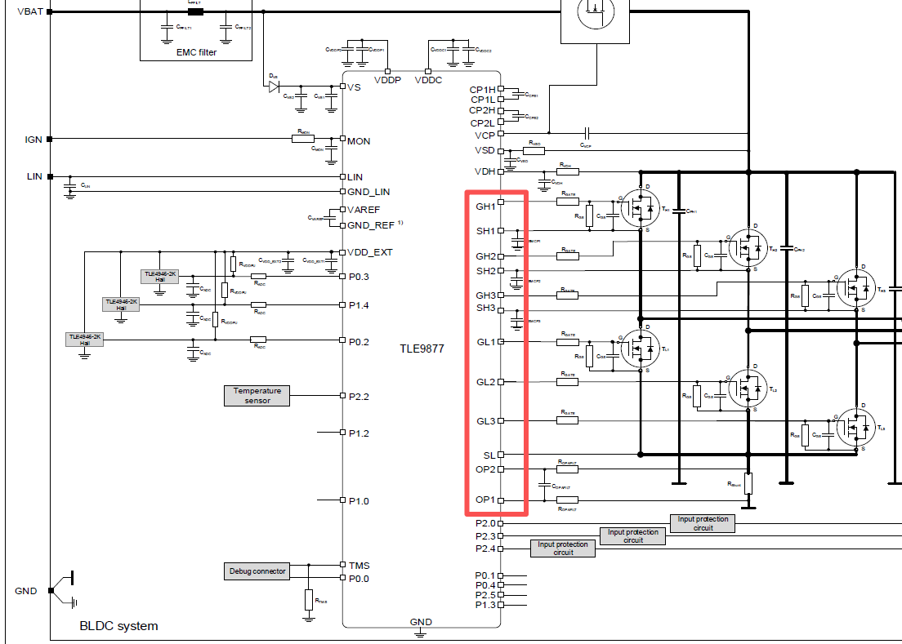
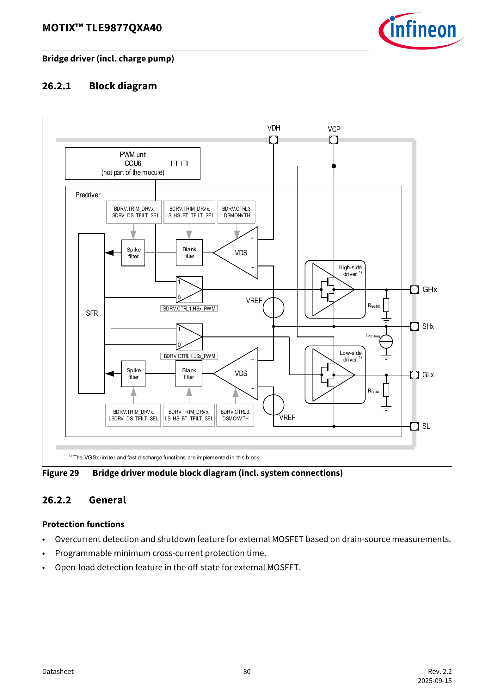
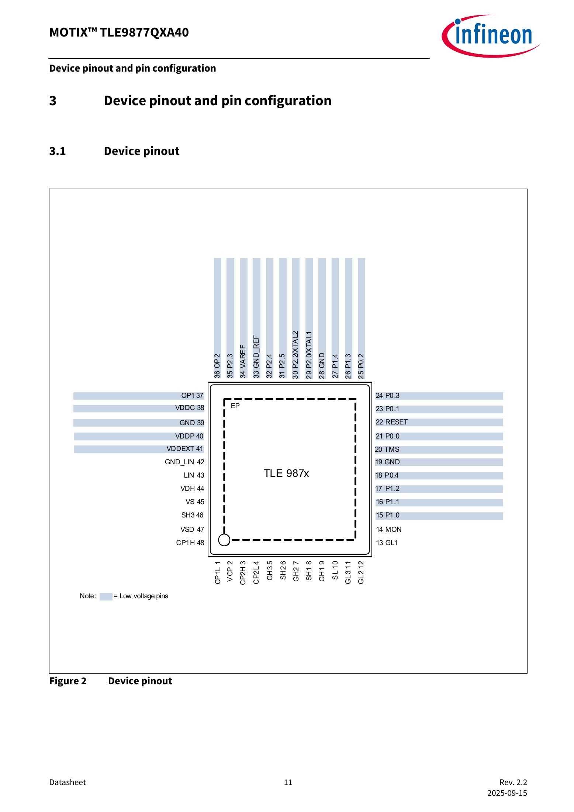

# 2. 芯片、控制板与 18 条引线

上一章：[电与整套系统](01-electricity-and-system.md) · [学习入口](README.md) · 下一章：[电机与控制](03-motor-and-control.md)

本章目标：读懂控制板上的各部分分别做什么；看到 GH1、SHP 等标签时，知道从哪里开始查。先学读图，再考虑具体接线。

## 2.1 芯片和控制板是什么关系

**芯片 IC**是把电子功能集成在一个小封装里的器件。**控制板 PCB**则把芯片、电阻、电容、功率开关和连接器等，通过板上的铜线连接起来。

芯片型号告诉我们这个器件具有什么能力。整块板实际怎样工作，还取决于外围电路和内部运行的程序。

**MCU，微控制器**，可以先理解为专门执行控制任务的小计算机。它有执行程序的处理器、保存程序的存储器，以及收发信号的电路。

**固件 firmware**是烧写到板卡上运行的程序，包括启动、通信、控制、保护和状态管理。芯片支持 FOC，并不等于当前固件一定采用某个特定 FOC 算法；这要看实际程序和说明。

## 2.2 在芯片内部先找五个功能

下图来自你提供的 TLE9877QXA40 芯片手册，第 10 页，Figure 1。图片保留整页，点击可放大。

按以下顺序看，不必一次理解所有方框：

| 图中名称 | 先怎样理解 | 与本次测试的关系 |
|---|---|---|
| Arm Cortex-M3 | 执行程序的处理器 | 运行控制与通信逻辑 |
| FLASH / SRAM | 程序存储和运行时工作区 | 固件版本、运行变量属于这一层 |
| CCU6 / PWM | 产生定时开关控制的模块 | 配合驱动器控制六路功率开关 |
| MOSFET driver | 把控制意图变成适合栅极的驱动 | 对应 GH/GL 等输出 |
| OP AMP / ADC / LIN | 小信号放大、模拟转数字、总线收发 | 对应反馈测量和外部命令 |

**ADC，模数转换器**，把连续变化的电压转成程序可以读取的数字。**运算放大器 OP AMP**在本场景中帮助放大小电流采样电压。**LIN 收发器**负责总线电气信号的收发，后面还要有协议和固件配合。

手册及[Infineon 官方产品说明](https://www.infineon.com/part/TLE9877QXA40)确认这一芯片集成处理器、LIN、采样与桥驱动等功能；功率级的六个 MOSFET 位于外部电路。

## 2.3 MOSFET：受控制的功率开关

**MOSFET**在这里可以先看成电子开关。常见三个端子是 G、D、S：

| 端子 | 中文 | 在本场景中的作用 |
|---|---|---|
| G，Gate | 栅极 | 接收驱动，控制开关状态 |
| D，Drain | 漏极 | 电流通路的一端 |
| S，Source | 源极 | 电流通路的另一端，也是理解驱动电压的重要参考 |

“栅极驱动”关注的是 G 相对于 S 的电压，即 VGS。上桥 MOSFET 的源极会随相节点变化，所以栅极相对地的电压，与栅极相对源极的驱动电压，需要分别理解。

**栅极驱动器**负责较快地给栅极充放电，使 MOSFET 按要求开关。电机的大部分功率电流经过功率开关与绕组；控制信号负责决定这些开关的动作。

## 2.4 三相桥：为什么有六路驱动

三相电机有 U、V、W 三个外部相节点。每相由一只上桥开关和一只下桥开关构成一个桥臂，三相共六只。

~~~text
以 U 相为例：

母线正端
   │
 上桥 MOSFET  ← GH1 驱动其栅极
   │
   ├────────→ U 相节点，连接电机
   │
 下桥 MOSFET  ← GL1 驱动其栅极
   │
低端公共节点／分流测量路径
~~~

V、W 两相分别对应 GH2/GL2、GH3/GL3。上桥和下桥按控制规律切换，三相绕组中形成所需电流。

**死区 dead time**是同一桥臂切换时预留的短暂空档，帮助避免上下开关同时导通形成直通。真实电路还存在二极管、延迟和诊断，所以上面只用于理解结构。

## 2.5 对着你给的截图读一遍

图源：你提供的控制边界截图，原样收录。它是理解器件连接的材料，实际改装接线需另有对应图纸。

按四步找：

1. 中间写 TLE9877 的大框是芯片，右边六个开关符号是外部功率 MOSFET。
2. 沿 GH1 找到右侧第一只上桥 MOSFET 的 G 端，再沿 GL1 找到对应下桥 G 端。
3. 找右下方 Rshunt，这是把电流转成小电压的分流电阻；OP1、OP2 通向采样链。
4. 再看左边的 LIN、供电和其他输入，区分“要求怎样进来”与“功率怎样送出去”。

原图左侧还有 Hall 字样的器件示意。针对本次电机，提供的引线说明写“无位置传感器”，因此这张通用应用图不能用来认定本次样机装了霍尔传感器。红框也只帮助定位图上信号，最终保留与替代哪些电路，应看实际 HIL 改装图。

## 2.6 GH、GL、SH、SL 分别是什么意思

图源：所提供手册，第 80 页，Figure 29。第一次只看最右侧 GHx、SHx、GLx、SL 四个名称，x 表示 1、2、3 中的一相。

| 名称 | 芯片图中对应的功能 | 读资料时要区分什么 |
|---|---|---|
| GHx | 上桥栅极驱动 | 查对应相及相对哪个参考点测量 |
| GLx | 下桥栅极驱动 | 查低端参考及信号调理 |
| SHx | 相应上桥源极／相节点相关连接 | 与 GHx 配合理解上桥驱动参考 |
| SL | 低端源极公共节点相关连接 | 与采样通路及公共参考有关 |

**SHP、SHN 是板级引线表中的采样标签；SH1、SH2、SH3 是芯片图里的另一组名称。** 它们名字相似，查表时要逐字看清。SHP/SHN 到 OP1/OP2 的具体连接，需要实际板图核对。

## 2.7 18 条线先按功能分组

完整序号、焊接位置和原始出处见[样机接口表](../tle9877-hil-intake.md#2-引线怎么理解)。先用下表建立分类，避免一口气背 18 个名称。

| 功能组 | 本次标签 | 从板卡角度怎样理解 |
|---|---|---|
| 供电和参考，3 条 | BAT、GND1、系统地 | 为板卡供电，建立相应参考；接地与隔离方案需结合平台 |
| 外部命令，2 条 | PWM-IN、LIN-IN | 接收运行要求；LIN 线上也会有板卡响应 |
| 功率与相关节点，5 条 | U、V、W、VM、SL | 与三相桥、母线和低端节点有关；实际保留／断开／替代方式待确认 |
| 电流采样，2 条 | SHP、SHN | 把差分采样电压送向板卡测量链 |
| 六路驱动，6 条 | GH1～3、GL1～3 | 从 MOS 栅极位置引出驱动信息，供适配电路接收 |

VM 原文是“母线电压线，控制板产生”，这还不足以把它定义成一个 HIL 模拟输出注入端。U/V/W 也属于电气节点，不能只因为名称像“信号”就当作低压测量输入。

## 2.8 “输入”和“输出”要先说站在哪一边

同一根驱动线，对板卡可能是输出，对接收它的 HIL 调理电路则是输入。反馈线刚好反过来。

读接口表时，可以在每条记录旁补四项：**由谁产生、由谁接收、相对哪里测量、采用什么范围与时序**。四项里有未知，就写具体未知项。

例如 GH1 可以先写：“板卡功率 MOS 栅极引出 → 待确定调理电路 → HIL 驱动捕获；参考点、幅值与共模待确认。”这比只写“数字 IO”更有助于后续落实。

Excel 的“18V/2=9V”还没有解释分压发生的位置、实际输出端和上桥共模处理。因此本教程用它说明待确认问题，实际 HIL 输入电平需按转接板规格确定。

## 2.9 看芯片脚号时再打开这一页

图源：所提供手册，第 11 页，Figure 2。这里的数字是**芯片封装脚号**。Excel 18 条引线前面的数字是**表格序号**。另外，M4、R33、C27 是板上器件位号，分别表示某个 MOSFET、电阻、电容。三套编号分别用于三个层次。

## 2.10 小练习

1. 芯片、控制板、固件分别是什么？
2. GH1 与 U 相节点各在什么位置，作用有什么不同？
3. 芯片图里的 SH1 和板级标签 SHP 能否仅凭名称当作同一根线？
4. 若别人说“这是一根 9V 数字信号”，至少还要问哪两类信息？

参考答案

1. 芯片是器件，控制板连接多个器件，固件是在其上执行的程序。
2. GH1 控制上桥 MOS 栅极；U 是桥臂中点连接电机的功率节点。
3. 需要查实际连接。相似名称不能替代电路映射。
4. 参考点、实际范围与共模、是否已调理，以及接收端的规格和时序要求，至少应明确其中相关项。

接下来进入[第 3 章](03-motor-and-control.md)，把这些开关与电机转动联系起来。
