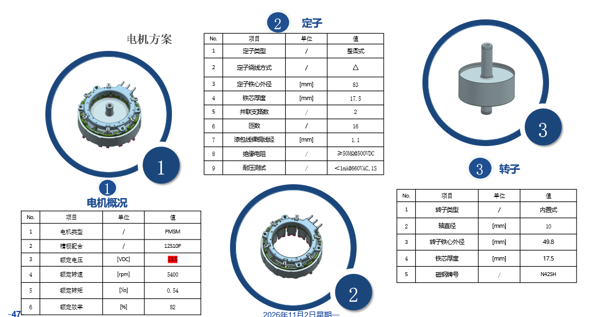
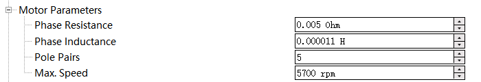

# 3. 电机怎样转，控制怎样起作用

上一章：[芯片、控制板与引线](02-chip-board-and-wires.md) · [学习入口](README.md) · 下一章：[反馈与 HIL](04-feedback-and-hil.md)

本章目标：把“电流、电磁转矩、转速”连成一条因果关系，并认识控制程序中最常出现的词。第一遍理解方向和作用即可。

## 3.1 先认识电机里面的两个部分

图源：引线 Excel，“电机方案”页第一张原图。

看图中间的**定子**和右侧的**转子**。定子相对外壳固定，含有绕组；转子与轴一起旋转。本次资料写 PMSM、内置式转子、12 槽 10 极、Δ 绕组。

**PMSM**全称 Permanent Magnet Synchronous Motor，中文是永磁同步电机。转子含永磁体，定子绕组中的电流建立磁场，两者相互作用产生转矩。

“同步”表示正常同步运行时，转子与定子旋转磁场保持对应的转速关系。它不表示转速永远准确，也不表示电机天然知道外部命令。

## 3.2 三相是什么意思

可以先把 U、V、W 理解为三个按规律配合的电流通道。合适的三相电流能合成旋转的磁场，使转子持续受到转动作用。

你会看到三条电流曲线随时间交替变正、变负。**负电流**表示相对于选定正方向反向流动，本身是正常的电机运行现象。是否异常，要结合幅值、相位、工况和判据判断。

**Δ，三角形接法**与**Y，星形接法**描述绕组之间的连接。相同的三个外部端子，并不意味着内部连接相同。绕组支路电流、外部线电流和参数定义也可能不同。

本次提供的电机是 Δ 接法，软件预演采用明确假设的等效星形参数。要建立样机对应模型，需先对齐绕组参数与目标组件的定义，所需条件见[接入记录](../tle9877-hil-intake.md#3-电机参数已给出什么还缺什么)。

## 3.3 转速与转矩是两种量

**转速**是转得多快，常用 rpm，即每分钟转数。**转矩**是推动物体转动的作用，单位 N·m。相同转速下，负载较重，可能需要更大的转矩。

拿手摇一个带阻力的轮子：你可以让它一直保持同样快，但阻力增大后，需要更用力。电机也会在相同转速下改变电流和电磁转矩。

**电磁转矩**来自电机中的电磁作用。**负载转矩**描述外部机械负载对轴的作用。按适当的符号约定，电磁转矩超过负载与损耗所需的部分用于加速；接近平衡时，转速趋于稳定。

**转动惯量**描述对象改变转速有多困难。它越大，相同净转矩下加减速越慢。电机尺寸可以提供几何线索，但不能代替已经确认的惯量参数。

## 3.4 10 极为什么是 5 极对

一对磁极包含一个 N 极和一个 S 极，所以 10 极对应 5 极对。资料中的 12 槽描述定子结构，不能拿 12 去当极对数。

电机控制还会用到**机械角度**和**电角度**：

~~~text
机械转一圈：轴转过一整圈
对于 5 极对电机：对应 5 个电角度周期

电频率（Hz）= 机械转速（rpm）÷ 60 × 极对数
~~~

例如 2400rpm = 每秒 40 圈，5 极对时电频率是 200Hz。**200Hz 是这个例子中的电频率**；开关 PWM 的频率是另一个量，外部 PWM-IN 命令频率又是第三个量。

## 3.5 PWM 为什么能控制电机

PWM 是脉宽调制。一个重复周期内，高电平持续时间占总周期的比例叫**占空比**。

~~~text
周期 T = 一次完整重复的时间
频率 f = 1 ÷ T
占空比 D = 高电平时间 ÷ 周期
~~~

例如每 50μs 重复一次，就是 20kHz。高电平持续 20μs，占空比为 40%。这是算例；20kHz 也是当前软件预演的开关设定，实际样机频率仍需确认。

功率开关的端点电压在开关过程中变化，绕组的电感让电流按相应规律变化。控制器调节三相开关时序，从而影响电流、转矩和转速。

这里的“40%”首先描述脉冲时间比例。若 PWM 被用作外部通信命令，它表示什么运行状态，还要查专门的协议映射。第 5 章会结合本次 PWM-IN 图表解释。

## 3.6 闭环为什么要一层层调节

一种常见结构是外层调转速、内层调电流。可以按四步理解：

1. 转速环查看“想多快”和“现在多快”的差距。
2. 根据差距提出转矩或电流要求。
3. 电流环查看实际电流是否达到要求，再调整电压控制量。
4. PWM 模块把电压控制量转换为开关动作，电机响应后再反馈。

**控制环**就是持续执行“比较—调整—反馈”的过程。内层通常需要更快地处理电流变化，外层按机械变化的特点工作；实际执行周期由固件决定。

~~~mermaid
flowchart LR
    A[参考转速] --> B[转速控制]
    B --> C[电流或转矩要求]
    C --> D[电流控制与调制]
    D --> E[三相桥和电机]
    E --> F[电流反馈]
    F --> D
    E --> G[转速测量或估计]
    G --> B
~~~

如果上位机每 20ms 更新一次运行命令，芯片仍然可以在其间执行很多次内部控制。通信更新周期与控制周期分属不同层次。

## 3.7 FOC 到底在做什么

**FOC，磁场定向控制**，是一种组织电机控制计算的方法。转子磁场一直在转，直接盯着三条起伏的相电流处理比较复杂。FOC 把电流换到跟随转子旋转的参考方向上，得到常见的 d、q 两个分量，再分别调节。

第一轮可以这样理解：d 方向与转子磁场相关，q 方向主要与转矩产生相关。不同电机类型和运行区域下，具体电流分配会变化，不能把“d 永远为零”当成通用规则。

沿着软件图，你可能见到这些名称：

| 词 | 在流程里做什么 | 第一次学到哪一步 |
|---|---|---|
| Clarke / Park 变换 | 把三相电流换到便于控制的坐标 | 认识输入输出及为什么需要角度 |
| PI 控制器 | 根据当前误差和累计误差调整输出 | 理解它会持续修正，先不整定参数 |
| SVPWM | 把电压要求变成三相开关时间 | 知道它位于控制计算与开关之间 |
| MTPA | 在一定条件下选择电流分配，提高每单位电流的转矩效果 | 知道它会影响 d/q 电流指令 |
| 限幅 | 把某个控制量限制在设定范围 | 查明限的是电流、转矩还是其他量 |

这些术语用来帮助读模型。当前软件预演使用示例控制器并作了明确修改；本次样机固件采用什么算法和参数，需要由固件说明确认。

FOC 与采样关系的进一步参考：[TI 单分流 FOC 应用说明](https://www.ti.com/lit/pdf/spract7)，第 2 节。第一遍看框图即可。

## 3.8 “无感”为什么仍然需要测量

这里的**无感 sensorless**通常指没有专门的转子位置传感器。程序仍要利用电流、电压、模型参数等信息估计转子状态。

**状态估计器／观测器**是根据可测量的量和模型，推算难以直接测量状态的算法。电机运动产生的**反电动势**可以提供状态信息。采用反电动势估计的方法在低速时信息较弱，因此常需要专门的启动和切换过程；不同算法可能采用其他办法。

一个便于理解的示例过程是：准备和检查 → 对齐或建立初始状态 → 按预定规律升速 → 满足条件后采用估计角度闭环 → 正常运行。它用于说明“启动是一段过程”，实际样机顺序以固件为准。

Microchip 的[官方无感单分流示例](https://onlinedocs.microchip.com/oxy/GUID-686B08E8-FD18-4AAD-87B9-32B527406A88-en-US-3/GUID-942885A0-341F-425F-94BD-714A4351EF12.html)给出了其中一种实现，可作为原理补充。

## 3.9 为什么模型能转，样机接入后还要验证

当前预演直接使用模型内部的转子角度，控制器容易取得所需位置。真实无感固件需要自己估计，还要面对采样、延迟、参数偏差和启动条件。

因此预演很适合让你观察“调速和加负载后，电流、转矩、转速怎样变化”。要回答真实样机是否能启动、能否正确保护，则需要把实际固件及其反馈路径接入对应测试。

## 3.10 对着参数截图读名字

图源：你提供的参数截图，原样收录。

| 截图或模型字段 | 含义 | 本次使用时要补充什么 |
|---|---|---|
| Phase Resistance / Rs | 绕组电阻参数 | 确认“相”的定义及 Δ 与目标模型的对应 |
| Phase Inductance | 绕组电感参数 | 确认测量条件、参数口径及与 Ld/Lq 的关系 |
| Pole Pairs | 极对数 | 当前提供值 5，与 10 极一致 |
| Max. Speed | 某配置中的最大速度设置 | 确认作用位置及与固件限幅的关系 |
| Ld / Lq | d/q 方向电感 | 样机配置中仍有待补项 |
| PM flux | 永磁磁链，反映永磁磁场与绕组的联系 | 需要参数来源或反电动势常数的对应定义 |
| Inertia | 转动惯量 | 需要轴上对象及模型范围 |

模型要求的参数可以查 [Typhoon PMSM 组件说明](https://www.typhoon-hil.com/documentation/typhoon-hil-software-manual/References/three_phase_permanent_magnet_synchronous_machine.html)。先对照组件参数名称，再看公式。

## 3.11 小练习

1. 负载增加、参考转速不变时，为什么仍可能看到电流变化？
2. 5 极对电机以 1800rpm 旋转，对应电频率是多少？
3. “无位置传感器”和“没有任何测量”有什么区别？
4. 为什么只有一个 11μH 数字，还不足以直接认定 Ld、Lq 都已经确认？

参考答案

1. 控制器需要产生更多转矩抵消增加的负载，常通过改变电流实现。
2. 1800÷60×5=150Hz。
3. 前者仍可用电流、电压等信息估计位置；后者没有建立这种测量依据。
4. 需要知道这个数的定义、测量条件、绕组接法，以及目标模型要求。Ld 和 Lq 可能不同。

下一章沿着反馈路径，看看控制程序怎样取得这些信息。
