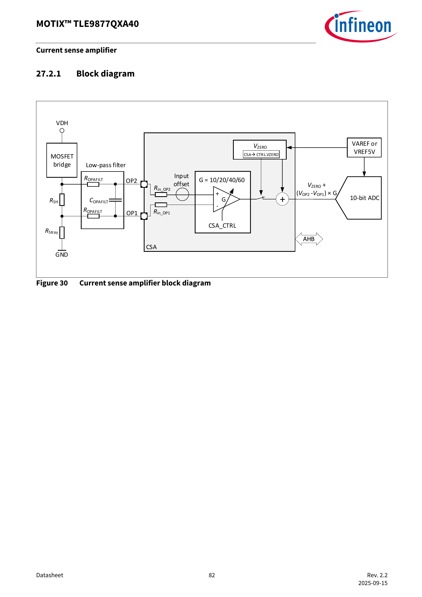

# 4. 电流怎样测，HIL 怎样接进闭环

上一章：[电机与控制](03-motor-and-control.md) · [学习入口](README.md) · 下一章：[LIN 与 PWM](05-lin-and-pwm.md)

本章目标：理解从“电流”到“程序读数”的每一步，并画清真实板卡和仿真模型的交界。

## 4.1 沿着 10A 走到程序里

电流不能直接变成程序里的变量，需要经过测量链。对本次单分流场景，可以按下面的功能顺序理解：

~~~text
被测电流
  → 分流电阻两端的小电压
  → 滤波与放大
  → ADC 采样得到数字
  → 固件按标定关系换算
  → 电流重构、控制与保护
~~~

这条链里，某一步的比例、正负号、偏置或时刻出现问题，都会改变控制器“看见”的电流。

## 4.2 差分电压与共模，先做一道算术

SHP、SHN 是本次板级电流采样引线。**差分电压**是两点相减；**共模电压**可以先理解为这两个点整体相对参考地的位置。

~~~text
例 A：SHP=0.005V，SHN=0V，差值=0.005V
例 B：SHP=1.005V，SHN=1V，差值=0.005V
~~~

两例差值相同，但两端相对地的位置不同。某个输入电路能正确测例 A，并不意味着它必然能接受例 B。实际允许范围要查芯片、板级电路和调理电路。

这两个例子只解释差分与共模，均不作为实际注入设定。

## 4.3 看懂芯片手册的采样图

图源：你提供的手册，第 82 页，Figure 30。

按从左到右的顺序看：

1. RSH 是分流电阻，电流在它两端产生电压差。
2. Low-pass filter 是低通滤波，帮助抑制不需要的高频干扰，同时也会影响动态响应。
3. OP2、OP1 是芯片输入名称；右边的放大器用增益 G 放大差值。
4. VZERO 给测量信号设置零点偏置，右侧 ADC 把电压转换成数字。

图中关系为：

~~~text
送入 ADC 的电压 = VZERO + (VOP2 - VOP1) × G
~~~

这说明同样的分流电压，采用不同增益、偏置或接线极性，会得到不同读数。**板级 SHP/SHN 与芯片 OP2/OP1 的映射仍需按实际连接确认。**

### 计算例子：为什么 5mV 和 2.6V 都可能出现在讨论里

假设某条测量链的 G=20，VZERO=2.5V，正方向的 10A 对应 5mV：

~~~text
分流电压差：10 × 0.0005 = 0.005V
放大后的增量：0.005 × 20 = 0.1V
送 ADC 的电压：2.5 + 0.1 = 2.6V
~~~

这里的增益和偏置是教学假设。5mV 属于放大器前的小差分量，2.6V 属于假设的放大偏置之后；是否可在某处注入，取决于真实电路。向前级注入后级数值，会把量程和物理含义弄错。

“只差一点偏置”也可能影响很大。对 0.5mΩ 分流电阻，额外 1mV 差分电压等效于 2A。这个算例说明为什么需要认真确认零点和标定。

## 4.4 单分流为什么能看三相电流

**单分流**指用一个公共电流测量位置，在不同开关状态和采样时刻取得信息，再重构所需的相电流。

最容易误解的一点是：公共分流电流会随开关状态改变，它不是把 Ia、Ib、Ic 简单求平均。对于理想三线电机端口，三条外部线电流在同一时刻满足电流和接近零；这条电路约束本身也不足以告诉我们某一时刻分流电流是多少。

固件要知道“此刻哪个开关组合生效”，再把此刻分流读数解释为相应电流信息。有效电平持续得足够久，测量链稳定、ADC 在合适时刻采样，信息才可用。

[TI 官方应用说明](https://www.ti.com/lit/pdf/spract7)专门讨论单分流的有效测量时间及重构问题。学习阶段先理解“开关状态、模拟反馈、采样时刻必须对应”。

## 4.5 同样的幅值，晚到也会改变含义

假设某次有效开关状态持续一小段时间，固件安排在中间采样。如果仿真反馈经过计算、输出和调理后到得太晚，ADC 可能读取到前一状态或切换过渡过程。

因此检查反馈要分两步：

| 要检查什么 | 典型问题 |
|---|---|
| 数值关系 | 10A 对应多少差分电压？正负号、增益和偏置是否正确？ |
| 时间关系 | 这个电压代表哪个开关时刻？输出延迟和稳定时间是否允许 ADC 正确采样？ |

这也是为什么低频 LIN 状态读数很适合监视，却难以替代高速电流反馈或快速保护动作的时间证据。

## 4.6 HIL 是在测试什么

HIL 是 Hardware-in-the-Loop，硬件在环。针对控制器的 HIL 测试保留真实控制器，让仿真器实时计算它所控制的对象，并通过电气接口交换驱动与反馈。

可以对照三种情形：

| 情形 | 控制器在哪里 | 电机和负载在哪里 | 主要能学习或验证什么 |
|---|---|---|---|
| 真实运行系统 | 真实板卡 | 真实电机及负载 | 实际系统行为，需对应设备与操作条件 |
| 当前软件预演 | 模型内控制器 | 模型内对象 | 模型、事件、采集、分析和运行现象 |
| 后续控制器 HIL | 真实板卡 | 实时仿真对象 | 在确认的接口与模型范围内验证板卡行为 |

**实时**指仿真计算及 I/O 要跟上真实控制器的时间。真实板卡不会因为电脑计算慢而自动等待。当前 Virtual HIL 则在电脑上按仿真时间推进，适合预演，不连接外部板卡形成真实闭环。其虚拟 I/O 回环规则见 [Typhoon 官方说明](https://typhoon-hil.com/documentation/typhoon-hil-software-manual/concepts/vhil_analog_digital_io_loopback.html)。

## 4.7 把未来的闭环画出来

~~~mermaid
flowchart LR
    C[LIN 主节点或已确认命令源] --> B[真实控制板与固件]
    B -->|六路栅极相关信号| A[驱动信号调理和捕获]
    A --> M[实时逆变器与电机模型]
    M -->|电流及其他必需反馈| F[输出调理和注入]
    F --> B
    B -->|LIN 状态响应| C
~~~

这是**拟接入的功能关系图**。具体留下多少功率电路、在哪里注入、哪些诊断需要保留，要由实际改装图确定。尤其是 GH/GL 来自 MOS 栅极，SHP/SHN 来自小信号采样位置，二者量程和参考方式不同。

**信号调理**可以包括分压、放大、偏置、滤波、隔离和电平转换，使两端电气条件匹配。**隔离**用于控制两侧电气连接关系；是否隔离、怎样建立参考，需按平台和转接板设计执行。

HIL 模型里电机产生的“10A”，首先是计算结果。经反馈接口送回板卡的是相应的电气测量信息，例如经确认的采样端电压；控制器 HIL 中通常不需要通过电机功率线向板卡送回那 10A 功率电流。

## 4.8 你现在就能准备的接口笔记

每条路径都用下面的句式记录：

~~~text
发送方：谁产生这个量？
物理量：电压、电流、开关状态，还是协议字段？
位置：从哪一个节点引出、注入哪里？
接收方：哪个设备、哪个通道使用它？
数值：单位、比例、偏置、方向、范围、参考点？
时序：何时更新、何时采样、允许多少延迟？
依据：哪份资料明确给出，哪些仍需答复？
~~~

以 SHP/SHN 为例，你已经可以填“分流设计值为 0.5mΩ”；对注入位置、芯片端映射、共模和采样窗口，先保留具体问题。这样拿到答复后能直接补成接口合同。

## 4.9 小练习

1. 20A 对应 0.5mΩ 分流电阻两端多少 mV？
2. 上述假设 G=20、VZERO=2.5V 下，这一正方向电流对应的 ADC 输入电压是多少？
3. 为什么模拟反馈幅值正确，还可能使电流重构出错？
4. 当前软件预演中使用模型内部角度，能据此证明样机无感启动已经通过吗？需要补什么证据？

参考答案

1. 20×0.0005=0.01V=10mV。
2. 2.5+0.01×20=2.7V，仍只是教学假设。
3. 可能存在延迟、采样时刻、开关状态对应、稳定时间或极性问题，需要分别观测。
4. 还需实际固件、对应反馈、接口及时序条件下的启动和切换证据。

下一章开始做无需接板的通信练习。
