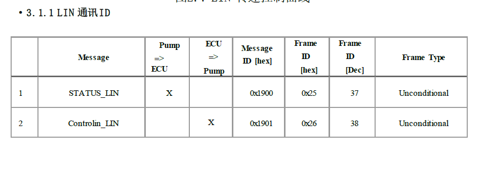
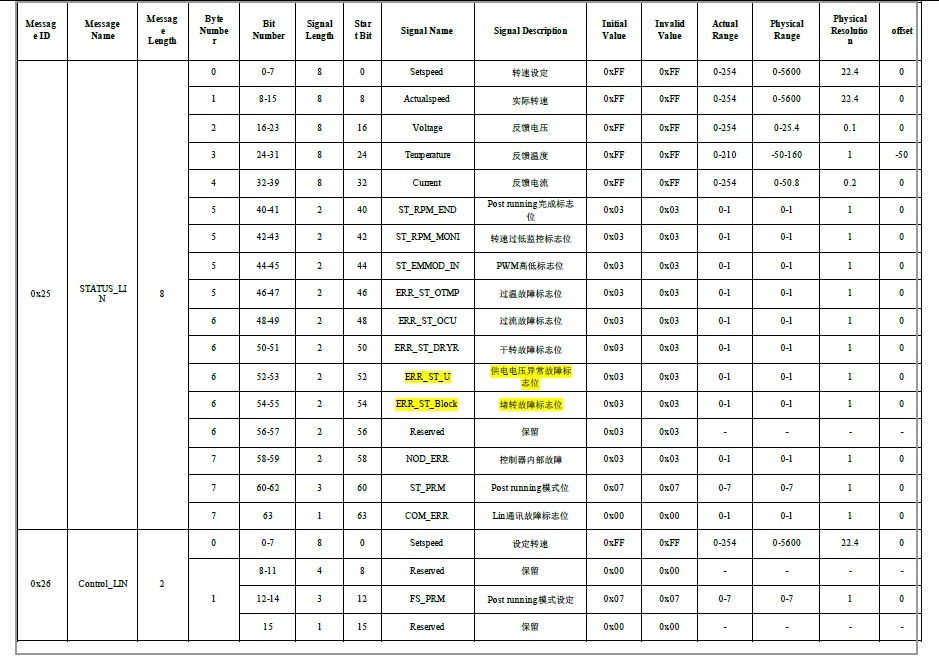
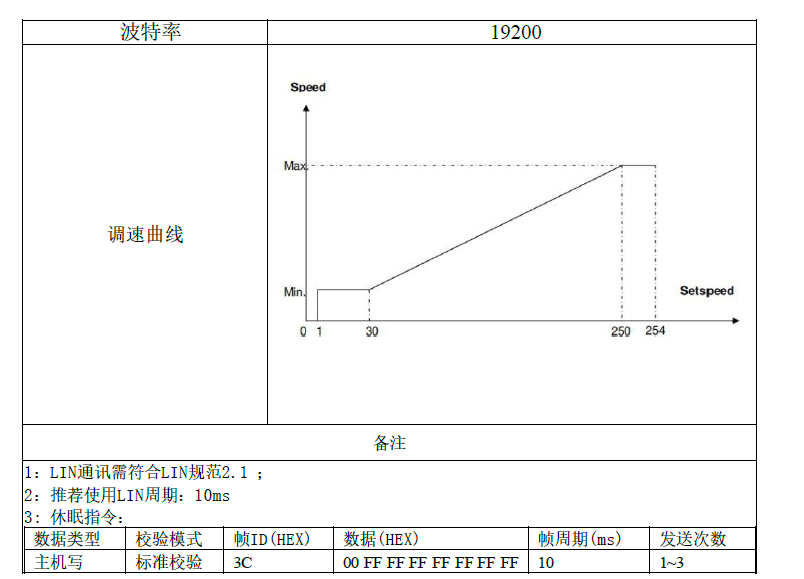
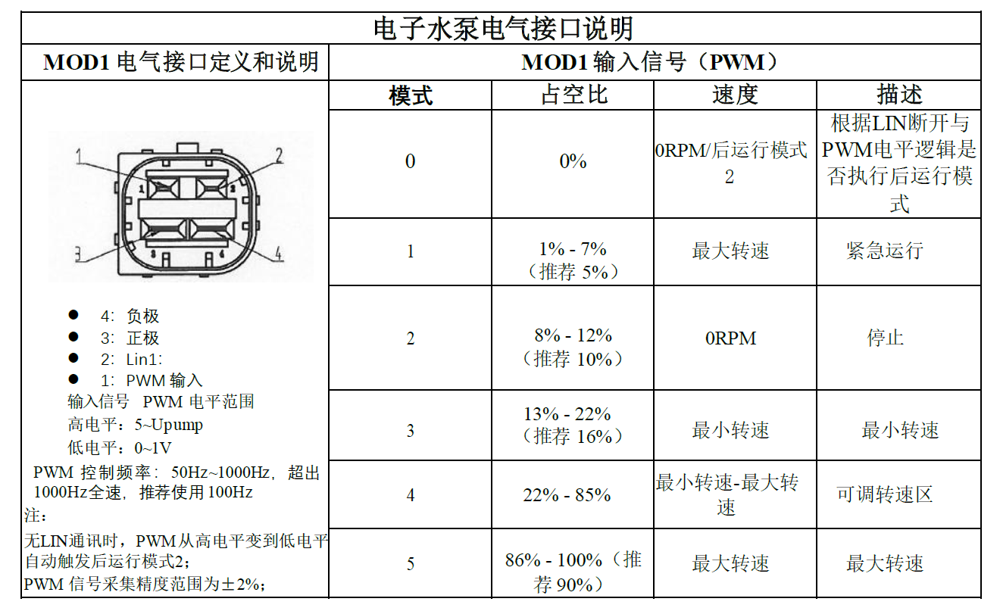
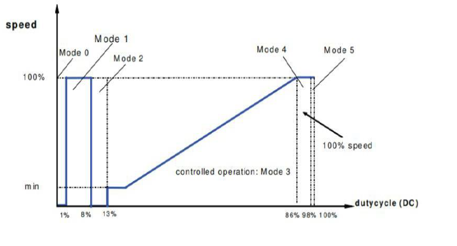

# 5. LIN 与 PWM：边算边做

上一章：[反馈与 HIL](04-feedback-and-hil.md) · [学习入口](README.md) · 下一章：[Typhoon 预演](06-typhoon-walkthrough.md)

本章目标：弄懂外部命令怎样表示，并亲手解读一组字节。所有命令都是**离线计算**，无需连接板卡，不会发送真实总线信号。

## 5.1 先区分三种软件

| 软件或文件 | 在哪里、做什么 |
|---|---|
| 板卡固件 | 运行在芯片上，执行实际启停、控制、通信和保护 |
| 项目 Python 工具 | 运行在电脑上，检查资料、编解码、调用仿真和整理结果 |
| LIN.ldf | 描述总线节点、帧、字段和换算规则的文件，工具按它解释数据 |

LDF 可以理解为本次通信的“字典和排班表”。有了字典，电脑能计算报文；要让报文真正出现在 LIN 线上，还需要 LIN 主节点设备、收发器、驱动及实际调度。

## 5.2 两种外部调速接口，各怎样表达要求

**LIN**通过数字报文表达命令，并能按协议读取状态。**PWM-IN**通过输入脉冲的占空比和其他条件表达命令。本次两者都出现在资料里，优先级、超时切换和非活动状态仍需确认。

另外六路 GH/GL 也可能呈现 PWM 开关波形，它们负责桥驱动，与 PWM-IN 的调速语义和时间尺度不同。

## 5.3 先用一分钟学会字节和十六进制

**bit，位**，取值是 0 或 1。**byte，字节**，含 8 位，可以表示 0～255。

**十六进制**用 0～9 和 A～F 表示数字，A=10，F=15。前缀 0x 表示十六进制；报文串中常省略前缀。

~~~text
0x64 = 6×16 + 4 = 十进制 100
0xFF = 15×16 + 15 = 十进制 255
0x20 = 十进制 32 = 二进制 0010 0000
~~~

所以 data=[100,0] 和 data_hex="64 00" 可以描述同一组两个字节。看到不同显示方式，先统一进制再比较。

## 5.4 本次 LIN 上的角色与帧

LDF 给出主节点 ECU、从节点 EWP，速率 19200bit/s。这里 ECU 是命令一方的协议名称，测试时可由合适设备承担；EWP 是板卡一方。

一次常规帧包括**帧头**和**响应**。主节点发起帧头，规定的数据发布者发送数据和校验。读状态时也需要主节点发起相应帧头，再由板卡回应。[ST 官方 LIN 说明，第 2 节](https://www.st.com/resource/en/application_note/an3055-getting-started-with-stm8a-lin-package-stswstm8alin-stmicroelectronics.pdf)

| 本项目别名 | LDF 帧名 | 6 位 ID | PID | 数据长度 | 数据发布者 |
|---|---|---|---|---|---|
| control | ControlLIN | 0x26，十进制 38 | 0xA6 | 2 字节 | ECU |
| status | StatusLIN | 0x25，十进制 37 | 0x25 | 8 字节 | EWP |
| version | VARIANTLIN | 0x27，十进制 39 | 0xE7 | 2 字节 | EWP |

**ID**用于标识帧；**PID**在 ID 上加了协议规定的校验位。具体硬件 SDK 要求传 ID 还是 PID，要查接口说明。**checksum，校验和**用于检查传输数据是否与校验值一致，它不评价转速是否达标。

图源：引线 Excel，“lin控制协议”页原图。先看两行的传输方向和 Frame ID。图中 0x1900/0x1901 是另一栏 Message ID 标签，不能拿来替代上表的总线帧 ID。

## 5.5 练习一：把 2240rpm 编成命令

LDF 中的转速规则是：

~~~text
转速（rpm）= raw × 22.4
raw 是一个字节里的原始码，常规有效范围 0～254
255，即 0xFF，按本次资料处理为无效值
~~~

手算 2240÷22.4=100，十六进制是 0x64。控制帧第一个字节就取 64。

第二个字节还包含后运行设置 **PostSet**，位于整帧 bit 12～14，也就是第二个字节的 bit 4～6。普通 no_post 设置为 0，其余未分配位按本次工具约定填零，所以得到：

~~~text
控制帧的数据域：64 00
~~~

在 PowerShell 中，一次执行一条命令：

~~~powershell
Set-Location 'D:\Typhoon\lab-workflow'
.\lab.ps1 lin-encode --rpm 2240 --post-set 0 --json
~~~

`Set-Location` 是进入项目目录；`.\lab.ps1` 调用项目入口；`lin-encode` 选择编码；`--rpm` 指定转速；`--json` 让结果按带字段名的文本输出。

在返回的 result 中找这些字段：

~~~json
{
  "data_hex": "64 00",
  "requested_rpm": 2240.0,
  "encoded_rpm": 2240.0,
  "firmware_target_rpm": null,
  "sent_to_hardware": false
}
~~~

这是摘出的重点字段。`null` 表示当前没有该数值；`false` 表示否。firmware_target_rpm 为空，因为离线编码不能告诉我们真实固件限幅后采用什么目标。

### 再改一次：请求 2250rpm

~~~powershell
.\lab.ps1 lin-encode --rpm 2250 --post-set 0 --json
~~~

2250÷22.4≈100.446，工具按最近码取整，得到 raw=100，所以编码仍为 2240rpm。这种离散化叫**量化**。请求值与编码值要分别保存。

工具采用最近有效码、中点向上；输入范围为 0～5689.6rpm。最高有效码 254×22.4=5689.6rpm。资料中的额定转速、截图最大设置和固件平台上限还有其他来源，具体关系见[接入记录](../tle9877-hil-intake.md#6-需要提供方进一步澄清的差异)。

## 5.6 练习二：看看高位字段怎样改变字节

~~~powershell
.\lab.ps1 lin-encode --rpm 2240 --post-set 2 --json
~~~

PostSet=2，对应第二字节的 bit 4～6，因此该字节数值为 2×16=32，即 0x20。结果数据域为 **64 20**。这只是离线打包演示，stage2 的真实持续时间和动作还需固件说明。

本工具允许作为常规输入的 PostSet 为 0～5；6 未定义，7 为初始状态。后运行是状态机行为，需要确认触发、取消、目标和退出条件。

## 5.7 练习三：把编码的命令解读回来

~~~powershell
.\lab.ps1 lin-decode --frame control --data '64 00' --identifier 0xA6 --identifier-kind pid --checksum 0xF4 --json
~~~

预期看到：ControlSetspeed 的 raw=100、value=2240；PostSet 的 label=no_post；checksum_verified=true。

`--data` 只放数据域。PID、checksum、break 和 sync 均不拼进这串数据。当前工具对这三个业务帧使用增强校验准备，真实设备设置仍需与固件和抓包核对。

## 5.8 练习四：逐字节读状态

使用这一组教学样例：

~~~text
64 64 5A 50 0A 00 00 00
~~~

从 byte 0 开始计数，前五个字段这样读：

| 字节 | 十六进制 | 十进制 raw | LDF 换算 | 结果 |
|---|---|---|---|---|
| 0，Setspeed | 64 | 100 | ×22.4rpm | 板卡反馈的目标字段 2240rpm |
| 1，ActualSpeed | 64 | 100 | ×22.4rpm | 板卡反馈的速度字段 2240rpm |
| 2，Voltage | 5A | 90 | ×0.1V | 9V |
| 3，Temperature | 50 | 80 | −50℃ | 30℃ |
| 4，Current | 0A | 10 | ×0.2A | 2A |

这些数是**报文按字段定义表达的值**。其中电流究竟是哪一测量量、怎样滤波，速度来自什么估计，都要查固件说明；也要保留 HIL 模型自身的速度作为另一列。

~~~powershell
.\lab.ps1 lin-decode --frame status --data '64 64 5A 50 0A 00 00 00' --checksum 0x5D --json
~~~

最后三字节包含多个位字段。工具返回的 label 帮你按字典解释；例如 ST_RPM_MONI=0 表示转速监测启用。应逐字段阅读，不能把所有状态一律当作“0 正常、1 故障”。

图源：引线 Excel，“lin控制协议”页原表。第一次只对照前五行、Byte Number、Physical Resolution 和 offset。图表与 LDF 的部分名称、枚举和上限存在差异，软件当前用 LDF 名称作主键，差异见接入记录。

## 5.9 练习五：看看无效值怎样表现

~~~powershell
.\lab.ps1 lin-decode --frame status --data '64 FF 5A 50 0A 00 00 00' --json
~~~

第二字节变成 FF，ActualSpeed 会返回 raw=255、validity=invalid、value=null。它没有变成“5712rpm”，也没有自动变成零。

此时命令顶层仍可能 status=passed，意思是“成功解析这组输入”。判断读数可用性，还要看字段的 validity。本命令未提供 checksum，checksum_verified 为 false。

继续试版本帧：

~~~powershell
.\lab.ps1 lin-decode --frame version --data '01 00' --json
~~~

Version 的原码是 1，validity 为 unencoded，因为 LDF 没有给出版本编码解释。应保留原码，取得版本格式说明后再解释成具体版本号。

## 5.10 10ms 时隙与 20ms 周期怎样读

LDF 的 EWPTEST 调度如下：

~~~text
时隙开始：   0ms          10ms          20ms          30ms
帧：         Control      Status        Control       Status
~~~

相邻时隙间隔 10ms；同一帧每两个时隙重复一次，名义间隔 20ms，即每秒 50 次。时隙包含安排给该帧及相应间隔的时间，不应把 10ms 理解成数据一直在传输 10ms。

CheckVersion 是另一张调度表，不能仅因为它写在 LDF 里，就认为它会自动插进 EWPTEST。实际调度由主节点工具或程序选择执行。

图源：引线 Excel，“lin控制协议”页原图。上图提示低速、高速平台；下方写“推荐 10ms”，与 LDF 中同帧 20ms 的安排需要确认。下方另列休眠指令，它不属于当前三个业务帧离线工具的功能范围。

## 5.11 PWM-IN：占空比必须按本次协议读

图源：引线 Excel，“PWM控制协议”页第一张原图。图左是协议中的连接器示意，与 18 条测试引线的序号属于不同编号体系。

先找四处：推荐频率 100Hz；1%～7% 为紧急最大速度；8%～12% 写停止；0% 会与后运行条件关联。

100Hz 对应周期 10ms。若占空比 10%，高电平时间为 1ms；5% 则为 0.5ms。但根据这份协议，5% 位于紧急最大速度区，10% 位于停止区。**占空比小并不自动表示转得慢。**

曲线与表格在部分边界表达上有差异，完整问题已经列入[接入记录](../tle9877-hil-intake.md#5-pwm-调速协议有哪些操作含义)。实体操作时采用双方确认的具体命令和非活动接口状态；本章只做读图与离线算术。

## 5.12 小练习

1. raw=50 按本次转速线性规则对应多少 rpm？
2. 0x50 是十进制 50 吗？作为温度 raw 时是多少℃？
3. 100Hz、占空比 16% 的高电平时间是多少？
4. 同帧每 20ms 一次，每秒多少次？
5. 接到“工具通过”的输出后，怎样进一步确认字段是否有效、是否发过硬件？

参考答案

1. 50×22.4=1120rpm。这是线性编码结果，实际固件平台行为另查。
2. 0x50=80；80−50=30℃。
3. 周期 10ms，高电平 1.6ms。
4. 1000÷20=50 次。
5. 查看 scope、每个字段的 validity、checksum_verified，以及编码结果 sent_to_hardware。离线工具没有证明板卡收到命令。

接下来用已经准备好的软件模型，把“要求—响应—结果记录”完整看一遍。
