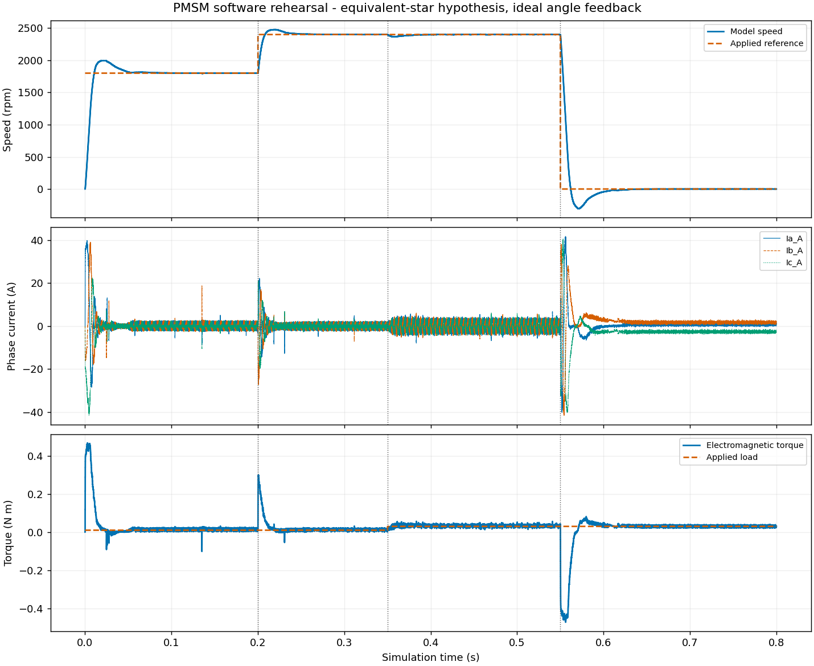

# 6. 在 Typhoon 中做一次有解释的预演

上一章：[LIN 与 PWM](05-lin-and-pwm.md) · [学习入口](README.md) · 下一章：[测试准备](07-test-preparation.md)

本章目标：把一个已经准备好的模型读懂，运行时知道它在改变什么，拿到波形后知道先看哪里。建议先看已有记录，再决定是否自己运行。

## 6.1 先认识这一套文件

| 文件类型或位置 | 可以怎样理解 |
|---|---|
| .tse | Typhoon 原理图，描述模型里的器件和信号连接 |
| .cpd | 编译后供仿真加载的文件 |
| .cus | HIL SCADA 的面板配置，用于交互和显示 |
| configs 中的 JSON | 告诉项目程序本次参数、事件、采样和判据 |
| results 中的一次运行目录 | 保存本次模型副本、数据、报告和复核依据 |

**编译**是把模型转换成仿真执行所需形式。**加载**是把编译结果交给执行系统。**启动仿真**后，模型时间才开始推进。界面出现 VIRTUAL HIL MODE 表示采用虚拟模式，还要进一步确认仿真是否实际在运行。

本章通过统一命令完成这些步骤，暂时不用自己搭建一套 SCADA 面板。GUI 基本操作可按[已有建模练习](../modeling-practice.md)复习。

## 6.2 先看现有结果，认识要做的实验

打开这份[已有预演报告](../../results/20261103-095519-case-pmsm_software_preview-4741ec/runs/01-pmsm_software_preview/report.html)。它是已经留存的一次软件运行记录；完整证据入口见[验证索引](../validation-history.md)。

图源：上述运行记录的 waveforms.png，按字节复制。图中的横轴为仿真时间；蓝色实线与橙色虚线等图例见下文。它采用等效星形假设和理想内部角度反馈。

先按三个图层阅读：

| 图层 | 英文图例 | 中文含义 | 第一眼看什么 |
|---|---|---|---|
| 上图，Speed | Model speed / Applied reference | 模型速度／实际施加的参考 | 参考何时改变，速度随后怎样响应 |
| 中图，Phase current | Ia_A / Ib_A / Ic_A | 三相电流，单位 A | 启动、调速、加负载、零速时的变化 |
| 下图，Torque | Electromagnetic torque / Applied load | 电磁转矩／实际施加的负载 | 加减速与负载变化如何对应 |

先只描述看见的变化，再解释可能原因。例如：“0.35s 左右参考没变，负载增大，转矩和电流也改变，速度短暂变化后恢复。”这比只写“正常”包含更多信息。

## 6.3 运行前，把工况按时间写下来

**工况**就是实验在什么条件下进行。当前配置的时间安排如下：

| 仿真时刻 | 改变什么 | 想观察什么 |
|---|---|---|
| 启动 | 参考 1800rpm，负载 0.01N·m | 从静止附近进入运行，电流和速度如何建立 |
| 0.2s | 参考改为 2400rpm | 加速过程、超调及稳定后的误差 |
| 0.35s | 负载改为 0.03N·m | 参考不变时，控制器怎样应对负载变化 |
| 0.55s | 参考改为 0rpm | 模型控制器怎样减速及调节到零速附近 |
| 0.8s | 采集结束，停止本次仿真 | 是否拿到了完整记录 |

这些要求直接施加给模型内控制器。本次运行命令没有把第 5 章的 LIN 帧发给真实板卡。

软件模型的参数和算法范围见[软件准备说明](../tle9877-software-preparation.md#pmsm-软件预演)。磁链、惯量、部分电感和控制设定包含预演假设；样机事实另存。

## 6.4 读懂两份配置的分工

用文本查看器分别打开：

- [tle9877_sample.json](../../configs/tle9877_sample.json)：材料事实、接口与待确认项。可以把它当作“我们对样机已经知道什么”。
- [pmsm_software_preview.json](../../configs/pmsm_software_preview.json)：本次软件实验具体怎样执行。可以把它当作“这次模型按什么条件运行”。

在预演配置中先找四组：parameters 是参数，events 是事件，capture 是采集，acceptance 是预先规定的评价要求。

例如惯量参数的含义在上一章已经解释过。此时你只需指出它在文件中采用哪个值、属于什么来源，而不必立刻自己选一个更合适的惯量。

## 6.5 检查环境与案例

先回到 PowerShell，一次执行一条命令：

~~~powershell
Set-Location 'D:\Typhoon\lab-workflow'
.\lab.ps1 doctor
~~~

doctor 检查配套解释器、安装与模块。若这里报错，按[环境说明](../environment.md)核对安装路径，先处理具体错误。

再执行：

~~~powershell
.\lab.ps1 check-tle9877 --current-a 10 --json
~~~

在 result 中观察 interfaces、missing_motor_parameters、pending 与 shunt_relation。应能找到 18 条接口、部分缺失电机参数，以及 10A 对应的理想 0.005V 差分关系。

sample_model_ready=false 和 hardware_ready=false 的含义是：完整样机模型与实体接入仍待验收。这个状态可以与本次独立软件预演可运行同时存在。

继续准备本机官方模型并检查案例：

~~~powershell
.\lab.ps1 prepare-models --json
.\lab.ps1 validate-case --case pmsm_software_preview --json
~~~

prepare-models 从本机匹配安装准备项目副本。validate-case 检查材料、配置、代码支持和已登记证据；它本身不启动一次新仿真。

## 6.6 自己执行一次软件预演

如果已有 Typhoon 实验或 GUI 正占用仿真运行，先保留现场，等它正常结束或由操作人停止后再做本节。一次只执行一个仿真实验。

~~~powershell
.\lab.ps1 run-case --case pmsm_software_preview --json
~~~

它会依次准备本次副本、设置参数、编译、加载、启动、采集、停止、分析并复核。0.8s 是模型里的仿真时间，实际等待时间还包含编译、加载与软件执行，因此可能明显更久。

结束后先找到返回的 **run_dir**。这是本次批次目录，后面所有文件都沿它查找。旧报告的日期和目录名不应代替本次返回路径。

如果 status 为 failed，先看哪个评价项未达标；如果为 error，先看执行阶段和 error 字段。保留原输出，按[故障排查](../troubleshooting.md)定位问题。

## 6.7 找到本次报告和原始数据

批次目录里有一个 runs/01-pmsm_software_preview 子记录。你会找到：

| 文件 | 学习时先用它回答什么 |
|---|---|
| report.html | 本次条件和结果是什么，波形怎样变化？ |
| waveforms.png | 参考、速度、电流与转矩怎样对应？ |
| waveforms.csv | 原始每个采样点是多少？ |
| config.json | 这次实际请求采用什么条件？ |
| capture.json | 采了哪些信号，单位、采样率和时间范围是什么？ |
| events.json | 请求的改变有没有实际生效，何时被观察到？ |
| metrics.json | 用哪个窗口和公式得到什么结果？ |
| verification.json | 记录一致性和指标复算是否通过？ |

当前 run-case 会自动复核新结果，第一次阅读时直接查看这些文件即可。历史记录的 verify/report 会写文件，如需重建，应按[历史记录处理约定](../../PROJECT_SPEC.md#历史记录处理)先复制完整记录和依赖，在副本上操作。

## 6.8 按四个问题读波形

### 问题一：命令真的改变了吗

先找参考与负载曲线。竖虚线标出计划事件时刻；实际改变要结合采到的命令信号和 events.json，不能只凭图上画了一根竖线判断。

### 问题二：对象怎样响应

0.2s 后速度有加速过程，可能先超过目标再回落，这叫**超调**。随后进入较小误差范围，需要一定时间，这属于动态响应。

0.35s 后负载增大，速度可能短暂下跌，电磁转矩和电流随之调整。结合这些量，才能区分“参考变了”和“对象被扰动了”。

### 问题三：零速命令具体做了什么

0.55s 后当前模型采用控制器主动调节，负载命令仍在。零速附近仍可能有电流和保持转矩，减速过程也可能短暂越过零速。负速度表示模型按定义反向运动。

这个场景帮助理解当前软件控制器的行为。真实固件的停止、关断、后运行及恢复，需要另外给出状态和观测依据。

### 问题四：评价用的是哪段数据

本案例给每次变化留出 0.1s，再对后续规定窗口计算最大绝对转速误差。按当前工况，窗口是 0.10～0.20s、0.30～0.35s、0.45～0.55s、0.65～0.80s，实际边界和样本数看 metrics.json。

**最大绝对误差**是先逐点算“实际减参考”的绝对值，再取窗口里最大的那个。它与平均误差不同；平均值小，仍可能有一瞬间偏差很大。

## 6.9 采样率、步长和控制周期各是什么

**仿真步长**是计算模型按多小的时间推进。**控制周期**是控制计算多长时间更新一次。**采样间隔**是保存的相邻数据点相距多久。

它们还要与第 3 章的电频率、开关频率及第 5 章的通信周期区分。

当前预演采样率为 100kSa/s，即每秒保存约 100000 个采样点，间隔为 10μs。记录 0.8s，点数为 80000。这个采样条件能显示当前记录中的变化，是否足以评价更短的事件，还要比较事件时间尺度和所需精度。

CSV 中机械速度以 rad/s 保存；图上换成 rpm，关系为：

~~~text
rpm = rad/s × 30 ÷ π
~~~

因此不能只因为 CSV 中速度数字与图上不同，就判定两者矛盾。先检查单位。

## 6.10 怎样理解“通过”

本次软件判据维护在[案例验收说明](../../cases/pmsm_software_preview/acceptance.md)。这里重点认识两个字段：

| 字段 | 判断的问题 |
|---|---|
| experiment_status | 当前工况的数据是否满足事先规定的判据？ |
| record_status | 文件及其关联是否一致，指标能否按规定方法复算？ |

转速误差满足 50rpm 是当前软件预演的检查要求；三相电流和检查用于电路一致性。这些要求的适用范围写在案例内，真实样机的性能与保护判据要按测试需求另外确定。

## 6.11 完成一次学习记录

先按原配置完整做一轮，写下：

1. 本次 run_dir，以及报告和原始 CSV 的位置。
2. 三个事件各改变了什么，实际生效证据在哪。
3. 加负载之后，参考、电流、转矩和速度怎样变化。
4. 四个窗口的评价结果，以及两个状态字段的含义。
5. 当前哪些条件采用预演假设，哪些问题要等样机接入验证。

进阶练习可以把“如果负载变化更大，会发生什么”写成预测。要做对照时，先另存配置，明确只改变哪一个因素、固定什么和怎样判断，再检查支持范围。第一轮无需改参数。

## 6.12 小练习

1. 100000Sa/s 的采样间隔是多少？0.8s 有多少点？
2. 0.35s 增加负载，0.1s 后开始评价，对应从哪个时刻起？
3. 窗口平均误差为零，能否保证最大绝对误差小？
4. 模型里的零速命令，与真实板卡的功率输出已关断，是否是同一个判断？

参考答案

1. 10μs；80000 点。
2. 0.45s。
3. 不能。正负误差可能相互抵消，需要逐点算绝对值并取最大值。
4. 两者需要不同观测。零速是速度要求；关断还要看驱动、功率级状态和实际电流等证据。

下一章把学到的内容整理成可以用于联调的准备成果。
