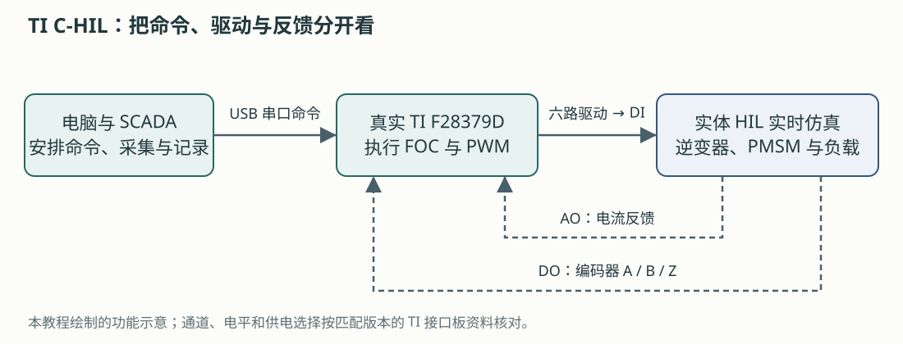
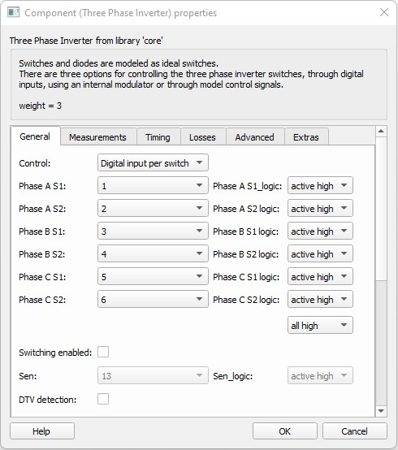
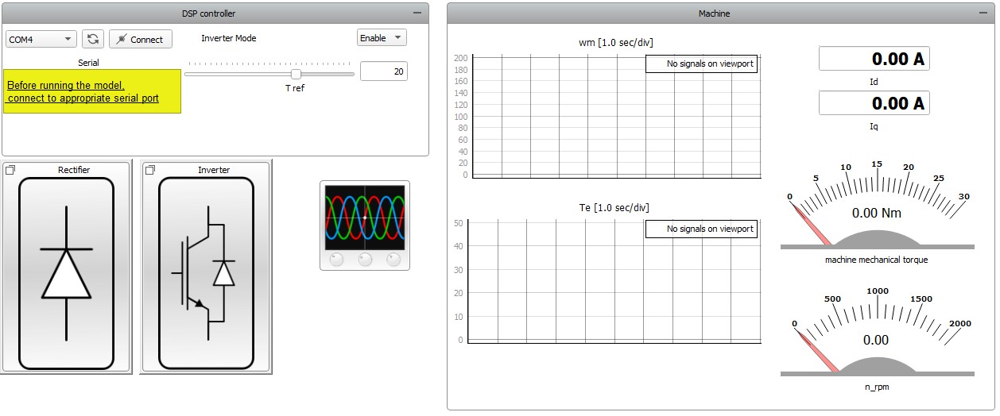

# 8. 中文实训：真实 TI 控制器怎样控制虚拟 PMSM

上一章：[样机测试准备](07-test-preparation.md) · [学习入口](README.md) · 下一章：[从 PMSM 软件预演到 TLE9877 实体 C-HIL](09-pmsm-to-tle9877-chil.md)

本章写给已经做过 [Typhoon 图形界面预演](../tle9877-gui-practice.md)、准备接触真实控制板的组员。目标是读懂一个完整的外部控制器案例，能在模型中找到驱动入口、反馈出口和测试判据，再把这些位置对应到自己的项目。

本章依据 Typhoon 官方 [PMSM torque control using TI LaunchPad 应用说明](https://www.typhoon-hil.com/documentation/typhoon-hil-application-notes/References/ti_pmsm_torque_control.html)，结合本机 THCC 2026.3 的模型、面板和测试脚本编写，是按学习任务组织的中文教学改编。图中的真实控制器是 **TI LAUNCHXL-F28379D**；第 9 章再讨论 TLE9877。

## 8.1 先抓住这件事：控制算法搬到了真实芯片上

在之前的软件预演中，模型里的控制器算出 PWM，模型里的逆变器和电机作出响应。在本案例中，执行 FOC 和 PWM 调制的是 TI 微控制器，HIL 实时仿真逆变器、电机及相关电路。真实控制器和虚拟对象通过电气信号交换信息，构成控制器硬件在环，即 **C-HIL**。[官方案例](https://www.typhoon-hil.com/documentation/typhoon-hil-application-notes/References/ti_pmsm_torque_control.html)



图为本教程绘制的功能示意。顺着它区分三条路径：

| 路径 | 谁发给谁 | 承担什么任务 |
|---|---|---|
| 命令 | 电脑 → TI 控制器，USB 串口 | 设置使能和转矩要求 |
| 驱动 | TI 控制器 → HIL 数字输入 DI | 告诉模型的六个功率开关何时开、何时关 |
| 反馈 | HIL → TI 控制器，AO 和 DO | 用模拟电压表示电流，用数字脉冲表示编码器信号 |

电脑负责安排实验和观察；快速闭环沿“TI → HIL → TI”运行。PC 串口的每次更新只改变要求，实时对象仍持续响应控制器输出的开关动作。

这里的电机和主功率电路由仿真器计算。模型中出现 400 V 电机，并不意味着要把 400 V 功率接到 LaunchPad；真实接口传递的是经过适配的信号。

## 8.2 为什么案例叫“转矩控制”，而原来的练习是调速？

之前的 GUI 练习修改 `w_ref`，要求模型维持某个转速。本案例修改 `T ref`，直接提出电磁转矩要求。其 FOC 设定 d 轴电流参考为 0，通过 q 轴电流调节转矩。[官方案例](https://www.typhoon-hil.com/documentation/typhoon-hil-application-notes/References/ti_pmsm_torque_control.html)

可以把它理解为：调速是在问“保持多快”，转矩控制是在问“用多大的劲”。电机最后转多快，还受负载和惯量影响。

用机械平衡理解这个区别：

```text
惯量 × 转速变化率 = 电磁转矩 − 负载转矩 − 摩擦转矩
```

当驱动力矩大于阻力矩，速度上升；二者平衡时，速度可能稳定。因而，判断这个案例先看转矩是否跟随 `T ref`，再看电流控制和速度响应。不能把原来软件预演的“转速误差小于 50 rpm”直接当作它的判据。

官方示例采用 `T_load = 0.001 × ω_mech²` 的负载关系，其中机械角速度按 rad/s、负载转矩按 N·m 表示，系数属于该示例。它使负载随转速增大；本次水泵的负载模型还需取得自己的依据。[官方负载定义](https://www.typhoon-hil.com/documentation/typhoon-hil-application-notes/References/ti_pmsm_torque_control.html)

**动手题：** 假如转矩已经跟随要求，而速度仍在增加，能否立刻判为控制失败？

<details>
<summary>核对思路</summary>

先看测试要求、负载和观察窗口。转矩跟随与恒速是不同的目标；速度仍增加可能来自尚未建立的机械平衡。还需核对电流、限幅和模型条件，才能判断是否异常。

</details>

## 8.3 拿到哪些文件，就能开始学习？

在 Control Center 的 **Example Explorer** 中搜索 `ti pmsm torque control` 或 `PMSM torque`。本机安装位置为：

```text
D:\Typhoon\Typhoon HIL Control Center 2026.3\
  examples\models\hardware in the loop\ti pmsm torque control\
    ti pmsm torque control.tse       电路与对象模型
    ti pmsm torque control.cus       SCADA 面板
    ti pmsm torque control.out       TI 控制器固件映像
    f28379d.ccxml                    TI 烧录目标配置
    generated.ufsettings            TI 烧录设置
    5SNG 0150Q170300_*.xml           功率器件损耗资料
  examples\tests\119_ti_pmsm_torque_control\
    test_ti_pmsm_torque_control.py   自动化测试脚本
```

先认识两个“程序”去哪里：`.tse` 编译后加载到 HIL；`.out` 用 UniFlash 烧录到 TI 控制器。它们服务于不同的硬件，不能互换。

学习时可以直接打开官方模型阅读。需要改动时，将**整个模型目录**复制到项目自己的学习目录，保留配套文件，再修改副本。测试脚本按相对目录查找模型；复制测试时需保留相同层级，或在副本中明确改好路径。

| 手头条件 | 现在可以完成的任务 |
|---|---|
| 只有电脑和 THCC | 阅读原理图、组件属性、SCADA 配置与测试代码，填写信号表 |
| 有实体 HIL，缺 TI 控制器或接口板 | 确认模型与设备配置，准备通道；完整 TI 闭环仍缺外部控制器 |
| TI 控制器、适配接口和实体 HIL 都齐备 | 按对应版本接线、固件与实验方案进行实体复现 |

官方在线要求表列出的最低配置是 **1 台 HIL101、Pro 1**；本机模型也保存为 HIL101、1 μs 电气步长。具体设备的编译配置和资源占用要重新核对。汉象方案中的 HIL404 是另一项设备选择依据，不能由这个示例推定其实际接入已经就绪。[官方案例要求表](https://www.typhoon-hil.com/documentation/typhoon-hil-application-notes/References/ti_pmsm_torque_control.html)

## 8.4 电脑练习一：沿原理图找出“被仿真的对象”

本节只阅读模型，不需要连接板卡或启动仿真。

1. 在 Example Explorer 打开模型，在 Schematic Editor 中缩放到能看清主电路。
2. 沿电能路径找到交流电源、三相整流器、直流母线、三相逆变器和 PMSM。
3. 找到负载计算、电流测量、编码器输出及 `Output Settings`。
4. 对照下面的表，给每个部分写一句用途。

| 模型部分 | 阅读时要理解的作用 | 迁移到水泵时先问什么 |
|---|---|---|
| 交流电源与整流器 | 给示例建立直流母线 | 水泵的直流供电应怎样建模？ |
| 母线与制动支路 | 表示储能与发电时的能量处理 | 实板保留哪些供电、功率与诊断电路？ |
| 三相逆变器 | 把六路开关动作变为三相电压 | 开关动作来自哪个真实节点？ |
| PMSM 与负载 | 计算电流、转矩、速度及机械响应 | 参数定义和负载规律是否对应本次电机？ |
| 电流／位置输出 | 为真实控制器提供运行信息 | 本固件实际需要哪些反馈？ |
| 损耗与热模型 | 演示如何扩展观察对象 | 首轮闭环是否需要这部分复杂度？ |

官方示例的 PMSM 为 19.8 kW、400 V、8 极，编码器为 4096 脉冲／转；这些都是 TI 案例条件。迁移时保留“驱动输入—对象计算—反馈输出”的结构，再重新选择水泵的电路、参数和反馈。[官方模型说明](https://www.typhoon-hil.com/documentation/typhoon-hil-application-notes/References/ti_pmsm_torque_control.html)

**本节产出：** 一张圈出主电路、驱动入口和反馈出口的模型截图，以及一份五行以内的对象说明。

## 8.5 电脑练习二：找到真实 PWM 进入模型的位置

双击 `Three Phase Inverter`，查看 `Control`。本案例使用 **Digital input per switch**，即每个功率开关分别接收一个数字输入。这个设置让外部控制器的六路信号直接决定模型开关状态。[三相逆变器组件说明](https://www.typhoon-hil.com/documentation/typhoon-hil-software-manual/References/three-phase_two-level_inverter_rectifier.html)



图源：Typhoon 官方案例 Figure 2，本机安装帮助的原图字节副本。图中 DI1～DI6 和 `active high` 属于这个 TI 案例。

| 图中的项目 | 中文含义 | 检查动作 |
|---|---|---|
| `Phase A/B/C S1` | A/B/C 相上桥开关 | 查每一路对应哪个 DI |
| `Phase A/B/C S2` | A/B/C 相下桥开关 | 查每一路对应哪个 DI |
| `active high/low` | 调理后的高／低电平表示开通 | 对照接口是否反相 |
| `Digital input per switch` | 六个开关各有独立输入 | 逐路核对开关状态与通道 |

再比较三个容易混淆的选项：

- **Internal modulator：** 模型内部产生 PWM，用于相应的软件控制结构。
- **Digital input per switch：** 捕获每个外部开关信号，保留实际六路时序。
- **Digital input per leg：** 每桥臂一个输入，由模型内部死区模块生成两路开关动作。

这些模式观察到的控制行为不同。若目标是验证真实六路输出及其死区，不应为了少接线就改成每桥臂一个输入。[控制模式定义](https://www.typhoon-hil.com/documentation/typhoon-hil-software-manual/References/three-phase_two-level_inverter_rectifier.html)

**本节产出：** 在笔记中填完 `控制器信号 → 接口板 → HIL DI → 模型开关 → 有效极性` 六行表。TLE9877 的通道号留待其自己的 I/O 合同确认。

## 8.6 电脑练习三：找到电流和编码器怎样返回 TI

打开模型中的 `Output Settings`，它使用 **Initial Settings** 组件集中配置输出。先读 `Signal` 和 `Channel`，再读比例、偏置与限幅。[Initial Settings 说明](https://www.typhoon-hil.com/documentation/typhoon-hil-software-manual/References/initial_settings.html)

本机 THCC 2026.3 示例保存的输出关系是：

| 输出 | 模型信号 | 真实控制器得到什么 |
|---|---|---|
| AO1、AO2、AO3 | Ia、Ib、Ic 对应的电流测量信号 | 用电压编码的三相电流信息 |
| DO17、DO18、DO19 | 编码器 A、B、Z | 位置／速度计算所需的脉冲 |

其中三路 AO 保存了 1.5 V 偏置及 0～3 V 限幅。它们表达的是该 TI 固件约定的采样接口；本板 SHP/SHN 的毫伏级差分接口另行设计。

编码器通过适配板连接到 TI 的 eQEP 接口。官方应用说明要求：接口板 **1.2 及更新版本**按 eQEP1 与 QEP_A 的对应方式接线；1.1 及更早版本按专门 FAQ 处理。实际插针方向和引脚对应应对照相同版本图纸。[接口板说明](https://www.typhoon-hil.com/documentation/typhoon-hil-hardware-manual/hil_ti_launchpad_interface/References/detailed_description.html)、[旧版本 FAQ](https://ticket.typhoon-hil.com/kb/faq.php?id=296)

### 用一组自己能算清的数理解输出比例

下面是**独立教学算例**，用于理解转换关系：假设希望把 −20～+20 A 表示为 0.5～2.5 V，且中间接口单位增益、无额外偏置，则：

```text
目标关系：V_AO = 0.05 × I_model + 1.5
−20 A → 0.5 V
  0 A → 1.5 V
+20 A → 2.5 V
```

写成这个关系后，再确定软件输入框采用的单位。如果填的是乘法增益，数值是 `0.05 V/A`；若采用“每伏代表多少安培”的比例，数值是其倒数 `20 A/V`。这组数不作为 TI 或 TLE9877 的接线设定。

<details>
<summary>为什么这里要先写转换关系，再填写 Scaling？</summary>

官方信号缩放应用说明使用“物理量跨度／输出电压跨度”的比例；Initial Settings 和 Analog Outputs 帮助则用乘法因子描述缩放。本机 TI 示例的 Initial Settings 还保存了旧格式标记 `model_load_legacy=1`。因此，不能仅凭都叫 `Scaling` 就把一个资料中的数字填入另一个界面。

实际配置时对照所用版本帮助及回读值，先在与板卡隔离的测试条件下核对零点和正、负测试点，再检查动态范围与限幅。接入控制器前还要把中间调理电路的增益、偏置和极性计入整条链路。[缩放应用说明](https://www.typhoon-hil.com/documentation/typhoon-hil-application-notes/References/how_to_signal_scaling.html)、[AO 设置定义](https://www.typhoon-hil.com/documentation/typhoon-hil-software-manual/References/analog_outputs_settings.html)

</details>

**本节产出：** 一张输出表，写明物理量、输出通道、目标转换关系、接口增益／偏置、允许范围，以及需要什么测量来核对。

## 8.7 有齐套硬件时：一次 TI 案例复现怎样安排？

本节供实验负责人组织 TI 台架复现。只有电脑时，完成前面的阅读练习即可；Virtual HIL 的内部 I/O 回环不会连接真实 LaunchPad。[Virtual HIL 回环说明](https://typhoon-hil.com/documentation/typhoon-hil-software-manual/concepts/vhil_analog_digital_io_loopback.html)

### 开始前，先把对象和资源对上

记录 HIL 型号、设备标识与配置，LaunchPad 型号、接口板版本、THCC 版本和固件来源。使用匹配的接口板文档核对供电选择、编码器排线与数字／模拟通道。接口板可以采用不同供电方式，USB 与 HIL 供电选择应按板级文档落实。[接口板供电说明](https://www.typhoon-hil.com/documentation/typhoon-hil-hardware-manual/hil_ti_launchpad_interface/References/detailed_description.html)

### 按阶段操作，并留下对应证据

| 阶段 | 操作 | 应取得的证据 |
|---|---|---|
| 1. 准备 TI 固件 | 核对 `.out` 和目标配置，用 UniFlash 烧录到匹配的 TI 控制器并运行代码 | 目标型号、文件摘要、烧录成功记录 |
| 2. 核对 HIL 模型 | 在学习副本中确认设备配置、六路 DI、AO/DO 映射和依赖文件；编译并加载到所选实体 HIL | 编译结果、设备标识、模型与输出配置 |
| 3. 建立命令连接 | 打开配套 `.cus`，在设备管理器确认串口，选择 COM 后点击 `Connect` | 实际串口和连接状态 |
| 4. 进入初始状态 | 按台架方案设置初始转矩、使能状态和采集窗口；开始实时仿真 | 初始条件、HIL 运行状态、输出检查 |
| 5. 改变要求 | 在已确认的范围内将 `Inverter Mode` 置 `Enable`，改变 `T ref` | 命令记录、六路驱动、对象响应 |
| 6. 捕获与退出 | 捕获暂态；按台架停机流程退出使能并确认状态，再停止仿真和释放串口 | 原始波形、停止及资源释放记录 |

UniFlash 的基本流程是识别／选择目标、载入匹配配置、选择 `.out` 并执行烧录。串口应从 Windows 设备管理器中的 TI 设备核对，截图里的 COM4 只是演示值。[官方烧录与串口教程](https://ticket.typhoon-hil.com/kb/faq.php?id=96)



图源：Typhoon 官方案例 Figure 3，本机安装帮助原图。先看左上角 COM、Connect、Inverter Mode 和 T ref，再看右侧转矩、速度及 Id/Iq。截图中的滑块值和仪表状态是官方界面示意。

零转矩命令、退出使能、停止 HIL 和断开串口是不同动作。退出时应按匹配固件与台架流程确认实际状态；HIL 停止后的 AO/DO 状态也要单独核对。本机示例配置包含停仿真时将 AO 复位到偏置值的设置，不能把“停止”一概理解为全部端口输出 0 V。

## 8.8 看哪些波形，才能说清控制效果？

先按问题选信号，再设置 Capture/Scope。具体可选名称以当前模型的信号列表为准。

| 想回答的问题 | 需要一起看什么 | 阅读顺序 |
|---|---|---|
| 转矩是否跟随？ | `T ref` 的实际发送记录、电磁转矩 | 看命令时刻，再看暂态与稳态窗口 |
| 电流控制是否符合设计？ | Id、Iq、对应参考及三相电流 | 看目标关系、偏差、饱和或异常尖峰 |
| 速度为何改变？ | 机械速度、转矩、负载 | 联系加减速过程和机械平衡 |
| 模型是否收到真实驱动？ | 控制器输出、调理后信号、模型开关状态 | 从真实引脚逐段追到模型 |
| 反馈是否送对？ | 模型电流、AO 实测值、控制器采样 | 对照比例、偏置、极性和时序 |

本机测试脚本实际捕获的信号包括 `3 ph PMSM VBR.electrical torque` 和 `3 ph PMSM VBR.i_ds`。这些是模型内部可观察量；如果需要评价 MCU 自己算出的 Id/Iq，还要取得固件侧观测，记录其来源。

整流器和逆变器子面板展示损耗与温度计算。它们可用于学习模型扩展；计算值的适用性取决于所用器件数据和热参数，实板温度需要对应测量。

## 8.9 阅读官方自动化脚本：把“看起来正常”变成判据

在 Example Explorer 中用 `Open Test` 打开脚本，**先阅读，不启动测试**。本机 THCC 2026.3 脚本的关键条件如下：

| 项目 | 代码中的条件 | 学习重点 |
|---|---|---|
| 转矩调节测试点 | 8、12 N·m | 每个点分别运行并评价 |
| 转矩允许区间 | 参考值 ±1.5 N·m | 允许带必须来自明确要求 |
| d 轴电流允许区间 | −0.8～+0.8 A | “零电流目标”不等于数值必须逐点等于 0 |
| 采集 | 3 s、1 MSa/s | 采集范围与评价范围分别设置 |
| 评价窗口 | `ranges.after(1)` | 评价采集时间轴上 1 s 后的区段 |
| 断言严格度 | `strictness=0.9` | 与当前测试库定义一起阅读，不能解释成所有点都在范围内 |
| 热响应演示点 | 5、15 N·m | 绘图与性能断言分别查看 |

以上数值来自本机 `examples/tests/119_ti_pmsm_torque_control/test_ti_pmsm_torque_control.py` 的静态阅读，仅用于解释 TI 案例。

阅读代码时按这个顺序找：连接资源 → 编译／加载 → 下发使能与参考 → 采集 → 选择窗口 → 执行断言 → 保存报告 → 清理资源。这套顺序可以迁移到水泵测试，具体命令、数值和数据来源则重新定义。

脚本默认 `auto_flashing = 'yes'`，可能通过 UniFlash 改写 TI 控制器固件；它还会连接设备、操作串口并启动 HIL。若台架采用已确认的现有固件，应先在测试副本中按计划设置 `auto_flashing = 'no'`，同时核对模型路径和设备选择。`Open Test` 用来读代码，`Run` 才执行这些动作。[官方自动化说明](https://www.typhoon-hil.com/documentation/typhoon-hil-application-notes/References/ti_pmsm_torque_control.html)

## 8.10 遇到问题，怎样逐段定位？

下面是检查顺序。每一项都需要本次记录支持，再形成结论。

| 现象 | 下一项检查 | 有用的证据 |
|---|---|---|
| 找不到示例 | 本机安装版本、Example Explorer 搜索词、安装文件 | 实际文件路径与版本 |
| 模型编译失败 | 目标设备与配置、依赖文件和具体错误 | 完整错误信息及失败组件 |
| COM 无法连接 | 设备管理器端口、驱动、其他程序占用 | 设备枚举、连接日志 |
| 使能后没有驱动 | 固件是否运行、命令是否正确、接口路由 | 命令与控制器输出捕获 |
| 有驱动但对象不响应 | DI 映射、极性、母线与模型开关状态 | 调理后输入及模型侧波形 |
| 电流／转矩明显异常 | 相序、反馈比例、偏置、编码器方向与初始化 | 模型量、端口测量、固件状态 |
| GUI 有响应而自动测试失败 | 固件、命令、采集窗口与判据是否一致 | 原始波形及具体失败断言 |

## 8.11 学完后，交出一页 TI 案例读图记录

~~~text
案例／THCC 版本：
模型、面板、测试脚本位置：
控制算法运行在哪个芯片：
要求控制的是转矩还是转速：

六路驱动：控制器端 → 接口 → HIL DI → 模型开关／极性
电流反馈：模型量 → AO → 接口 → 控制器采样
位置反馈：模型编码器 → DO → eQEP
PC 命令：端口、协议、使能和参考

软件阅读中已经找到的依据：
还缺哪些实体设备与版本资料：
若实际运行，要采什么、按什么窗口和阈值判断：
停止、恢复和输出复位需要核对什么：
~~~

完成后，应该能回答：**真实芯片控制的虽然是虚拟电机，但驱动、采样、控制程序和实时交互都能成为被测试的对象。** 下一章把这个结构落到本次水泵板卡。

## 8.12 按问题查官方资料

| 想继续查什么 | 官方资料 |
|---|---|
| 案例完整结构、演示视频与硬件要求 | [TI LaunchPad PMSM C-HIL 应用说明](https://www.typhoon-hil.com/documentation/typhoon-hil-application-notes/References/ti_pmsm_torque_control.html) |
| 输入模式、开关逻辑与死区 | [Three Phase Inverter](https://www.typhoon-hil.com/documentation/typhoon-hil-software-manual/References/three-phase_two-level_inverter_rectifier.html) |
| 输出集中配置 | [Initial Settings](https://www.typhoon-hil.com/documentation/typhoon-hil-software-manual/References/initial_settings.html) |
| 电气量怎样变成端口电压 | [信号缩放应用说明](https://www.typhoon-hil.com/documentation/typhoon-hil-application-notes/References/how_to_signal_scaling.html)、[Analog Outputs](https://www.typhoon-hil.com/documentation/typhoon-hil-software-manual/References/analog_outputs_settings.html) |
| TI 接口板路由与供电 | [HIL TI Launchpad Interface](https://www.typhoon-hil.com/documentation/typhoon-hil-hardware-manual/hil_ti_launchpad_interface/References/detailed_description.html) |
| TI 固件烧录与串口设置 | [UniFlash 和 Serial port widget 教程](https://ticket.typhoon-hil.com/kb/faq.php?id=96) |

本机安装帮助中的对应页面位于 `typhoon/help/t-an001/References/ti_pmsm_torque_control.html` 等目录，可离线对照。官方页面可能随版本更新；复现实验时保留实际使用版本和文件摘要。
