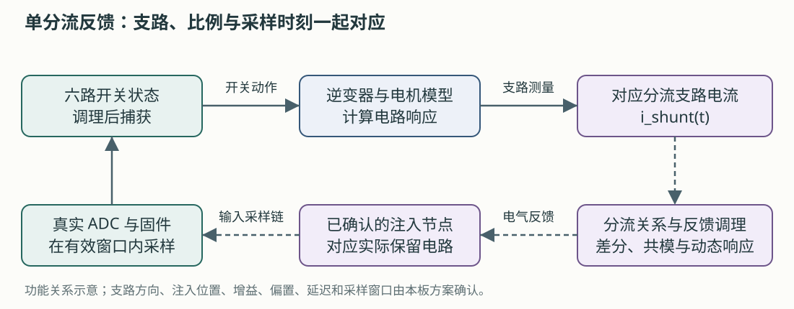

# 9. 从 PMSM 软件预演到 TLE9877 实体 C-HIL 测试

上一章：[TI LaunchPad 中文实训](08-ti-launchpad-chil.md) · [学习入口](README.md) · [现场联调操作与记录](../tle9877-field-commissioning.md)

本章面向准备参与样机联调的组员。目标是把已有软件预演、TI 官方案例和本次板卡资料接成一条可执行的准备路线：知道模型要改哪里、接口要确认什么、首个实体用例怎样留下证据。

**本次要建立的闭环：LIN／已确认命令源 → 真实板卡与固件 → 六路驱动的调理与捕获 → HIL 逆变器及 PMSM → 固件所需的电气反馈 → 真实板卡。**

案例名称沿用 TLE9877，实物完整型号、板号和固件以确认记录为准。板级事实集中查[样机接入记录](../tle9877-hil-intake.md)，实际接线填写 [I/O 合同](../../configs/tle9877_hil_contract.json)。

## 9.1 三个系统放在一起，变化发生在哪里？

| 对比项 | 现有 PMSM 软件预演／GUI 练习 | 官方 TI C-HIL | 本次 TLE9877 实体 C-HIL 目标 |
|---|---|---|---|
| 控制算法 | Typhoon 模型内部控制器 | TI F28379D 固件 | 实际交付板卡上的固件 |
| 被控对象 | 模型逆变器、电机、负载 | HIL 实时电气与机械模型 | 按功率级边界建立的实时模型 |
| 上位机命令 | 直接修改模型参考 | 串口发送转矩与使能 | LIN／确认后的 PWM-IN 等命令 |
| 功率开关输入 | 内部控制器产生 | TI 输出经接口送 DI | GH/GL 引出信号经专用调理送 DI |
| 电流反馈 | 模型内部理想反馈 | 模型相电流经 AO 返回 | 对应实际采样链和窗口的反馈注入 |
| 位置／速度 | 理想模型角度 | 编码器 A/B/Z 返回 TI | 无感固件按其实际输入估计；模型量用于独立观察 |
| 运行平台 | 电脑 Virtual HIL | 实体 HIL | 实体 HIL 与匹配接口 |
| 本项目已有入口 | GUI 教程、`pmsm_software_preview` | 官方安装示例 | 接入资料、工作表和 smoke 计划 |

TI 案例适合学习“外部控制器怎样接入”，而水泵的命令、反馈与功率级要按本板重新设计。特别是无感控制，不能把模型的理想角度直接送给算法后，就据此评价其估计与启动能力。

Virtual HIL 的 I/O 回环在软件内部传递信号。它可以帮助理解输入／输出配置；实体控制板需要真实的接口和实时仿真硬件。[官方回环说明](https://typhoon-hil.com/documentation/typhoon-hil-software-manual/concepts/vhil_analog_digital_io_loopback.html)

## 9.2 第一步：保留软件预演，把它作为对照

先复习 [GUI 练习](../tle9877-gui-practice.md)或[软件预演导读](06-typhoon-walkthrough.md)，确认自己能找到控制器、逆变器、电机、负载和观察量。

然后查 [pmsm_software_preview.json](../../configs/pmsm_software_preview.json) 的 `assumptions`。现有练习采用等效星形口径、理想模型角度及明确列出的控制和电机参数假设；这些设定支持软件学习，实际电机参数另填实体参数表。

准备三个独立的材料位置：

| 材料 | 应保存什么 | 本项目位置 |
|---|---|---|
| 软件基线 | 原有模型、配置与已完成波形 | [软件预演案例](../../cases/pmsm_software_preview/README.md) |
| 实体对象参数 | 已确认的参数定义、单位、来源与待补项 | [motor_pending 工作表](../../configs/tle9877_motor_pending.json) |
| 实体接入方案 | 节点、通道、参考、电平、调理、时序与确认依据 | [hil_contract 工作表](../../configs/tle9877_hil_contract.json) |

后续新建实体模型副本，保留这些材料的对应关系。这样发现差异时，可以区分是控制器改变、参数改变，还是接口改变。

**本步完成标志：** 能指出软件预演中哪些参数已有资料，哪些是学习假设，哪些实体模型必需项仍为空白。

## 9.3 第二步：先画功率级边界，再画接线

一个 C-HIL 模型要替代实物系统的哪一部分，决定了接口需要传递什么。把实际改装图上的器件标成三类：**保留、断开、由模型替代**。

本次六路 GH/GL 引线取自 MOSFET 栅极；U/V/W、VM、SL 和 SHP/SHN 也都有实际电路位置。应沿原理图确认它们与驱动诊断、电流采样和参考电位的关系。[本板引线记录](../tle9877-hil-intake.md#2-引线怎么理解)

| 要确定的边界 | 需要拿到的具体答复 |
|---|---|
| 真实功率 MOS | 是否保留、怎样处理能量通路、会影响哪些驱动诊断 |
| 三相节点 U/V/W | 哪些由真实电路决定，哪些需要模型反馈，接在哪个节点 |
| VM／SL | 功能、参考点、保留电路和允许范围 |
| 栅极取出 | 取的是 G 对哪个参考的电压，调理前后怎样表示开关状态 |
| 电流反馈 | 注入在 SHP/SHN、放大器后或其他确认节点，原采样路径怎样处理 |
| 停止与恢复 | 固件状态、输出状态、电源与通信如何配合 |

这里尤其要区分：**HIL 数字输入接收开关信号；普通 AO/DI 接口承担信号交互。** 如果真实功率级仍参与能量交换，需要平台方明确相应接口和设备。不能只根据“电机用模型替代”推导出 U/V/W 的接法。[硬件接口指南](https://www.typhoon-hil.com/documentation/typhoon-hil-hardware-manual/hil_interfacing_guide/topics/abstract.html)

**本步完成标志：** 一张标注实板版本、保留／断开部分、反馈注入点和参考电位的改装接线图。

## 9.4 第三步：让真实六路驱动接管模型逆变器

迁移时，按以下顺序修改自己的实体模型副本：

1. 保留所需的直流供电、三相桥、PMSM 与机械负载结构，参数按本次边界重新配置。
2. 停用或移除模型内部控制器对该逆变器的驱动，明确唯一的控制来源。
3. 将逆变器控制方式设为 `Digital input per switch`。
4. 按已确认接线，为六个模型开关分别分配 HIL DI，填写各路调理后的有效极性。
5. 保留开关状态、电流、电压、转矩和速度的观察位置，供后续逐段核对。

`Digital input per switch` 的含义与属性以[逆变器组件说明](https://www.typhoon-hil.com/documentation/typhoon-hil-software-manual/References/three-phase_two-level_inverter_rectifier.html)为准。下面只列功能对应，实际 DI 号由合同填写：

| 本板引线 | 已给出的取出位置 | 经调理后拟对应的模型开关 | 仍要填写 |
|---|---|---|---|
| GH1／GL1 | U 相上／下 MOS 的 G 脚 | Phase A S1／S2 | DI、极性、参考点、延迟 |
| GH2／GL2 | V 相上／下 MOS 的 G 脚 | Phase B S1／S2 | 同上 |
| GH3／GL3 | W 相上／下 MOS 的 G 脚 | Phase C S1／S2 | 同上 |

这里将 U/V/W 暂对应模型 A/B/C 以说明关系，最终相序和方向一起确认。TI 示例的 DI1～DI6 只属于其自身通道配置。

上桥栅极与对应源极之间的驱动电压，和相对于系统地的电位，是两个不同问题。引线材料写的“18V/2=9V”还缺实际分压位置、共模与参考说明；按这些信息选择差分／隔离等调理，再核对 HIL 输入规格。[本板驱动接口待确认项](../tle9877-hil-intake.md#六路驱动的18v29v还不是完整接线规格)

**本步完成标志：** 六路通道表完整，并能用实测或平台已验证记录说明每路输入如何对应模型开关。

## 9.5 第四步：把“三相电流反馈”改成固件真正需要的采样链

TI 案例通过三路 AO 提供相电流。本板资料给出单分流采样电阻 **0.5 mΩ**，并引出 SHP/SHN；反馈模型需要表示对应分流支路在正确时刻的电流，再按实际采样电路生成输入。



图为本教程绘制的设计关系。具体分流支路、极性、滤波、共模与注入位置按改装图和固件配置落实。

### 为什么不能把三相电流平均后送回去？

用一个理想三线制三相桥算例理解：定义 `i_u、i_v、i_w` 为由桥流向电机的线电流，`S_u、S_v、S_w` 为三个上桥的理想开关状态，直流侧电流满足：

```text
i_u + i_v + i_w = 0
i_dc = S_u × i_u + S_v × i_v + S_w × i_w
```

| 理想开关状态 `(S_u,S_v,S_w)` | 由式子得到的 `i_dc` |
|---|---|
| (1,0,0) | i_u |
| (1,1,0) | i_u + i_v = −i_w |
| (0,1,0) | i_v |
| (0,0,0) 或 (1,1,1) | 0 |

这是教学推导，假定理想互补开关、忽略死区和器件换流。它说明：**同一分流测量在不同开关状态下代表不同相电流信息。** 实体模型应优先在对应电路支路测量，并核对方向；真实采样还受二极管续流、死区、消隐、滤波和最小有效窗口影响。

Infineon 的 TLE987x 无感 FOC 应用说明给出一种单 PWM 周期内两次分流采样并重构相电流的实现，可重点读第 2.4 节和第 4.1 节。其演示平台是 TLE9879 EvalKit；本次实际固件是否采用相同算法与采样时刻，需要固件侧说明。[Infineon 单分流与无感 FOC 应用说明](https://community.infineon.com/gfawx74859/attachments/gfawx74859/jpmotixmcu/1578/1/Infineon-TLE987x-Sensorless-Field-Oriented-Control-ApplicationNotes-v01_00-EN.pdf)

### 数值正确，还要保证反馈在采样时已经稳定

以分流电流 10 A 为教学例子：

```text
理想分流差分电压 = 10 A × 0.0005 Ω = 0.005 V = 5 mV
```

`5 mV` 表示分流两端的差值。若注入在放大器之后，还需计入增益和偏置；若注入在 SHP/SHN，还需满足两个端点各自的共模、输入范围和参考要求。实际输出命令不能只由这一个乘法得出。

以 HIL404 手册为例，AO 表列分辨率为 0.3 mV、偏移误差为 0.5 mV。对 0.5 mΩ 换算，0.5 mV 相当于 1 A 的分流电流量级。这只是量级比较，说明需要对调理、校准和误差预算作判断；整条链路精度仍需按实际设备、量程和测试条件验证。[HIL404 电压与模拟接口规格](https://www.typhoon-hil.com/documentation/typhoon-hil-hardware-manual/hil404_user_guide/References/hil404_IO_voltage_levels.html)

按下面顺序整理反馈时间链：

```text
真实栅极变化 → 调理与 DI 捕获 → 对象求解
→ AO 更新 → 外部反馈调理与建立 → 固件 ADC 采样
```

为每一段取得更新率、延迟、滤波和建立时间，再与 ADC 有效采样窗口对照。HIL404 的数字输入捕获速率和模拟量更新节拍分别定义；手册中的数字捕获速率不能直接当作模拟反馈带宽。[HIL404 I/O 时序](https://www.typhoon-hil.com/documentation/typhoon-hil-hardware-manual/hil404_user_guide/References/hil404_IO_timing.html)

**本步完成标志：** 一张带节点、方向、单位、参考、传递关系、延迟和有效窗口的反馈链图，以及静态测试点和动态时序的核对记录。

## 9.6 第五步：按真实固件建立无感运行所需条件

无位置传感器表示位置／速度由固件根据所需信息估计，仍然需要电气测量和相应的启动过程。先向固件方取得下面四项说明：

| 主题 | 要落实的内容 | 模型与采集怎样配合 |
|---|---|---|
| 运行算法 | 实际算法、使用的电流／电压／诊断输入 | 建立对应反馈，列明当前覆盖范围 |
| 启动过程 | 初始定位、开环阶段、切换条件及超时 | 从使能前开始采集并观察状态转换 |
| 采样配置 | ADC 触发、增益、偏置、滤波、消隐和有效窗口 | 反馈链与当前固件配置对应 |
| 驱动诊断 | 依赖哪些相节点、母线和 MOS 状态 | 保留或模拟对应物理条件 |

HIL 模型的真实角度／速度可以作为评估固件估计值的参考观察量。若测试目标包含无感估计，把理想角度接入算法会改变被测问题，应在模型和报告中明确采用何种反馈。

电机参数使用[实体参数工作表](../../configs/tle9877_motor_pending.json)。已有资料是 12 槽 10 极、Δ 接法、5 极对，以及原文的 5 mΩ 相电阻、11 μH 相电感；先确认参数属于绕组支路、线间测量还是模型等效量，再取得目标模型的 Rs、Ld、Lq、磁链、惯量和负载。

供电也要分列：板卡引线资料建议 9 V、上限 10 V；电机方案额定点为 13.5 V。实体模型母线取值及固件在该条件下的启动行为，由本次方案确认。[本板电机与供电资料](../tle9877-hil-intake.md)

**本步完成标志：** 反馈需求和参数定义能对应到这块实物、这份固件及选定的模型。

## 9.7 第六步：把上位机串口命令换成本板的 LIN 业务

从 TI 案例可以迁移的是“上位机发要求，真实固件控制对象”的分工。本板的命令接口按 LDF 与固件实现，不能使用 TI 的串口命令或转矩值。

在项目根目录做一次**离线练习**：

```powershell
Set-Location 'D:\Typhoon\lab-workflow'
.\lab.ps1 check-tle9877 --current-a 10 --json
.\lab.ps1 lin-encode --rpm 2240 --post-set 0 --json
.\lab.ps1 lin-decode --frame control --data "64 00" --identifier 0xA6 --identifier-kind pid --checksum 0xF4 --json
```

应能解释这些结果：

- 请求 2240 rpm，按 22.4 rpm/code 编为 raw=100，即 `0x64`。
- 控制帧数据为 `64 00`，6 位 ID 为 `0x26`，PID 为 `0xA6`，工具按当前政策算出的增强校验和为 `0xF4`。
- 编码结果中的 `sent_to_hardware=false`；固件实际采用的目标转速仍需状态／固件证据。
- 准备检查中的 `hardware_ready` 和 `sample_model_ready` 分别表示实体条件和样机模型准备状态。

这些命令及字段定义见[软件准备说明](../tle9877-software-preparation.md)。实际发送需要 LIN 主节点设备与适配驱动；当前 `lin-mock` 使用模拟响应和模拟时钟。

正式接入时，采用“请求转速、编码转速、板卡目标回读、板卡实际转速、模型转速”五列记录。前两列说明发了什么，后面三列分别说明固件和对象怎样响应。各列保留有效性、来源与时间戳。

LDF 的 EWPTEST 包含两个连续 10 ms 时隙，因此同一业务帧名义上每 20 ms 重复。LIN 状态适合监视和记录，快速电流反馈由 HIL 与板卡的实时链路承担。[LIN 调度与状态定义](../tle9877-hil-intake.md#44-调度表的-10ms-是时隙不是每个帧的重复周期)

**本步完成标志：** 离线样帧核对一致，已选择的实体 LIN 工具能按确认调度保存原始发送、响应和设备时间戳。

## 9.8 第七步：用一个正常工况建立实体证据

采用已有 [tle9877_hil_smoke 计划](../../cases/tle9877_hil_smoke/plan.json)，把目标、范围与判据填具体。这个计划当前 `execution_enabled=false`，还不是现有 `run-case` 可以执行的实体案例；需要完成实体后端、LIN 驱动与反馈集成。

首轮用例可以写成：**从已确认初始状态，发送一个允许范围内的正常转速命令，观察闭环建立，按指定方式停止并恢复。** 命令值由固件和现场条件确定。

| 阶段 | 要回答的问题 | 最低记录 |
|---|---|---|
| 接入复核 | 板卡、设备、模型和接线是否对应？ | 版本、改装图、I/O 合同、文件摘要 |
| 信号核对 | 六路驱动和反馈的数值／时序是否对应？ | 调理后波形、反馈测试点、采样窗口 |
| 版本与状态 | 主节点能否取得有效响应？ | ID/PID、数据、校验、方向与设备时间戳 |
| 正常闭环 | 实际驱动、模型响应和板卡状态是否一致？ | 五列转速、门极／开关状态、反馈和模型波形 |
| 停止与后运行 | 是否按规定进入结束状态？ | 实际停止命令、状态、驱动、电流及速度 |
| 恢复 | 能否按步骤回到初始条件？ | 恢复操作和最终状态 |

运行前写清以下项目，填写到计划和[现场记录模板](../templates/tle9877-field-record.md)：

1. 采用的命令和允许范围、初始状态、母线与负载。
2. 响应超时、运行时间、评价起点与有效数据要求。
3. 模型转速和板卡估计转速分别采用的误差定义与阈值。
4. 电流限制、异常退出动作、停止速度与截止时间。
5. LIN／PWM 优先级、超时和后运行退出方式。

软件预演的 50 rpm 判据、TI 案例的 8/12 N·m 以及 `Id≈0` 都有各自对象和条件。首轮 TLE9877 用例按实际要求重新固定。

### 把三个结束动作分开记录

给零转速、执行固件停止流程、停止 HIL 是不同事件。还要记录后运行是否激活，以及停仿真后的输出状态。释放 LIN 设备只说明通信资源已释放，不能据此推定板卡已经停机。具体动作顺序使用[现场联调流程](../tle9877-field-commissioning.md)。

**本步完成标志：** 同一用例内有命令、真实驱动、对象反馈、停止和恢复的可追溯记录。

## 9.9 第八步：用时间和证据评价结果

HIL 捕获、示波器和 LIN 设备可能有不同的时间起点。先记录每份文件的时钟域、单位、触发方式及采样／导出关系，再判断能否对齐。

| 已有依据 | 可以做什么 |
|---|---|
| 共享触发或已确认的时钟转换 | 按有依据的关系比较事件和响应时刻，保留同步误差 |
| 只有各自时间轴 | 分别观察形态、状态与各自域内的事件 |
| 停止事件没有被捕获 | 保留该项缺证据或未评估，安排针对性的重采 |

文件交接按[数据采集说明](../tle9877-data-collection.md)，离线整理和评价使用[现场数据工具](../field-data.md)。这些工具处理已有文件；原始数据、LDF 和来源信息保留。

形成报告时，把结论分列：

| 结论层面 | 示例问题 |
|---|---|
| 数据质量 | 通道、单位、有效码、采样范围和时钟依据是否足够？ |
| 分析完成情况 | 哪些指标已计算，哪些因缺证据未计算？ |
| 判据结果 | 在哪个窗口，哪些已定义要求通过／失败／未评估？ |
| 样机行为 | 本块板、该固件和本组工况下观察到了什么？ |
| 记录复核 | 文件来源、摘要及复算是否一致？ |

首次正常闭环和停止过程有了记录后，再逐项增加调速、负载变化、供电变化或明确的故障测试。每次扩展都先定义目标、扰动方式、实际生效证据和判据。

## 9.10 现在就能完成的学习任务

| 次序 | 任务 | 交付物 |
|---|---|---|
| 1 | 做完已有 GUI 预演导读 | 一张能解释控制器、对象与反馈的图 |
| 2 | 完成第 8 章的三个电脑读图练习 | TI 模型结构、六路 DI 表、AO/DO 表 |
| 3 | 对比 TI 与本板 | 一张命令、驱动、采样、无感条件的差异表 |
| 4 | 在现有工作表中整理已有资料与问题 | I/O 合同、实体参数表中的来源和待补项 |
| 5 | 与负责人明确第一个正常用例 | 填好目标与判据的 smoke 计划和记录草稿 |

**本阶段的学习终点：** 能说明每条真实信号为什么接、模型怎样使用它、固件需要怎样的反馈，以及要用哪些实际记录判断闭环成立。

## 9.11 自检：可以把方案讲给另一个组员吗？

1. 把内部控制器换成真实板卡，需要修改哪些模型入口与出口？
2. 为什么 TI 的编码器反馈不能直接变成本板的无感方案？
3. 为什么三相电流相加接近 0，单分流电流仍可能明显不为 0？
4. 为什么 SHP/SHN 的 5 mV 计算不能直接当作 AO 命令？
5. LIN 解码成功之后，还要用什么证明模型收到了板卡驱动？
6. `run-case` 能运行软件预演，为什么还不能据此执行实体 smoke？

<details>
<summary>核对要点</summary>

1. 驱动来源改为真实 DI，反馈改为真实 AO/DO 或已确认接口，命令送真实板卡；同时配置对象参数与观察量。
2. 编码器直接提供位置信息，无感算法依赖自己的输入和估计；本板所需的电气与诊断条件要逐项落实。
3. 分流电流反映特定支路和开关状态，其与各相电流的关系随状态变化。
4. 还缺注入节点、增益、偏置、共模、极性、量程、动态误差和采样窗口等条件。
5. 真实栅极／调理后输入与模型开关状态、对象波形的对应证据。
6. 现有执行器的设备、通信和实时反馈能力不同；实体计划仍有明确待集成项。

</details>

继续工作时，用[现场联调说明](../tle9877-field-commissioning.md)执行具体流程，用[样机接入记录](../tle9877-hil-intake.md)查事实与缺口，用[验证状态](../validation.md)查已经完成的验证范围。
