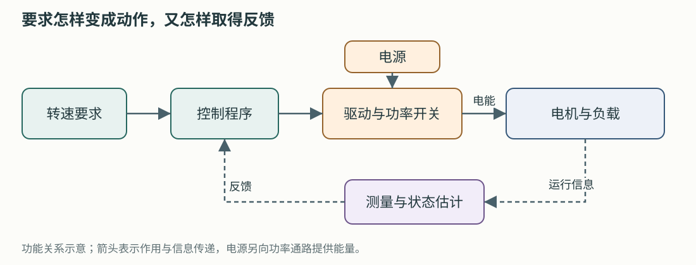
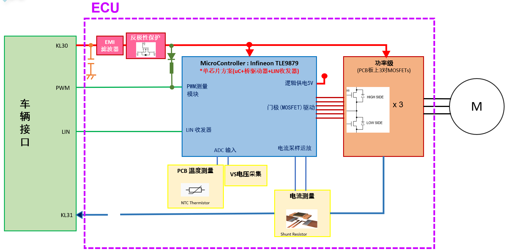

# 从零理解这次样机测试

这套教程写给**此前没有学过芯片、电路和电机控制，最近才熟悉 Typhoon 操作的你**。目的是让你能读懂本次样机资料、理解联调人员在检查什么，并独立完成电脑上的学习练习。先从一条完整的工作过程建立认识，再逐步认识里面的器件、信号和软件。

贯穿全套教程的问题是：**我们要求电机转到某个速度，这个要求怎样变成电机动作，又怎样知道动作是否正确？**

阅读方式：[离线图文阅读页](index.html)适合在浏览器中按章节阅读、查词和放大图片；本目录 Markdown 保存可编辑正文。离线页直接打开即可使用。

## 先看懂一张图

这张示意图由本教程绘制。先沿箭头记住：提出要求 → 程序决定动作 → 电机响应 → 把实际情况送回来。电源向功率通路提供能量，控制程序决定怎样使用它。第 1 章会解释这些词。

### 再对照你提供的原图

图源：你提供的《电机控制板引线连接位置信号及方案说明.xlsx》，“电机方案”页内嵌原图。此图用于理解功能关系；图中写的是 TLE9879，本次名称沿用 TLE9877，实际型号需核对实物。

第一次只看五处：左侧车辆接口提出要求，中间芯片执行控制，右侧功率级控制电能进入电机，圆圈 M 是电机，下方电流测量把运行信息送回芯片。图中的其他缩写会在后面逐个解释。

你已经接触过 Typhoon，因此可以先把“电机模型”想成电脑里按电机规律计算的对象。接下来要理解的是：这个对象需要什么输入，会产生什么反馈，以及真实控制板如何与它交互。

## 按这个顺序学习

每次学一章，完成章末小练习再继续。时间是安排学习的参考，遇到不熟的词可以停下来查最后一页。

| 次序 | 教程 | 本章能回答的问题 | 建议时间 |
|---|---|---|---|
| 1 | [电、电路与整套系统](01-electricity-and-system.md) | 电压、电流是什么？控制、供电和测量怎样配合？ | 45～60 分钟 |
| 2 | [芯片、控制板与 18 条引线](02-chip-board-and-wires.md) | MCU、固件、MOSFET、GH/GL 分别做什么？怎样读原理图？ | 60～90 分钟 |
| 3 | [电机怎样转，控制怎样起作用](03-motor-and-control.md) | PMSM、三相、闭环、FOC、无感分别是什么意思？ | 60～90 分钟 |
| 4 | [电流怎样测，HIL 怎样接进闭环](04-feedback-and-hil.md) | 10A 为什么对应 5mV？为什么反馈时刻也很重要？ | 60～90 分钟 |
| 5 | [LIN 与 PWM：边算边做](05-lin-and-pwm.md) | 2240rpm 怎样变成 64 00？状态报文怎样读？ | 60～90 分钟 |
| 6 | [在 Typhoon 中做一次有解释的预演](06-typhoon-walkthrough.md) | 怎样看模型、运行命令、读波形和判断结果？ | 60～120 分钟 |
| 7 | [把学习变成样机测试准备](07-test-preparation.md) | 如何整理资料、提问题、读报告和逐步排查？ | 45～60 分钟 |
| 8 | [TI LaunchPad PMSM C-HIL 中文实训](08-ti-launchpad-chil.md) | 真实 MCU 怎样控制虚拟电机？六路 DI、电流 AO 和编码器 DO 怎样配合？ | 60～120 分钟 |
| 9 | [从 PMSM 软件预演到 TLE9877 实体 C-HIL](09-pmsm-to-tle9877-chil.md) | 怎样迁移模型、适配单分流与无感反馈，并准备首个实体用例？ | 60～120 分钟 |
| 随时查 | [术语、资料与图片索引](reference.md) | 缩写是什么意思？原图和手册关键页在哪里？ | 按需 |

第一轮先读正文和算例，英文官方链接留到第二轮按需查阅。电机控制中的矩阵推导、寄存器逐位配置和控制器整定，等碰到具体问题时再深入。

已经完成 [GUI 练习](../tle9877-gui-practice.md)时，可以从[第 8 章](08-ti-launchpad-chil.md)继续：先阅读官方 TI 外部控制器案例，再按第 9 章把驱动入口、采样反馈、LIN 命令和首轮判据落实到本板。两章的电脑读图练习可先完成；实体复现按各自设备与接口条件安排。

## 学习时准备什么

一台能打开项目文件的电脑、现有 Typhoon 环境、PowerShell，以及一个记录问题的笔记即可。第 1～5 章的练习主要是画图、计算和离线命令。第 6 章先读已有报告，需要自己运行时再使用 Virtual HIL。

本教程中的命令均明确标注用途。离线编解码只处理数字；Virtual HIL 预演运行电脑内模型。真实板卡的供电、信号测量和反馈注入，需要按实际设备、改装接线图和实验负责人确定的步骤开展。

## 读本次资料时，分清三种内容

| 内容 | 本次例子 | 学习时怎么用 |
|---|---|---|
| 资料明确提供的信息 | 引线表建议板卡 9V、上限不超过 10V；分流电阻 0.5mΩ；电机 10 极 | 认识当前对象；同时保留来源和适用位置 |
| 为软件预演选定的条件 | 模型内控制器、理想角度、等效星形参数、特定负载和事件 | 学习模型和数据流程；查清采用这些条件的原因 |
| 需要进一步确认的信息 | 实际芯片及固件、栅极调理、采样窗口、缺失电机参数 | 整理成可以回答的具体问题 |

板级事实和待确认项集中维护在[样机接入记录](../tle9877-hil-intake.md)与[样机配置](../../configs/tle9877_sample.json)。软件预演条件维护在[预演配置](../../configs/pmsm_software_preview.json)。教程解释这些信息的含义，后续参数更新以对应配置和接入记录为准。

## 学完后，用这五件事检查自己

1. 能从“转速要求”出发，画出控制、驱动、电机和反馈的关系。
2. 能在资料中找到一条线，说明它的功能、方向和参考点；不清楚的地方能具体写出来。
3. 能手算并用工具核对一组 LIN 命令与状态。
4. 能解释预演报告中的参考、实际转速、电流、转矩和事件。
5. 能区分“命令编码正确”“板卡接受命令”“模型响应正确”这几个不同的证据。

现在从[第 1 章](01-electricity-and-system.md)开始。已经看过原先的准备指南，也建议按这个顺序补一遍基础。
