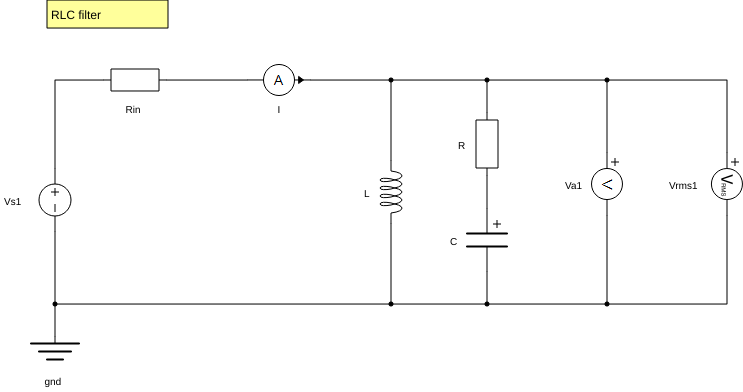
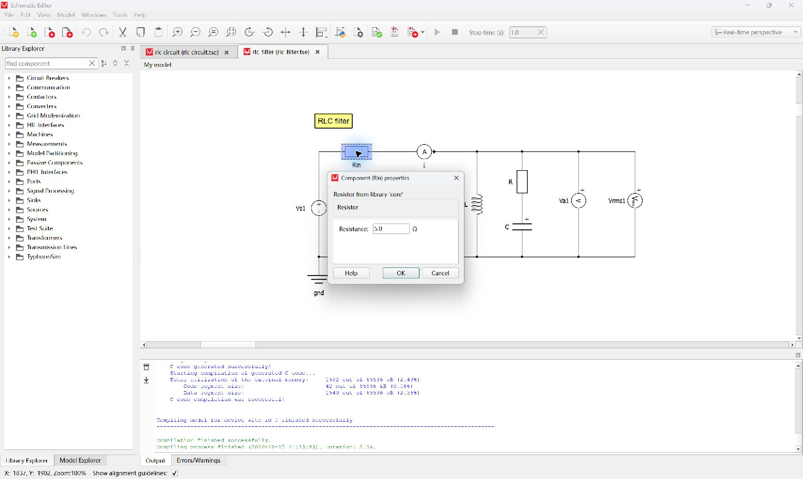
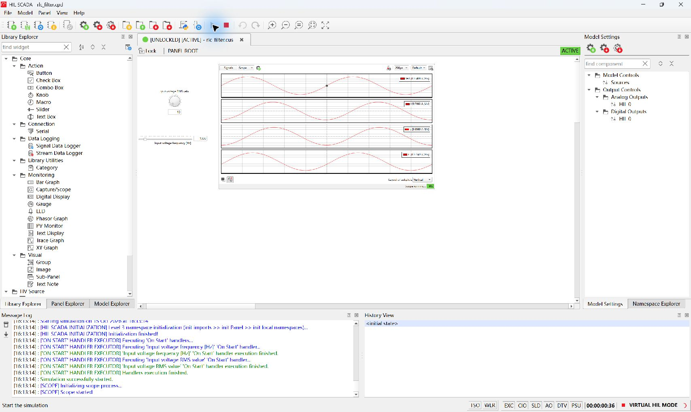

# 首次实验：运行、采集与核对

本页面向有电路基础、首次使用 Typhoon 与 Python 的组员。通过 RLC 基准和输入电阻扫描，学会完整执行一次实验，并能指出报告中每个结果对应的证据。闭环控制实验使用相同入口，熟悉本页流程后可直接阅读 [Boost 教程](boost-experiments.md)。

## 准备并检查模型

先按 [环境配置](environment.md) 完成 doctor 与 smoke，再执行：

```powershell
.\lab.ps1 inspect --model rlc_filter
```

在 Schematic Editor 中打开 [rlc_filter.tse](../models/rlc_filter.tse)。模型由电压源 Vs1、输入电阻 Rin 以及两条对地并联支路组成：一条为 L，另一条为 R 串 C。I 测量源电流，Va1 测量并联节点电压。

沿连线找到这些元件与测量点，查看属性名称和单位。参数、拓扑与计算公式见 [RLC 实验说明](experiments.md)。



## 在图形界面完成一次实验

先完成一次 GUI 操作，认识模型、面板和信号，再使用脚本复现。界面位置随窗口大小变化，以按钮名称和悬停提示定位。本项目的操作使用 Virtual HIL。

1. 在 Schematic Editor 中打开教学模型 `rlc_filter.tse`。练习结构修改前先复制模型与同名 `.cus` 面板到自己的实验目录。沿连线识别 Vs1、Rin、L、R、C、I 和 Va1；双击元件查看参数与单位，Rin 基准值为 5 Ω。
2. 点击 **Compile and (re)load model in HIL SCADA**。未连接硬件时会出现 **Unable to connect to the hardware device**，在该选择框点击 **Load Model to Virtual HIL (VHIL)**。等待加载完成，确认窗口右下角为 **VIRTUAL HIL MODE**。
3. 如果中央显示 **Create new Panel**、**Open Panel** 和 **Panels files found in Model directory**，点击 **Open Panel**，选择本次模型同目录的 `rlc_filter.cus`。工具栏的 Open Panel 是带绿色向上箭头的文件夹。
4. 面板打开后应有 **Input voltage RMS value**、**Input voltage frequency [Hz]** 和 **Capture/Scope**。面板保存的初值可能与教学工况不同，逐项输入电压 `10`、频率 `1000`，每项按 Enter 确认，并核对显示与 Message log 中宏执行完成信息。
5. 点击 Capture/Scope 左上角 **Signals** 核对映射：第一视口 Va1、第二视口 I；原面板还配置了 L、C 两个通道。关闭属性框。仿真启动前图中可能显示 **No signals on viewport**；此时先核对信号配置与运行状态。
6. 点击顶部主工具栏绿色、向右三角形 **Start simulation**，悬停提示为 **Start the simulation**。确认日志出现 **Simulation successfully started** 与 Scope 启动信息，并观察 Va1、I 的周期波形。1000 Hz 对应每周期 1 ms；若 Scope 为 200 µs/div、十格横轴，应显示约两个周期。按实际刻度核对，勿把整屏宽度当一周期。
7. 观察后点击相邻方形 **Stop simulation**，确认日志 **Simulation successfully stopped**。波形保留在屏幕上不表示仿真仍在运行，需同时查看日志、计时和按钮状态。
8. 关闭本次 HIL SCADA 窗口，释放会话后再使用脚本入口。保留自己的模型、截图和观察记录；源模型参数与运行时输入分别核对。





界面中的模型标题与 API 路径各有用途。本项目 API 顶层组件名为 `Rin`、`R`、`L`、`C`，通过 `inspect` 核对。以上截图用于识别操作与波形；定量 RMS、误差和判据按下面的脚本采集与原始 CSV 核对。操作验证的当前结论与实际证据见 [验证状态](validation.md)。

## 运行基准实验

打开 [rlc_baseline.json](../configs/rlc_baseline.json)，核对输入、元件值、采集窗口和判据，再执行：

```powershell
.\lab.ps1 run --config configs/rlc_baseline.json
```

脚本将结构参数写入本次模型副本，回读、保存并编译；加载后设置 10 V RMS、1000 Hz 正弦源，等待达到配置的仿真时间，再采集电流和电压。

记下终端输出的 run_dir。这个目录是本次实验的记录，核对时按以下顺序查看：

| 顺序 | 查看文件 | 要确认的内容 |
|---|---|---|
| 1 | config.json、manifest.json | 实际配置、环境、模型与实验状态 |
| 2 | model.tse、capture.json | 运行副本、信号名称、有效采样率与触发时间 |
| 3 | waveforms.csv | 时间、电流和电压的原始样本 |
| 4 | metrics.json、report.html | RMS、解析参考、相对误差与判据 |
| 5 | run.log、code_snapshot/ | 执行过程与所用源码 |

CSV 的 `t_relative_s`、`t_simulation_s` 单位为秒，`I_A` 为电流，`Va1_V` 为节点电压。图表应与这些原始数据对应。

## 复核并重建报告

将占位路径换为本次实际目录：

```powershell
.\lab.ps1 verify --run-dir 'results/本次实际目录'
.\lab.ps1 report --run-dir 'results/本次实际目录'
.\lab.ps1 verify --run-dir 'results/本次实际目录'
```

verify 核对文件哈希、代码快照和指标复算，结果写入 verification.json。report 从已有数据重建报告。阅读报告时确认参数和单位、实际采集窗口、解析拓扑、每项误差及判据。

若记录复核失败，保留目录并按 [故障排查](troubleshooting.md) 定位。实验状态和记录一致性的含义见 [README](../README.md#核对结果)。

## 扫描 Rin 并比较

打开 [rlc_sweep.json](../configs/rlc_sweep.json)，确认 Rin 为 1、5、10 Ω，其他条件相同，再执行：

```powershell
.\lab.ps1 sweep --config configs/rlc_sweep.json
```

扫描逐个修改 Rin、编译并运行。各工况保存在 cases/ 下，比较数据和图表为 comparison.csv、comparison.png，总报告列出全部工况状态。

按同样方式执行 verify、report、verify。选择一个工况，从原始样本独立计算一次 RMS，再对照 metrics.json；使用电路阻抗关系解释工况间差异。比较时明确当前模型、频率及保持不变的条件。

## 用 Agent 复现

参照 [Agent 工作流](agent-workflow.md) 提出相同条件的任务，对照自己的操作核对配置、工况与结果。独立复现的验收按 [交接流程](handoff.md) 记录。
