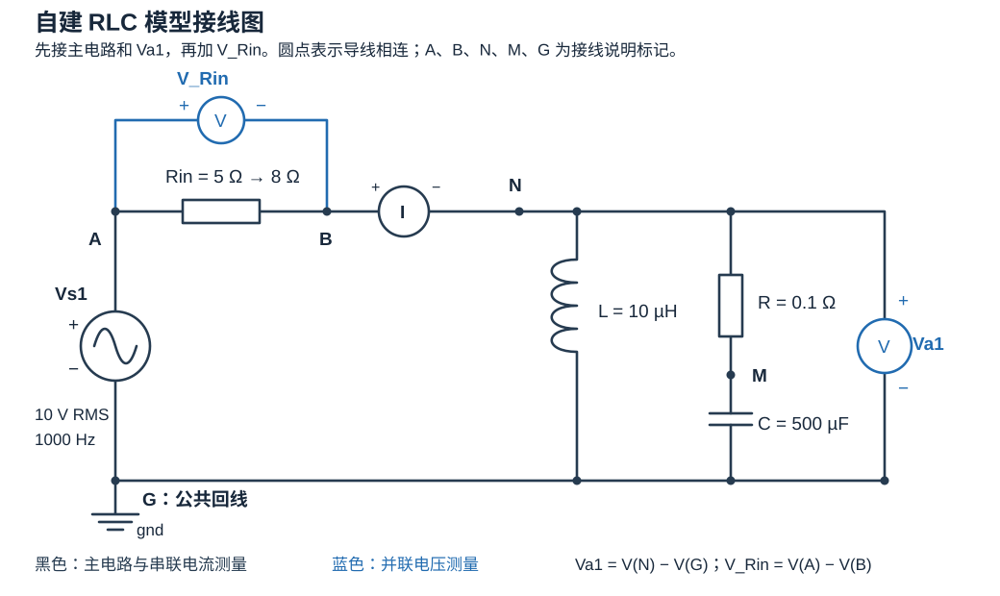

# 自建 RLC 模型到脚本采集

本练习面向有电路基础、刚开始使用 Typhoon Schematic Editor 和 Python 的组员。目标是从空白原理图建立可运行电路，说明每个元件、连线、参数和测量点的作用，再用统一入口取得可复核波形。本页的已执行部分由 Schematic API 建模并在 Virtual HIL 运行；下方图形界面重做步骤留给组员独立操作验收。

## 电路与判据

电压源 `Vs1` 驱动 `Rin` 串联 `[L 并联 (R 串联 C)]`。`I` 测源电流，`Va1` 测并联节点电压，新增的 `V_Rin` 测输入电阻压降。建模脚本从空白图创建 9 个元件、3 个连接点和 15 条连接，初始参数为 Rin=5 Ω、R=0.1 Ω、L=10 µH、C=500 µF。

运行脚本在**本次模型副本**中把 Rin 改为 8 Ω，回读并保存，再编译。源设置为 10 V RMS、1000 Hz；等待至少 0.05 s 后，以 20 kHz 采集 0.02 s。全部 400 个样本用于计算 `I`、`Va1`、`V_Rin` 的 RMS，与 `Rin + [L || (R+C)]` 的独立正弦相量值比较；三项相对误差均须不超过 3%。`V_Rin` 的解析参考为 `I_RMS × 8 Ω`。这检验了新增测量点和参数更改的实际效果。

## 建立和运行

在项目根目录（包含 `lab.ps1` 的文件夹），用 `environment.local.json` 指定的 THCC 2026.3 配套 Python 建立**新的** `.tse` 文件。下列命令以 `rlc-gui-practice` 为练习目录的示例名称，可替换为本次任务名称；路径相对于项目根目录解析。脚本拒绝覆盖已有模型。

```powershell
$labSettings = Get-Content -LiteralPath 'environment.local.json' -Raw -Encoding UTF8 | ConvertFrom-Json
$bundledPython = Join-Path $labSettings.typhoon_home 'python3_portable\python.exe'
& $bundledPython -B -X utf8 `
  scripts/build_rlc_practice.py `
  results/agent-tasks/rlc-gui-practice/modeling/rlc_handbuilt.tse
.\lab.ps1 practice-model --model-file results/agent-tasks/rlc-gui-practice/modeling/rlc_handbuilt.tse --json
```

第二条命令返回新的 `run_dir`。该目录含建模源副本、运行副本、代码快照、原始 `waveforms.csv`、`config.json`、`metrics.json`、`report.md` 和 `manifest.json`。从输出目录执行 `verify → report → verify`；最终 `verification.json` 的 `record_status` 表示哈希与全样本 RMS 复算一致性，`experiment_status` 表示 3% 判据结果。`practice-model` 只接受项目 `results/agent-tasks/` 下名为 `rlc_handbuilt.tse` 的模型，不会替换官方模板。

## 在图形界面独立重做

这里的“拓扑”就是上方“电路与判据”所述的连接关系。手工练习从下面的新建模型开始；前面的“建立和运行”使用脚本自动生成模型，可在手工练习完成后用于对照。

### 1. 新建模型

打开 Control Center → **Schematic Editor** → **File → New → New model**，进入 **New schematic settings** 页面，按下表设置。本练习采用与已有运行模型一致的编译目标。

| 页面字段 | 设置值 |
|---|---|
| Hardware product | **HIL402** |
| Hardware configuration ID | **Pro 1**（对应配置 ID 1） |
| Discretization method | **exact** |
| Simulation time step | **auto** |

下方 **TyphoonSim settings** 保持默认：Integration method 为 **BDF**，Maximum simulation step 为 **1e-4**，Absolute tolerance 和 Relative tolerance 均为 **1e-3**。

点击 **Next >**，在下一页核对设置后点击 **Finish**，进入空白画布。**Virtual HIL 在电路搭好并编译后、加载到 HIL SCADA 时选择**，具体操作见本节第 6 步。

### 2. 找到元件，放到画布上并填写参数

在左侧 **Library Explorer** 的搜索框输入下表中的英文名称，将元件拖到画布。双击元件图标打开属性；双击元件名称重命名。旋转时使用工具栏的 **Rotate 90°** 按钮，使端子朝向方便连线。

先放前七行共 **8 个元件**，完成主电路和 `Va1`；第 5 步再添加第二个电压测量元件 `V_Rin`，最终共 9 个。

| 搜索名称 | 数量 | 元件名称 | 参数或用途 |
|---|---:|---|---|
| Voltage Source | 1 | `Vs1` | 单相独立电压源；Source nature 选 Sine，RMS voltage 填 10 V，Frequency 填 1000 Hz，Phase 填 0° |
| Resistor | 2 | `Rin`、`R` | Resistance 分别填 5 Ω、0.1 Ω |
| Inductor | 1 | `L` | Inductance 填 `1e-5` H，即 10 µH |
| Capacitor | 1 | `C` | Capacitance 填 `5e-4` F，即 500 µF |
| Ground | 1 | `gnd` | 公共回路参考点 |
| Current Measurement | 1 | `I` | 串在 Rin 后面，测量源电流 |
| Voltage Measurement | 1 | `Va1` | 跨接在并联网络两端，测量节点电压 |
| Voltage Measurement（第 5 步添加） | 1 | `V_Rin` | 跨接在 Rin 两端，测量输入电阻压降 |

这里使用 **Voltage Source**，其输出由属性或运行时源设置给定。无需添加带信号控制输入的 Signal Controlled Voltage Source。电感初始电流、电容初始电压保留为 0。

### 3. 按接线图连接主电路和 Va1

下图是包含 `V_Rin` 的完整电路。先忽略上方的 `V_Rin` 支路，接好主电路和右侧的 `Va1`。元件位置可以调整，接到同一节点的端子必须保持一致。



在元件的电气端子上单击开始画线，再单击另一端子完成连接；折线路径可在空白处单击转弯。需要从已有导线分支时，将分支接到已有导线的连接点，核对确已吸附；导线仅在画面上交叉不能作为已连接的依据。

按下面顺序接线。`+`、`−` 表示电源或测量元件的正负端；脚本中对应 `p_node`、`n_node`。旋转图标后仍按端子极性判断。

1. **输入串联通路**：`Vs1 + → Rin → I +`，再从 `I −` 接到上方公共节点 **N**。图中 A 是 Rin 前端，B 是 Rin 后端；电流测量 I 串在 B 与 N 之间。
2. **电感支路**：从 N 接到 `L` 的一端，L 的另一端接下方公共回线 **G**。
3. **R-C 支路**：从 N 接到 `R`，R 的另一端接 `C`，C 的另一端接 G。R 与 C 之间的连接点记为 **M**。这样两条支路均从 N 出发、回到 G，构成 `L 并联 (R 串联 C)`。
4. **闭合回路和接地**：把 G 接回 `Vs1 −`，并将 `gnd` 接在 G 上。
5. **节点电压测量**：将 `Va1 +` 接 N，`Va1 −` 接 G。Va1 与两条支路并联。

电流测量 I 必须串入主电路。两个电压测量都采用并联接法，主电路通路不经过电压测量元件。

### 4. 逐个节点检查并保存 5 Ω 基础模型

按下表逐行核对。每行列出的端子应通过导线直接连在一起；不同字母代表不同节点。A、B、N、M、G 是本教程用于说明接线的标记，无需另外放置端口或命名元件。

| 节点 | 应连接的端子（完整模型） |
|---|---|
| A：Rin 前端 | `Vs1 +`、`Rin` 输入端、`V_Rin +`（第 5 步添加） |
| B：Rin 后端 | `Rin` 输出端、`I +`、`V_Rin −`（第 5 步添加） |
| N：并联支路上端 | `I −`、`L` 上端、`R` 上端、`Va1 +` |
| M：R-C 中点 | `R` 下端、`C` 上端 |
| G：公共回线 | `Vs1 −`、`L` 下端、`C` 下端、`Va1 −`、`gnd` |

此时先忽略表中的 V_Rin 两个端子，确认 Rin=5 Ω。特别检查：R 与 C 是串联，L 独占另一条支路，公共回线接到了电源负端和地。

检查完成后，创建本次练习的保存文件夹，并保存基础模型：

1. 打开 Windows 文件资源管理器，找到本机的 `lab-workflow` 项目文件夹（包含 `lab.ps1`），再依次打开 `results` → `agent-tasks`。
2. 为本次练习新建文件夹，例如 `rlc-gui-practice`。进入后，再新建名为 `modeling` （示例）的子文件夹。
3. 回到 Schematic Editor，点击 **File → Save as**。在保存对话框中选择刚创建的 `modeling` 文件夹，将文件名填写为 **`rlc_base_5ohm.tse`**，点击保存。

后续的模型副本和面板也保存在这个文件夹。本节以 `rlc-gui-practice` 为可替换的示例名称；如果使用其他名称，后续命令中的目录名也要相应修改。再次练习时使用新的目录名(例如`rlc-gui-practice-2`)，以区分各次模型与结果。

### 5. 添加 Rin 电压测量，分别保存脚本输入和 GUI 副本

添加一个 **Voltage Measurement**，命名为 `V_Rin`。将其 `+` 端接 A，`−` 端接 B。测量点恰好跨接 Rin 两端，负端位于 I 的输入侧。

此时保持 **Rin=5 Ω**，另存为 `rlc_handbuilt.tse`。它是后续 `practice-model` 接收的输入模型，必须已包含 `Vs1`、`Rin`、`I`、`L`、`R`、`C`、`Va1`、`V_Rin` 和 `gnd`。

接着另存一个 GUI 运行副本 `rlc_gui_8ohm.tse`，只在该副本中把 Rin 改为 **8 Ω**，再保存。后面的界面运行使用这个副本，与脚本运行的 8 Ω 工况对照。

`practice-model` 会检查输入文件的 Rin=5 Ω，并在它自己的运行副本中改成 8 Ω。因此不要把已改成 8 Ω 的 GUI 副本作为该命令的输入，也不要在已有 `rlc_handbuilt.tse` 的目录再次运行自动建模脚本覆盖它。

### 6. 编译、加载到 Virtual HIL 并观察波形

1. 打开 `rlc_gui_8ohm.tse`，再次核对 Rin=8 Ω、R=0.1 Ω、L=10 µH、C=500 µF，以及 Vs1 的 Sine / 10 V RMS / 1000 Hz / 0° 设置。
2. 点击工具栏 **Compile and (re)load model in HIL SCADA**。编译成功后，在连接选择框点击 **Load Model to Virtual HIL (VHIL)**，确认 HIL SCADA 状态栏为 **VIRTUAL HIL MODE**。若编译报错，先查看编译日志指向的元件或未接端子。
3. 自建模型没有现成 `.cus` 面板时，点击 **Create new Panel**。在 HIL SCADA 的 Library Explorer （见左侧）中找到 **Capture/Scope**，拖到面板上。
4. 在 Capture/Scope 的 **Signals** 设置中，点击加号添加信号，在每个信号对应行的**Signal**一栏分别选择 `I`、`Va1`、`V_Rin`，**Viewport（视口）** 一栏勾选显示位置：建议 `I` 勾选第 1 个方框，`Va1` 勾选第 2 个方框，`V_Rin` 勾选第 3 个方框，使三个信号分别显示在三个视口中。三个信号来自同名测量元件；若信号缺失，先核对元件名称、接线和本次加载的模型。
5. 在 HIL SCADA 的 **Model Settings** 停靠窗（见右侧）中展开 **Sources**，打开 `Vs1` 对应的源设置，核对正弦源的 RMS=10 V、频率=1000 Hz、相位=0°；有修改时应用设置。该停靠窗用于运行条件设置，和 Schematic Editor 的模型配置窗口分属不同工具。
6. 点击 **Start simulation**。等待仿真时间超过 0.05 s，观察三个信号。1000 Hz 对应每周期 1 ms；可将横轴设置为 200 µs/div，十格约显示两个周期，再按各信号幅值调整纵轴。保存面板到同目录的 `rlc_gui_8ohm.cus`。
7. 点击 **Stop simulation**，确认日志记录已停止。保存接线图、源设置及波形截图，并记录实际操作中遇到的问题。完成 GUI 操作、停止并关闭本次 SCADA 会话后，再使用脚本入口。

初次操作先以成功编译、启动及出现稳定周期波形为目标。定量比较使用相同工况下的原始样本和 RMS，不能只凭屏幕上的峰值判定。

### 7. 用手工模型完成脚本采集并核对

在项目根目录执行下面的命令。将示例中的 `rlc-gui-practice` 换成第 4 步实际建立的练习目录名；输入是含全部测量点且 Rin=5 Ω 的 `rlc_handbuilt.tse`。`results/agent-tasks/` 是脚本要求的存放范围，`rlc_handbuilt.tse` 是固定输入文件名：

```powershell
.\lab.ps1 practice-model --model-file results/agent-tasks/rlc-gui-practice/modeling/rlc_handbuilt.tse --json
```

该命令会在新的运行副本中改为 8 Ω，编译并以 10 V RMS、1000 Hz 运行，等待至少 0.05 s 后以 20 kHz 采集 0.02 s。记下实际返回的 `run_dir`，再执行 `verify → report → verify`。

对照 GUI 与脚本的拓扑、参数、源和三个测量信号。定量核对时使用一致的采样条件，将三个 RMS 与报告中的相量参考比较，固定判据为相对误差均不超过 3%。GUI 操作记录写明实际操作者、模型、截图和卡点；脚本运行结果保留在自己的运行目录。

### 常见卡点

| 现象 | 优先检查 |
|---|---|
| 找到的电源带有额外控制输入 | 是否选成了 Signal Controlled 类型；本练习选择独立 Voltage Source |
| 编译提示未连接、浮空或电路不成立 | 端子是否真正接上，G 是否闭合到电源负端并接地，支路分叉是否形成连接点 |
| 波形一直为零 | 仿真是否已启动，Vs1 是否仍为默认 Constant / 0 V，Scope 是否选择了本次模型的信号 |
| 某个电压始终接近零 | 测量正负端是否误接到同一节点；Va1 应接 N-G，V_Rin 应接 A-B |
| 电流或电压符号与预期相反 | 测量极性是否反接；I 正方向从 B 到 N，两个电压正方向见图 |
| `practice-model` 提示 Rin 应为 5 Ω | 是否把已修改为 8 Ω 的 GUI 副本传给了脚本 |

元件端子和源属性可查同版本安装资料，也可查官方的 [独立电源](https://www.typhoon-hil.com/documentation/typhoon-hil-software-manual/References/independent_sources.html)、[电压与电流测量](https://www.typhoon-hil.com/documentation/typhoon-hil-software-manual/References/voltage_and_current_measurements.html)及 [HIL SCADA 运行设置](https://www.typhoon-hil.com/documentation/typhoon-hil-software-manual/concepts/model_settings_dock.html)。本节接线图与节点表依据项目 `scripts/build_rlc_practice.py` 的实际端子连接整理；保存和改参顺序依据 `src/typhoon_lab/model_practice.py` 的输入检查整理。

同版本 Typhoon 安装目录下的 `Documentation/html/schematic_api.html` 的空白建模示例提供 `create_new_model`、`create_component`、`create_connection`、`save_as` 和 `compile` 的 API 用法。本项目脚本采用顶层 RLC 结构并增添 `V_Rin`；实际拓扑及数值以本页脚本和运行记录为准。

## 本机软件证据

已有 Virtual HIL 建模与采集结果见[验证状态](validation.md)中的“自建模型与接入演练”；任务记录、运行报告和最终复核的具体日期与目录见[验证记录索引](validation-history.md)中的“自建模型、陌生实例与复核接口”。图形界面人工重做、其他组员和跨电脑操作尚需独立验收。
