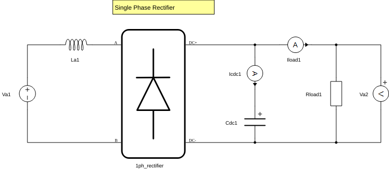

# 单相桥整流：把一个新案例接入工作流

本实验面向已经完成 RLC、希望学会接收新模型的组员。任务是理解单相二极管桥的电容滤波作用，分别改变输入电压和负载，采集稳态波形，再检查电压、电流和纹波是否符合独立电路参考。

## 模型、来源与教学工况

官方来源为安装目录 `examples/models/general power electronics/1ph rectifier/1ph rectifier.tse`。`models/single_phase_rectifier.tse` 与同名 `.cus` 是原始字节副本，版本与 SHA-256 见 `models/origin.json`。每次只修改结果目录中的 `model.tse`。

电路为正弦电压源 Va1 → 串联电感 La1 → 单相二极管桥 → 并联电容 Cdc1 和负载 Rload1。测量 Va2 为负载两端电压，Iload1 为负载电流，Icdc1 正方向为充入电容。



图为官方原始电路图，教学参数及测量低通的副本修改见下表。

| 项目 | 官方原模型 | 教学配置 | 选择原因 |
|---|---:|---:|---|
| La1 | 1 mH | 1 mH | 保留输入电感 |
| Cdc1 | 10 mF | 1 mF | 让滤波纹波在稳态窗口内清晰可见 |
| Rload1 | 10 Ω | 基准 100 Ω；重载 50 Ω | 分别观察正常与加重负载 |
| Va2 低通 | 开启，截止 2 Hz | 运行副本关闭 | 直接核对物理纹波，避免测量低通压低纹波 |
| Va1 初始信号 | 源默认常值 0 | API 明确设为 50 Hz 正弦 | 初始化与回读保证输入条件可追溯 |

230 Vrms 是本教学基准的明确选择。它不是原模型已设定且验证过的初值。三份配置只改变一个比较因素：

| 配置 | 输入 RMS | 频率 | 负载 | L / C | 要回答的问题 |
|---|---:|---:|---:|---|---|
| `configs/rectifier_baseline.json` | 230 V | 50 Hz | 100 Ω | 1 mH / 1 mF | 稳态电压、纹波和电流是否符合参考？ |
| `configs/rectifier_low_input.json` | 184 V | 50 Hz | 100 Ω | 同基准 | 源幅值为 0.8 倍时，电压、电流和纹波是否同比缩放？ |
| `configs/rectifier_heavy_load.json` | 230 V | 50 Hz | 50 Ω | 同基准 | 加重负载后，输出均值是否降低、纹波和电流是否增大？ |

这些是三次独立稳态实验，不是在一次运行中施加阶跃。它们共用 `schema_version=1` 的稳态配置布局；模型种类由 `model=single_phase_rectifier` 识别。

## 先固定参考与判据

原始 CSV 列为 `t_relative_s`、`t_simulation_s`、`Vdc_V`、`Iload_A`、`Icap_A`，单位分别是 s、s、V、A、A。配置要求等待 1.5 s，再以 20 kHz 采集 0.2 s，覆盖 10 个完整输入周期、20 个主要整流纹波周期。等待时间至少是 `max(0.5 s, 12 R C)`，同时还要用实际逐周期波形确认稳定性。

独立参考直接积分电路状态方程，不调用 Typhoon：

- 桥导通：`L di/dt = |Vs| − Vdc`，`C dVdc/dt = i − Vdc/R`。
- 桥截止：`i = 0`，电容按 `dVdc/dt = −Vdc/(RC)` 放电。
- 理想二极管约束 `i ≥ 0`。导通用四阶 Runge–Kutta，截止用指数解，关断处将负电流投影为零。

数值参考假设理想桥、线性电感、理想电容和电阻、零源内阻及周期稳态。每输入周期 4000 步，并与 2000 步结果比较；均值、RMS、峰峰纹波中最大的步长相对变化必须 ≤0.1%，末两周期最大归一化输出电压变化必须 ≤0.001%。数值积分带有限步长开关近似，因此称为独立数值参考。

| 检查 | 预先固定的要求 | 发现异常时优先排查 |
|---|---|---|
| 输出平均电压、RMS | 分别与独立参考相对误差 ≤2% | 源幅值单位、结构参数、稳态窗口 |
| 输出纹波峰峰值 | 与独立参考相对误差 ≤5% | Va2 是否仍有测量低通、采样率、C 和负载 |
| 负载欧姆定律 | `max(abs(Iload − Vdc/R))/mean(Iload) ≤0.5%` | 测量方向、信号映射、R 参数回读 |
| 电容直流平衡 | `abs(mean(Icap))/mean(Iload) ≤1%` | 未稳定、非整周期窗口、电容电流方向 |
| 相邻输入周期变化 | 对齐后最大电压差除以平均电压 ≤0.5% | 初始暂态残留、慢振荡、未完整周期 |
| 主纹波频率 | 应为 `2 f`，误差不超过一个 FFT 频率格 | 信号选择、滤波、采样时间、非周期暂态 |
| 采样条件 | 样本数满足配置；采样率、时长误差各 ≤1%；每输入周期 ≥200 点且整周期采集 | 实际降采样因子与采集元数据 |

实际判据保存在配置的 `acceptance`；限制不因某次失败自动放宽。均值是全部样本算术平均，RMS 是 `sqrt(Σx²/N)`，峰峰纹波是 `max−min`。无平滑、插值、缺失补齐或样本排除。

## 检查与执行

从项目根目录执行，已有其他仿真时先保留现场，由当前实验负责人决定何时释放：

```powershell
.\lab.ps1 inspect --model single_phase_rectifier
.\lab.ps1 run --config configs/rectifier_baseline.json
.\lab.ps1 run --config configs/rectifier_low_input.json
.\lab.ps1 run --config configs/rectifier_heavy_load.json
```

记录每次输出的实际 `run_dir`。模型 API 读取原件参数，运行时在副本写入并回读 L/C/R 与 Va2 低通开关，保存后编译；HIL API 设定并回读源，再等待与采集。先看 `actual_model_parameters` 和 `actual_source_settings`，再看指标。

官方 `.cus` 原件按字节保存用于来源追溯。本工作流的采集与报告直接使用 API。对原面板的静态检查发现其 Grid mode 启动宏引用模型中不存在的 `Va_grid`、`Vb_grid`、`Vc_grid`；如准备通过该面板教学，应先在单独的教学面板副本中核对并修正启动宏，然后进行 GUI 实测。当前脚本不会执行这些宏。

## 复核单次与三工况比较

对每条实际目录执行：

```powershell
.\lab.ps1 verify --run-dir 'results/实际目录'
.\lab.ps1 report --run-dir 'results/实际目录'
.\lab.ps1 verify --run-dir 'results/实际目录'
```

报告包含三条原始信号、固定检查、数值参考、逐周期统计、采集窗口和来源。`record_status` 检查记录与复算一致性，`experiment_status` 表示是否满足实验判据。

再把下面占位目录换成三次实际目录，执行纯离线比较：

```powershell
.\lab.ps1 compare-rectifier --baseline 'results/基准实际目录' --low-input 'results/低输入实际目录' --heavy-load 'results/重载实际目录'
```

比较首先复核源记录，然后要求低输入配置仅将源 RMS 乘 0.8、重载仅将负载电阻乘 0.5。低输入的电压均值、纹波峰峰值和电流均值之比应为 0.8，误差 ≤2%；重载这三个比值应与独立状态方程参考一致，误差 ≤3%，同时要求电压均值降低、纹波增大、电流增大。

输出一个新的比较目录，含 `inputs.json`、`metrics.json`、HTML/Markdown 报告、代码快照与清单。`inputs.json` 保存三条源记录的相对路径及哈希。比较目录也支持 `report` 与 `verify`，复核会重新检查源文件和比较指标。交接时应保留比较目录及三条源运行的相对位置；重新生成源报告会改变源清单，应随后重新生成比较记录。

完成标准是三条实验和趋势比较都留下真实记录，并能解释各项检查的通过或失败；软件记录与另一位组员独立复现分别验收，证据从 [验证状态](validation.md) 查阅。
