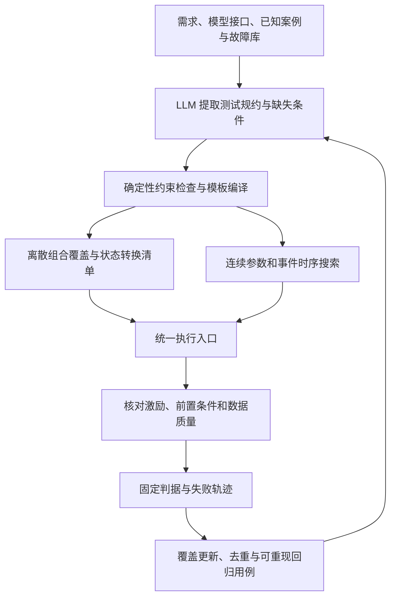
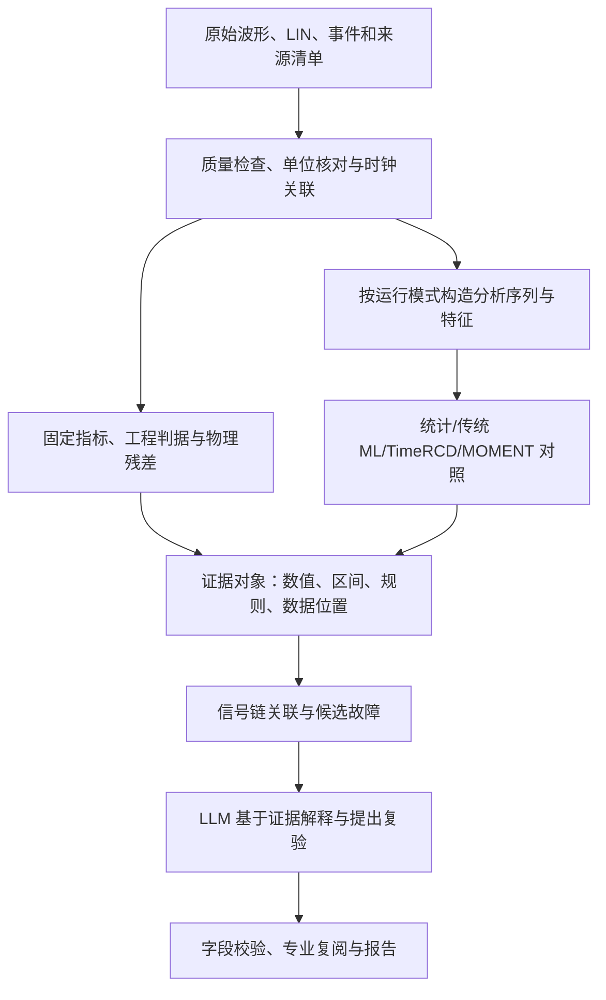

# HIL 智能测试用例生成与可信数据分析：技术选型方案

> 历史初稿（2026-11-06）。当前技术选型请阅读 [2026-11-08 修订版：HIL 智能测试生成与数据分析](../2026-11-08-hil-ai-selection/technical-selection.md)。新版根据两轮评估重定分析目标，补充电机主场景、故障识别/定位路线及分任务比较协议。本页保留初稿内容供回溯。

## 1. 建议采用的技术组合

**建议建设两个相互反馈的模块：用“需求与约束驱动的生成＋组合覆盖＋反例搜索”决定测什么，用“确定性测量＋分层异常检测＋证据约束解释”分析测到了什么。先完成小规模比较，再确定进入常规流程的算法。**

| 环节 | 首选方案 | 备选或扩展 | 选择依据 |
|---|---|---|---|
| 需求转用例 | 现有 LLM＋可检索的规格/案例/接口资料＋结构化测试规约＋模板编译 | 需求与模型规模扩大后再考虑 Graph RAG、领域微调 | 可以复用现有 Agent；把需求遗漏、接口错误和执行错误分别检查 |
| 合法性 | 现有适配器校验＋单位、时序、跨字段约束 | 约束复杂后引入 Z3 | 当前已有确定性校验；无需先重建约束平台 |
| 离散工况覆盖 | PICT 生成约束组合；独立复算可行组合覆盖 | 已有 ACTS 时可替换；风险因素增加局部 3-wise | PICT 有公开实现和命令行接口；ACTS 方法成熟，但当前官网要求申请下载 |
| 连续边界搜索 | 边界点/LHS 基线；PSY-TaLiRo 组织搜索，先比较 Dual Annealing | BoTorch 贝叶斯优化；高维或困难问题再试 TuRBO | 把仿真视为黑盒，复用既有指标；优化器由同预算试验决定 |
| 测试合格判定 | 现有指标计算与固定判据；新增时序需求可用 RTAMT | 经核对后增加物理残差 | 阈值、时间窗口和计算定义可审查、可复算 |
| 未知异常发现 | 模式分层的统计量、PCA/Isolation Forest | **TimeRCD 为优先新方法候选；MOMENT 冻结特征为对照** | 用本项目独立测试数据判断先进模型的增益 |
| 故障定位与解释 | 已知信号链＋证据检索＋候选原因排序＋建议复验 | 同步与干预数据充分后评估 AERCA | 当前先支持异常定位、关联分析和可验证假设 |

核心来源见 [PICT 官方文档](https://github.com/microsoft/pict/blob/main/doc/pict.md)、[NIST ACTS](https://csrc.nist.gov/projects/automated-combinatorial-testing-for-software)、[PSY-TaLiRo 实现](https://github.com/cpslab-asu/psy-taliro)、[TimeRCD 论文](https://proceedings.mlr.press/v306/lan26b.html)。

## 2. 两个任务的准确表述与当前起点

### 2.1 任务一：在有限预算内提高有效工况覆盖与失效发现能力

输入是需求、控制状态、模型接口、参数范围及可实现的故障机制。输出应包含可执行用例、需求映射、覆盖清单、实际激励证据及可重现的失败记录。

需要同时解决三个问题：生成的用例是否符合测试意图，定义的有效工况组合是否覆盖，连续输入和事件时序中是否存在容易漏掉的失效边界。“罕见”在前期按难触发或边界条件处理；要进一步报告现实发生概率，需要额外建立运行条件的概率分布。

### 2.2 任务二：让检测、判定、诊断和解释各自有证据

| 输出 | 要回答的问题 | 验证方式 |
|---|---|---|
| 数据质量 | 文件、单位、采样与时钟是否支持本次分析？ | 输入清单、采样检查、同步依据 |
| 性能判定 | 是否满足这一条已确定的需求？ | 固定判据与独立复算 |
| 异常检测 | 哪些区间偏离当前模式的正常行为？ | 留出事件上的召回、误报和定位误差 |
| 故障分类/定位 | 哪类故障或哪个环节与证据最一致？ | 已确认标签、可观测性与追加实验 |
| 结果解释 | 报告的数值和推论是否受证据支持？ | 字段核对、证据引用、专业复阅 |

### 2.3 本次对项目实际状态的核对

本次只读执行了 `doctor --json` 与 `validate-case --case boost_input_disturbance --json`，并查阅当前项目文档和 Boost 校验实现。核对结果保存于 [project-checks.json](project-checks.json)。

| 已核对事项 | 对选型的影响 |
|---|---|
| THCC 2026.3，配套 Python 3.11.4，HIL API 1.32.1，TyphoonTest 1.35.6，NumPy 2.2.3 | 可以围绕现有 Python/JSON 工作流集成；第三方算法仍单独建环境验证 |
| Boost 静态配置通过；每次最多一个事件，支持参考电压或输入电压变化，事件量化为 100 µs | 首个搜索任务限制在已支持的单事件参数空间 |
| 当前 Boost 运行证据状态为 `not_verified`，原因为 `evidence code is stale` | 先重跑少量基准确认当前版本的运行行为，再开展算法对比 |
| 已有外部波形、现场 CSV/LIN 接收、显式时钟关联、指标复算与 Agent 证据工具 | 新分析器应读取这些记录，复用其来源和复核机制 |
| 当前样机材料仍保留实体接入、完整样机模型与现场接口验收项 | 先在 Virtual HIL/离线数据验证方法，实体迁移单独安排 |

当前项目的 Virtual HIL 按仿真时间推进，没有外部 I/O。它适合筛选参数化场景与验证分析流程；实体 LIN 总线、电气调理、采样反馈及真实控制器保护需在对应设备链路上验证。具体依据见 [环境说明](../../environment.md)、[Boost 实验](../../boost-experiments.md)、[现场数据接口](../../field-data.md)、[样机联调](../../tle9877-field-commissioning.md)。

## 3. 本轮调研带来的选型依据

本轮按“生成意图—覆盖—反例搜索—异常检测—定位与可信解释—工程接入”六个角度检索，以近三年论文为主，保留组合测试、时序逻辑等必要基础方法。重点核对原始论文、作者仓库和官方文档；阅读深度、获取限制及证据编号见 [文献与工具证据表](evidence-register.md)。

| 研究或工具 | 核实到的有效信息 | 对本项目的决定 |
|---|---|---|
| FaultGene，2026 预印本 | 用结构化故障描述生成场景；离线利用语义与执行反馈形成微调材料；部署阶段单次生成 | 借鉴规约、校验和反馈组织；其 Scenic/CARLA、视频评价及训练流程需要重新适配 |
| 机电边界条件生成，Systems 2026 | 探索按关系类型逐步分析需求及 MBSE 上下文 | 用“前置条件—输入—预期行为—评价准则”组织需求；Graph RAG 作为后续候选 |
| CPS 贝叶斯反例搜索，TECS 2025 | 在黑盒仿真上研究局部代理模型、先验和采集函数，效果随问题而变 | 纳入 BO/TuRBO，对照随机/直接搜索；按测试耗时决定是否值得拟合代理模型 |
| TSB-AD，NeurIPS 2024 | 建立单变量、多变量基准，讨论数据与评价偏差，统计方法具有竞争力 | 保留简单基线，使用多指标，并检查异常区间标签 |
| When Foundation Models are One-Liners，ICLR 2026 | 在其单变量基准与设置中，若干基础模型的误差式检测与简单方差/差分基线没有显著差异 | 基础模型应证明实际增益；MOMENT 同时比较特征表示路线 |
| TimeRCD，ICML 2026 | 以相对上下文差异学习异常，有单/多变量实现和独立异常输出头 | 作为优先前沿候选；重点检查模式切换、长故障和窗口尺度 |

来源：[FaultGene 正文](https://arxiv.org/html/2610.29969v1)、[Systems 2026](https://www.mdpi.com/2079-8954/14/3/302)、[BO 论文正文](https://arxiv.org/html/2209.06735v3)、[TSB-AD 论文](https://papers.neurips.cc/paper_files/paper/2024/file/c3f3c690b7a99fba16d0efd35cb83b2c-Paper-Datasets_and_Benchmarks_Track.pdf)、[ICLR 2026 论文](https://proceedings.iclr.cc/paper_files/paper/2026/hash/cf70320e93c08b39b1b29a348097a376-Abstract-Conference.html)、[TimeRCD 论文](https://proceedings.mlr.press/v306/lan26b.html)。

另外检索到 **AutoHIL（ISSTA 2026）**，主题直接涉及需求到 ECU HIL 功能测试的生成，本轮核实了会议收录和摘要，尚未取得全文与可复现材料。它列为优先补读对象，摘要中的效果数字未用于本方案的收益估计。[会议论文页](https://conf.researchr.org/details/issta-2026/issta-2026-research-papers/64/AutoHIL-LLM-Based-ECU-Functional-Test-Generation-through-Domain-Knowledge-Augmentati)

## 4. 任务一：测试用例生成与覆盖优化

### 4.1 推荐流程



LLM 生成可检查的测试规约，模板把规约转换为当前接口接受的配置。现有项目优先生成 JSON 配置及工具请求，降低让模型直接编写任意控制脚本的集成成本。

### 4.2 测试规约应包含什么

以下是建议增加的上层规约字段，供生成与校验模块使用；它们需要映射到现有配置，不能直接当作当前 CLI 的输入格式。

| 字段 | 内容与检查 |
|---|---|
| requirement_ref | 需求编号、版本、原文位置；需求不足时记录缺口 |
| model / backend / capability_ref | 模型、执行后端、查询到的接口能力及版本 |
| operating_mode / preconditions | 启动、稳态、停机等阶段；如何观测前置条件已满足 |
| initial_parameters | 初始值、单位、工程允许范围与依据 |
| stimulus / fault | 扰动目标、幅值、注入位置和实现机制 |
| timing | 触发条件、时间域、量化步长、持续和恢复区间 |
| expected_behavior / oracle_ref | 预期动作、固定判据、计算方法及版本 |
| activation_evidence | 从哪些实测信号确认激励/故障生效 |
| coverage_tags | 对应的需求、状态转换、因素分区及故障标签 |
| reproducibility | 随机种子、生成器版本、模型与配置摘要 |

约束分两类处理。**执行边界**规定台架、接口和模型允许的操作；**被测对象正常条件**规定正常运行假设。故障测试可以有意违反通信内容或正常工况假设，但必须声明相应故障机制、预期响应和执行边界。例如，校验错误报文可作为合法测试意图，不能被“报文必须正确”的普通校验静默删除。

### 4.3 候选比较与采用顺序

| 方法 | 适用场景 | 数据和资源 | 主要限制 | 本次定位 |
|---|---|---|---|---|
| 人工表＋边界/网格扫描 | 因素少、需求清楚 | CPU；已有配置 | 因素增多后组合增长快 | 必留基线；低维任务可能直接采用 |
| LLM＋检索＋规约模板 | 文档分散、需求到接口映射费时 | 文档、接口能力、少量正确示例 | 可能遗漏约束或误解需求 | 近期引入，测人工修订量与语义正确性 |
| PICT/ACTS 约束组合 | 多个离散工况或等价分区交互 | 因素表、合法约束 | 不覆盖连续值，也不自动覆盖事件顺序 | 多因素任务的基础生成器 |
| PSY-TaLiRo＋直接搜索 | 可参数化、可重复运行的黑盒系统 | 输入范围、定量判据、执行预算 | 依赖规约与参数化质量 | 近期搜索框架候选 |
| BO / TuRBO | 单次实验昂贵，数值裕度有引导意义 | 历史输入—指标对；CPU/可选 GPU | 代理拟合开销、离散跳变和噪声影响收益 | 有成本收益证据后采用 |
| 强化学习/AST | 长序列、多步决策与概率化扰动 | 可复位仿真、状态/似然接口、大量交互 | 工程适配与样本需求较大 | 后续有明确需求再试 |

PSY-TaLiRo 提供黑盒模型及优化器扩展接口，官方 README 列出 UniformRandom 和 DualAnnealing。BoTorch 提供 TuRBO 示例，但示例不等于现成的 Typhoon 适配器，需要实现输入编码、调用、错误反馈和结果留存。[PSY-TaLiRo](https://github.com/cpslab-asu/psy-taliro)、[BoTorch TuRBO](https://botorch.org/docs/v0.15.1/tutorials/turbo_1)、[AST 原始论文](https://arxiv.org/abs/2004.04293)

### 4.4 覆盖怎样计算才有用

先冻结因素、分区、约束和需求集合，再分别报告：

- **设计覆盖**：生成集合覆盖的可行 t 元组数 / 可行 t 元组总数。一个元组“可行”意味着它能扩展成至少一个满足全部约束的完整用例。
- **执行覆盖**：已实际执行且激励有效的用例所覆盖的元组 / 同一个冻结分母。生成成功和实际执行分别记账。
- **需求覆盖**：有有效执行证据的需求数 / 计划验证需求数；缺少实现或判据的需求保留为缺口。
- **状态转换覆盖**：明确的状态边或规定的短序列是否实际发生；普通参数成对覆盖不能替代此项。
- **激活率**：确认激励/注入生效的次数 / 尝试注入次数；指令发送成功不足以证明被测对象受到了预期刺激。

先做全局 2-wise，对“电压状态×负载×保护阶段”等经领域评审确定的高风险关系增加局部 3-wise。非法组合应在生成中处理；事后删除用例可能破坏其他合法组合覆盖，需要重新计算并补齐。[NIST 组合测试](https://csrc.nist.gov/projects/automated-combinatorial-testing-for-software)、[PICT 约束说明](https://github.com/microsoft/pict/blob/main/doc/pict.md)

### 4.5 用反例搜索定位边界

初期对每条需求单独构造数值裕度。以现有 Boost 输入扰动的峰值偏差为例：

`r_peak(x) = 0.10 − max_event_window(|Vout − Vref|) / |Vref|`

搜索使裕度减小的输入；负值表示这条固定需求被违反。0.10 来自当前教学配置，适用范围限于该案例。预事件输出稳定、事件生效和采集完整先独立检查。恢复时间等其他需求保留单独结果，初期可轮流搜索；跨量纲组合目标需要预先确定归一化方式。

对于“事件后 T 时间内进入误差带并保持 H 时间”的新需求，可用 STL 表达为 `F_[0,T] G_[0,H](|e|≤ε)`，从已确认事件起点评价。RTAMT 可计算其定量语义；必须先核对采样语义、窗口完整性和边界比较规则，再与手工轨迹逐例比对。稠密时间监测还要登记点间重建假设，不能由采样轨迹推断已证明点间物理行为。[RTAMT 官方说明](https://github.com/nickovic/rtamt)

执行异常、激励未生效、前置条件未满足和数值不可计算分别记录。它们不进入正常性能裕度序列，也不计为发现被测对象失效；同时保留在总尝试数及总耗时中。`r≈0` 的结果结合采样、测量误差和判据定义复核。

**搜索不得改变判据。** 参数范围可依据明确的模型有效范围扩展，验收阈值、需求和分析版本在一次比较中固定。找到反例后，使用原始配置再次运行，并缩小参数或事件集合形成便于解释的回归用例。

### 4.6 当前 Boost 的最小落地点

从 `boost_vin_drop.json` 派生独立配置，固定参考、初始输入、采样和验收条件，先搜索“事件后的输入电压、事件时刻”两个变量。范围围绕已用过的 28～38.5 V 与可观察事件区间，由模型负责人确认；事件时刻编码为整数 tick，再乘 100 µs。当前 1.5 s 采集、0.5 s 恢复允许量和 0.1 s 稳态窗要求事件不晚于 0.9 s，还要留足预事件有效窗口。

这组范围只是首轮选型建议，不能据接口显示的 1000 V 数值上限推断电路在整个范围内有效。负载组合、多次故障、传感器断线和 LIN 错误等场景，需等相应适配器及生效证据建立后加入执行集合。

现有已知失败记录用于回归。新增失效按“违反的需求＋发生阶段＋波形特征”去重，先称为失效模式或反例类别；同一现象的多个参数点不直接计成多个独立缺陷。

## 5. 任务二：多源测试数据的可靠分析

### 5.1 推荐分层处理



### 5.2 先把数据转成可分析对象

每条记录至少包含：运行 ID、来源类型、板卡/固件/模型版本、工况、信号名与单位、采样设置、时钟域、同步依据、计划事件、实测激活区间、判据与标签依据。沿用现有 `physical / virtual_hil / mock / synthetic / unconfirmed` 来源分类。

多源关联使用现有 `t_common = scale × t_source + offset` 及误差范围。没有已确认关系时分别分析；文件开始时间一致或曲线形态相似，不能作为保护延迟或故障传播先后的依据。

建议建立两条分析支路：保留原始高频波形的瞬态/频谱支路，分析转速、包络和控制状态的较低频动态支路。重采样、抗混叠、滤波和特征提取写入派生记录，原件保持。机器学习所需填补值附带缺失掩码和处理说明，正式性能判定按原始采样与质量规则计算。

窗口长度同时登记“点数”和“物理时长”。例如，5000 点在 10 kHz 下对应 0.5 s；改变采样率就改变了模型看到的动态尺度。绝对电压/电流越限保留物理量支路，避免窗口归一化掩盖直流偏置或幅值故障。

### 5.3 算法比较与主次关系

| 候选 | 输入和数据需求 | 适合解决的问题 | 关键适配与限制 | 采用建议 |
|---|---|---|---|---|
| 固定指标＋物理残差 | 有单位、有需求或物理关系的信号 | 跟踪误差、超调、恢复、时序要求 | 测点、工况和模型假设需成立 | 所有正式判定的基础 |
| 滑窗均值/方差、MAD、差分、CUSUM | 代表性正常运行及模式标签 | 偏置、突变、漂移等 | 启动、切换、停机需分层，阈值用独立数据确定 | 必留低成本基线 |
| PCA＋Isolation Forest | 同步多通道或窗口特征；正常拟合数据 | 多信号联合偏离、特征异常 | 先按完整运行分组；需要正常模式覆盖 | 首个学习型基线 |
| MOMENT 冻结特征＋kNN/IForest | 预训练权重、窗口；正常特征参考集 | 少标注条件下检验可迁移表示 | 与物理特征同协议比较；重建误差另列 | 对照候选，先冻结、后考虑微调 |
| **TimeRCD** | 预训练权重及单/多变量上下文 | 上下文相关、未预先设阈值的异常 | 检查长异常占比、上下文污染、分阶段与时长敏感性 | 优先试验的新方法 |
| AERCA | 同步多变量正常数据、可检验依赖及故障标签 | 更深入的异常源定位 | 闭环反馈、共同原因和未测变量影响解释；当前材料需继续补读 | 数据条件成熟后评估 |

MOMENT 提供重建与嵌入等接口；它的预训练表示是否有用，应由当前任务验证。TimeRCD 官方 API 的多变量输入为 `(T,C)`，输出是每时刻一个异常分数 `(T,)`，并不直接给出故障部件。AERCA 的公开仓库仍提示实现处于建设中。[MOMENT 论文](https://proceedings.mlr.press/v235/goswami24a.html)、[MOMENT 实现](https://github.com/moment-timeseries-foundation-model/moment)、[TimeRCD 使用说明](https://github.com/thu-sail-lab/Time-RCD/blob/main/Tutorial.md)、[AERCA 实现](https://github.com/hanxiao0607/AERCA)

第一轮控制候选数量：统计基线、PCA/IForest、MOMENT 特征、TimeRCD 四组即可。Anomaly Transformer、TimesNet 等保留在方法库，只有前述比较暴露出具体不足时再增加，避免用有限数据同时调试大量模型。

### 5.4 异常与根因之间如何推进

优先按已知链路组织证据，例如“命令→板卡目标→驱动→模型/电机响应→反馈”。先定位哪一条关系失配，再确定追加测点或复验。

以转速下降为例，分别核对命令是否下降、母线电压是否变化、负载是否变化、驱动/限流标志是否出现、转速反馈是否可信。共同时间轴和误差支持时才讨论先后；尚无法区分的原因合并保留，复验改变一个可控因素并观察差异。

物理残差也要有适用条件。三线端口的三相电流和可作为一致性检查，前提是测点、极性和同步均匹配；它本身不足以定位具体器件故障。根因标签须来自已确认的注入、独立测量或检修结论。用例标注的计划故障、实际注入是否成功、观察到的异常和物理机制分别保存。

### 5.5 数据划分与未知处理

异常标签、性能通过/失败和故障原因标签分别定义。例如，保护动作可以使波形明显变化且满足需求；计划注入故障的时刻也不一定等于实测异常起点。确认注入生效后，依据观测和任务定义标记异常区间，避免把用例名称直接当作诊断真值。

1. **按完整运行分组后再切窗口。** 同一次运行及其重叠窗口只进入训练、校准或测试中的一个集合；同源增强样本跟随原记录分组。
2. **拟合与校准分开。** 标准化、PCA、正常参考库在拟合集建立；报警阈值在校准集确定；测试集只用于最终评价。
3. **分别检验工况与设备迁移。** 留出转速/负载区间、固件或板卡；Virtual HIL、合成与实体结果分别报告。
4. **保留独立评估集。** 搜索算法找到的失败可以用于开发和回归；用另一批冻结工况评价日常误报与泛化。
5. **显式保留未知。** 质量不足、缺少同步、超出已评估工况或多个原因不可区分时输出相应原因，报告能确定的异常位置与待补证据。

模型异常分数及语言模型自报信心均不直接解释为真实故障概率。TimeRCD 的分数虽落在 0～1，工程报警阈值仍需按本项目校准。[TimeRCD 阈值说明](https://github.com/thu-sail-lab/Time-RCD/blob/main/Tutorial.md)

### 5.6 LLM 如何生成可靠报告

LLM 主要读取结构化证据：指标数值与单位、分析窗口、判据结果、异常区间、原始记录路径、需求/文档摘录及仍缺失的条件。按需调用已有工具读取局部波形和补充证据。

数值、单位、需求编号及判据状态由程序核对；解释关联现有证据 ID。对没有数据支撑的机理判断保留为待验证假设，随后生成一项能区分候选原因的复验。校验失败的回答保留原件和错误原因，由修正流程重新生成。

沿用当前项目中 `data_quality_status`、`analysis_status`、`criteria_status`、`performance_status` 和 `record_status` 的不同含义。记录复算一致可以与性能失败同时成立。结构与引用校验能减少报告错误，自然语言机理仍需专业复阅；当前实现边界见 [现场数据](../../field-data.md)、[Agent 说明](../../agent.md)。

## 6. 与现有 Typhoon 工作流的集成

### 6.1 保留统一执行入口，在外部增加生成与分析组件

```text
生成/搜索环境 → 已校验的候选配置 → lab.ps1 → Typhoon 配套 Python
                                                   ↓
                                         原始记录、指标、事件、摘要
                                                   ↓
外部分析环境 ← 可追溯数据副本/派生特征 ← 记录读取与质量检查
       ↓
异常分数、区间、模型版本 → 证据工具 → LLM 报告与复验候选
```

算法环境通过文件和 JSON 交换数据，Typhoon API 调用继续由配套 Python 执行。搜索回调读取结果目录和固定指标；算法自身保存种子、候选参数、约束拒绝、错误、耗时及目标值。单台设备/当前执行入口保持串行，避免优化框架的并发功能占用同一会话。

### 6.2 需要增加的最小接口

| 接口职责 | 复用内容 | 新增内容 |
|---|---|---|
| 获取能力 | `list-cases`、`validate-case` | 将能力快照绑定到生成任务 |
| 编译用例 | 适配器校验、现有配置 | 上层规约到配置的模板；约束拒绝记录 |
| 执行候选 | `run` / `run-case`、互斥及记录 | 搜索任务与子运行的关联、预算统计 |
| 计算搜索目标 | 固定 `metrics`、`events` | 按需求读取裕度；明确不可计算状态 |
| 增加异常分析 | 波形/现场数据接收与来源 | 版本化预处理、模型输出和阈值记录 |
| 汇总覆盖 | 案例与运行清单 | 设计/执行/激活覆盖、遗漏原因 |

当前执行器的模型复制、编译、运行开销全部纳入预算。是否能缓存或复用编译应另行验证，首轮不假设已有此能力。

### 6.3 工具环境、许可证和资源

| 组件 | 已核对信息 | 原型安排 |
|---|---|---|
| PICT | MIT；独立命令行工具 | 固定源码/二进制版本，CPU 生成；核对导出编码和覆盖 |
| ACTS | NIST 官网说明公有领域、免费，当前通过申请取得 | 已有安装可直接比较；本任务未代发申请邮件 |
| PSY-TaLiRo | BSD-3-Clause；所查 3.2.0 元数据为 Python `>=3.10,<3.13` | 独立 Python 3.11 环境，锁定版本并测黑盒回调 |
| RTAMT | BSD-3-Clause；有离散/稠密时间监测 | 先用纯 Python 离线监测；逐例核对采样语义 |
| TimeRCD | 代码 Apache-2.0；所查包元数据要求 Python ≥3.10、PyTorch ≥2.0 | 独立环境；核对具体权重说明，固定 checkpoint、代码摘要、窗口与 batch |
| MOMENT | 代码 MIT；README 推荐 Python 3.11 | 从较小版本与冻结特征开始，另核对具体权重说明 |
| AERCA | 代码 MIT；作者列出 Ubuntu 20.04/Python 3.11 环境 | 后续独立复现实验；Windows 接入另测 |

许可证及依赖来源：[PICT](https://github.com/microsoft/pict/blob/main/LICENSE.TXT)、[ACTS](https://csrc.nist.gov/projects/automated-combinatorial-testing-for-software)、[PSY-TaLiRo 元数据](https://github.com/cpslab-asu/psy-taliro/blob/main/pyproject.toml)、[PSY-TaLiRo 许可证](https://github.com/cpslab-asu/psy-taliro/blob/main/LICENSE)、[RTAMT](https://github.com/nickovic/rtamt)、[TimeRCD 元数据](https://github.com/thu-sail-lab/Time-RCD/blob/main/pyproject.toml)、[MOMENT](https://github.com/moment-timeseries-foundation-model/moment)、[AERCA](https://github.com/hanxiao0607/AERCA)。

基线、组合生成和低维优化先使用 CPU。深度模型先在现有资源上测少量序列的加载时间、吞吐、峰值内存/显存，再确定批量和设备；前期无需预训练或全量微调。论文中的 GPU 延迟受通道数、序列长度和批量影响，不作为本台架的时延承诺。LLM 先复用现有可调用服务，固定版本、提示模板和调用预算后比较。

## 7. 两组可直接组织的选型试验

本节的预算和门槛是建议的原型决策规则，需在正式运行前冻结；它们不替代控制器规格要求。两份任务卡见 [research-question-card.md](research-question-card.md)。

### 7.1 A 组：生成质量、覆盖与边界搜索

**A1：需求到用例。** 从已有案例中选取有明确依据的需求和边界条目，先以 10～20 条为目标；不足时逐条评审。比较直接 LLM、LLM＋检索/结构化规约、人工模板基线，使用同一模型及相同调用限制。预先标注必需条件、禁止操作、判据和正确接口，由领域人员盲评测试意图及人工修订量。

**A2：覆盖生成。** 对已实现能力建立离散因素表，比较人工、随机与约束组合。规模小时枚举全部合法配置，用独立计算核对 t-wise 覆盖；因素少到穷举成本很低时，保留全枚举。尚无执行机制的故障可进入设计清单，执行覆盖保持未完成。

**A3：连续搜索。** Boost 基准复验后，比较 LHS、Dual Annealing 和 BO。试运行每方法 3 个种子、每种子最多 30 次实际执行，共最多 270 次；共享初始样本并计入各自预算，同时记录候选生成与总墙钟耗时。若基准有区分度且成本可接受，正式比较再扩大到每方法 10 个种子、100 次上限。

| 主指标 | 口径 |
|---|---|
| 首次生成有效率 | 无修订且满足规约与接口的用例 / 全部首次候选；修正轮另报 |
| 语义正确率 | 满足人工预定测试意图的用例 / 评审用例；独立于可执行率 |
| 覆盖 | 第 4.4 节的冻结分母；生成、执行、激活分别统计 |
| 反例发现 | 同预算发现至少一个有效反例的种子比例；首次反例调用数 |
| 多样性 | 去重后的失效模式数；已知失败回归与新增发现分列 |
| 成本 | 实际运行、失败尝试、LLM 调用和总墙钟时间 |

没有找到反例的种子按预算截尾保留。报告全部种子的结果和区间，避免仅统计成功种子的平均调用数。若某一空间几乎处处失败或全通过，先在独立预试中调整基准设计，再冻结正式任务。

**采用规则建议：** 准入用例全部通过硬约束；小型因素表的设计覆盖经独立枚举达到声明目标；BO 在多个有代表性的需求上，首次反例调用数或失效模式发现有稳定增益，且总耗时值得承担。可暂以调用数改善 20% 作为继续扩大试验的参考线；未达到时采用更简单的搜索器。

### 7.2 B 组：异常检测与报告可信性

先把已有小样本用于功能回归，再建立独立数据集。数据来源分为：可复现的 Virtual HIL 正常/扰动运行，明确标注的合成或派生异常，后续实体采集。合成异常用于检查检测机制；其结果单独报告。转速变化、正常启动等合法动态必须进入正常集合。

首轮可从 30 次正常和 30 次异常的独立运行开始，检验接口、尺度及明显失效模式；相近条件的重复记录按组处理。正式性能评价的样本量按目标误差与工况层次确定。以独立正常运行为单位，零误报 n 次的二项模型单侧 95% 上界为 `1−0.05^(1/n)`：30 次约 9.5%，59 次约 5%。因此，少量样本上的零误报仍需要补充验证。

四组算法使用相同的拟合/校准/测试分组及信息边界。TimeRCD 先用固定预训练权重；MOMENT 比较冻结嵌入＋简单检测器，重建误差作为单独消融项；物理特征＋PCA/IForest 为主要学习基线。

| 主指标 | 工程含义 |
|---|---|
| 事件召回与漏报 | 每个确认异常事件是否在规定延迟内检测；已知关键失败单列 |
| 正常运行误报比例 | 至少一个误报警的正常运行 / 正常运行总数；适合当前短实验 |
| 报警次数/小时 | 有足够连续正常记录后再使用，报警合并/冷却规则提前固定 |
| 检测延迟、区间定位 | 从确认异常起点到可发出报警的时间，另报异常区间匹配质量 |
| PR-AUC / VUS-PR | 辅助评价分数排序；说明标签、区间容忍与参数 |
| 跨工况与资源 | 留出模式/设备上的性能，加载、推理、内存/显存与总分析耗时 |
| 报告证据准确性 | 数值和单位一致率、引用有效率、错误机理陈述及需人工修订量 |

点级 F1 仅作补充；不采用“击中一点即把整个真实异常段补判正确”的 point adjustment 作为主要成绩。TSB-AD 对此类评价偏差有专门讨论。[TSB-AD](https://papers.neurips.cc/paper_files/paper/2024/file/c3f3c690b7a99fba16d0efd35cb83b2c-Paper-Datasets_and_Benchmarks_Track.pdf)

本方案首先面向离线分析。使用未来上下文的居中窗口，报告其离线定位能力；若扩展在线报警，按报警实际可用时刻计算延迟，并计入窗口等待、特征和推理耗时。

**采用规则建议：** 在相同误报预算下比较事件召回与延迟，按工况分层核对；例如以事件召回提升 5 个百分点作为继续验证新模型的参考，同时检查不确定区间及关键漏报。收益接近时选维护成本较低的方法。报告中的可核对数值、单位和判据状态必须全部一致；机理解释另作盲评。样本不足时交付试验结果与缺口，保留当前较稳妥方案。

## 8. 实施顺序与交付物

建议由一名软件/算法人员推进、一名熟悉电路与被测控制器的人员评审需求及异常标签。以下是具备现有模型和算力条件下的四阶段安排，墙钟预算由首批运行实测后调整。

| 阶段 | 工作 | 交付与完成条件 |
|---|---|---|
| 第 1 周：冻结基准 | 核对需求与接口，复验 Boost 基准，整理数据/标签分组，测单次耗时 | 需求与场景表、固定判据、有效范围、独立划分与版本清单 |
| 第 2 周：完成生成比较 | 检索与规约模板、约束组合、LHS/直接搜索；小规模 BO 对照 | 首次/修正有效率、可复算覆盖、所有尝试和反例记录 |
| 第 3 周：完成分析比较 | 统计与物理特征基线、TimeRCD、MOMENT 特征；证据报告校验 | 同协议分层性能、错误样本、运行成本、报告审查结果 |
| 第 4 周：决策与闭环 | 固定保留算法，重复反例、加入回归，并把未解释异常转为测试候选 | 采用/暂缓决策、可复现配置、回归集与下一阶段缺口 |

第一阶段最值得交付的闭环是：**一条有依据的需求→合法场景→实际施加证据→可复算失败/通过→定位异常窗口→提出并执行可区分原因的复验。** 当前运行器复用统一执行与记录；新增工作集中在生成、搜索和离线分析层。

进入 TLE9877 实体测试前，逐项完成 I/O 与电气边界、六路驱动/反馈、单分流测点与缩放、LIN 实际协议、复位和停止行为、时钟/触发及采样验收；具体以 [现场联调清单](../../tle9877-field-commissioning.md) 为准。软件控制器与实体固件若不同，分别建立基准；只有形成相同测试条件下的对应数据后，再讨论多保真搜索或仿真到实体迁移。

## 9. 本轮决策清单

| 决策 | 结论 |
|---|---|
| 用例生成近期重点 | 需求结构化、能力约束、设计/执行覆盖和可重现反例 |
| 连续搜索工具 | PSY-TaLiRo 作为候选框架；先比较 LHS/直接搜索，BO 按收益采用 |
| 异常分析近期重点 | 固定指标、数据质量及模式分层基线；优先实测 TimeRCD，保留 MOMENT 特征对照 |
| 根因分析近期输出 | 证据支持的候选环节与可区分原因的复验 |
| 暂缓项目 | 全量微调、从头训练基础模型、重型 Graph RAG、端到端强化学习及自动物理根因断言 |
| 算力与部署 | 复用现有 LLM 与计算资源，算法环境隔离；根据实测吞吐决定扩容 |
| 技术选择的依据 | 同预算、同数据划分的效果与成本；正式接入由比较结果决定 |

后续重点补读 AutoHIL 全文，核对原附件所列电机基础模型迁移研究的完整实验与数据，并持续跟踪 TimeRCD 等异常专用模型。文献更新通过证据表追加，已冻结的试验协议保持版本化。
