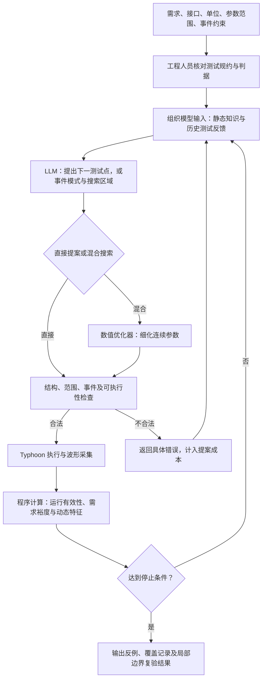
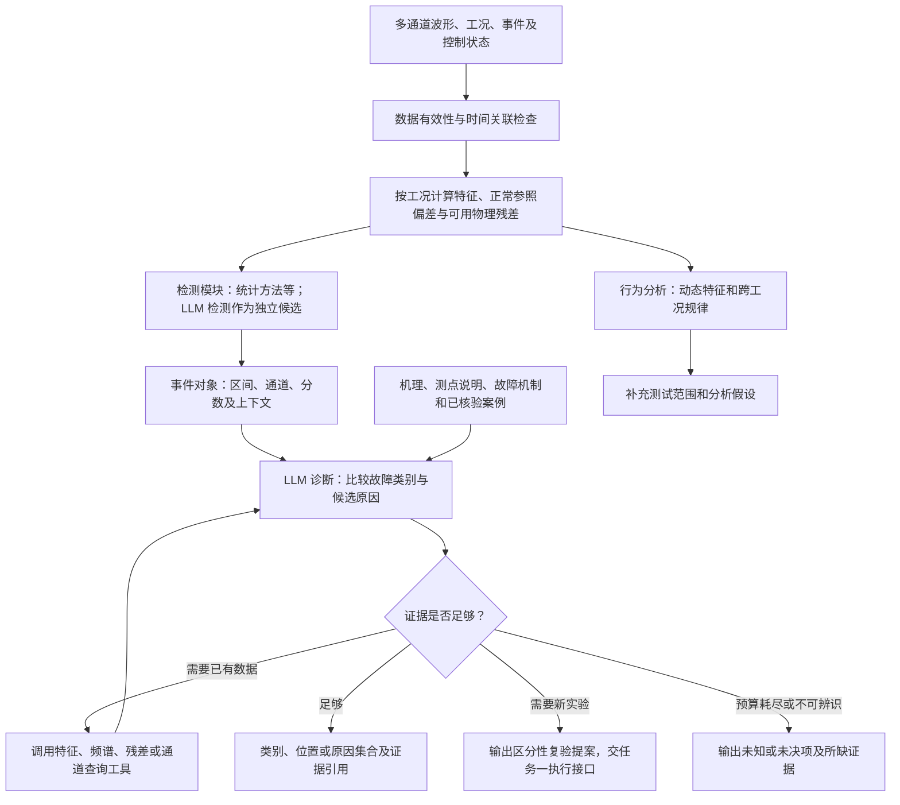

# 11 月 11 日技术选型讨论梳理与改进建议

依据为[讨论文字稿](../../../../docs/技术选型方案讨论.txt)、[讨论稿](discussion-brief.md)、[完整方案](technical-selection.md)及[LLM 专题调研](../2026-11-09-llm-core-methods/research-report.md)。讨论文字稿含口语及转写误差，下文按时间定位和上下文归纳，不将未形成结论的讨论写成已确定要求。

## 1. 对这次讨论的判断

你的判断抓住了核心：需要具体说明大模型如何参与两项任务。进一步说，师兄希望看到一条可实施、可分工、可估算投入的技术路线：**工程资料如何形成输入 → 各模块怎样处理 → 大模型作出什么决策 → 工具如何执行与反馈 → 用什么证据判断效果。**

现有研究目标可以保留。此次修订重点应放在方法和实施层：为每个核心模块说明输入、输出、算法、工程知识、接口、失败出口和验证方式。流程图应承载这些信息，并配合一个完整例子讲清楚一轮执行。

已有材料提供了具体技术路径：专题调研解释了部分论文机制，完整方案写了主流程、候选方法和对照设计。当前主要缺口是把这些内容进一步转化为本项目的模块设计，并在讨论稿中呈现出来。完整方案也需要补充，单纯把讨论稿中的链接指向全文仍不足以解决师兄的问题。

## 2. 讨论提出了哪些要求

| 讨论位置 | 主要意见或问题 | 对下一版的具体要求 |
|---|---|---|
| 00:00—00:37 | 此前与合作方主要交流了测试用例；技术方案尚未交流；样机测试等待对方建模，无确定时间 | 将技术预研计划与外部模型、现场联调依赖分别列出；再次交流时携带明确资料需求 |
| 00:47—01:26 | 主线不够清楚，“失效边界”被理解为芯片硬件失效 | 在首页定义失效：违反已确定的功能或性能需求；给出对象、输入、判据和输出 |
| 01:35—03:44 | 写测试脚本与生成有价值的工况不同；大模型需要哪些专家支持、怎样生成工况？ | 展开工程知识准备、候选工况表示、反馈搜索和合法性检查，说明各自贡献 |
| 04:06—05:24 | 需要说明每一步使用的技术及 LLM 的作用，训练和本地模型也要有依据 | 每个核心模块采用“输入—处理—输出—评价”的写法；由任务需求推导部署与训练选择 |
| 05:43—06:33 | 先给完整流程图，再展开关键模块；简单模板转换可以简写 | 增加总体图、任务一搜索细图、任务二检测和诊断细图；把篇幅用于关键决策机制 |
| 06:33—06:48 | 每项任务需要时间估计 | 按模块列工作量、依赖、阶段产物；区分人日与日历周期 |
| 07:23—08:07 | “电信号、各种参数”不足以说明输入 | 列出实际信号、单位、时间轴、采样条件、工况和状态；区分原始波形与模型输入 |
| 08:18—10:19 | 异常、故障识别和原因诊断交叉；诊断是否有必要、是否依赖大量知识？ | 划分能力层次和输入输出，说明首批诊断深度及其证据条件 |
| 10:38—12:30 | 知识增强需要哪些知识？哪些资料需要合作方提供？后续组员如何执行？ | 增加知识与资料清单、模块分工及交付物，使对方知道要准备什么 |
| 12:56—13:14 | 根据两项核心任务重新做模型与算力选型 | 将模型规模、输入形式、工具能力、适配方式和资源测量放在一张对应表中 |
| 13:44 起 | 纯文字难以支撑现场讲解 | 讨论稿以图和核心表格组织，正文围绕图解释决策及依据 |

师兄对原因诊断提出的是范围与可行性问题，讨论没有形成“删除诊断”的决定。建议保留原因分析目标，明确首批定位到什么层级、依据什么信息，后续怎样扩展。

## 3. 之前的调研和完整方案已经有多少内容

### 3.1 现有材料的覆盖与不足

| 问题 | 已有内容及位置 | 仍需补充 |
|---|---|---|
| 需求怎样进入测试系统 | 完整方案 §3.1：结构化规约、接口知识、固定校验，参考 AutoHIL | 一份真实规约示例；接口和约束的来源、维护者与确认方式 |
| LLM 怎样搜索工况 | 完整方案 §3.3：参数/事件提案、裕度、响应反馈；A0—A3 对照 | 提示内容、测试点表示、历史保留策略、错误处理、停止条件和逐轮示例 |
| LLM 与数值优化器怎样合作 | 完整方案 §3.3：LLM 提区域/事件模式，优化器细化 | 离散与连续变量如何划分；预算分配；何时换区域；局部最优结果怎样反馈 |
| 信号怎样进入 LLM | 完整方案 §4.1、§4.3、§5.1：特征、参照、残差、工具查询及采样原则 | 对应实际通道的字段表；一个从原始数据到诊断输入的转换例子 |
| 检测、分类、原因分析怎样连接 | 完整方案 §4.2、§4.3、§4.6 分别已有方法 | 明确模块边界、事件对象、候选原因对象及复验交接；画出信息流 |
| 知识增强具体是什么 | 专题调研 §3.1、完整方案 §4.3 提及过程和故障知识 | 知识条目结构、资料清单、来源、版本、检索条件和核验责任 |
| 本地模型与训练 | 完整方案 §5.5 已覆盖原权重、LoRA、对齐、蒸馏和规则生成 | 具名候选模型及版本、任务适配理由、资源试测、训练触发条件和样本格式 |
| 实施安排 | 完整方案 §7 有阶段工作及产出 | 模块工作量、人员、依赖、首批交付日期和实体条件等待时间 |

因此，更准确的回答是：**已有技术路线来源和方法框架，尚未形成充分展开的本项目实施方案。** 部分内容被精简稿压缩了，部分内容在全文中也只写到了概念和流程层。

### 3.2 哪些论文已经能够支持具体展开

本次进一步检查了已有本地正文快照，重点是 LLM-Falsifier 的方法部分和 S2S-FDD 的信号组织、提示与检索过程。以下区分论文机制与建议迁移方式；迁移方案尚未通过本项目实验验证。

| 方法 | 已有证据中的具体机制 | 本项目可采用的设计 |
|---|---|---|
| LLM-Falsifier | 静态模型信息和规格组成提示；LLM 每轮提出一个输入；仿真器与 STL 监测器计算鲁棒度。正文逐步加入规格及变量语义、压缩输出轨迹、实现鲁棒度的关键时刻；保留最近 10 次样本，按时间排列；找到负鲁棒度反例后停止 | 将电机输入表示为有限参数与事件序列，由执行器计算需求满足裕度；比较参数/分数反馈与加入动态响应反馈。历史长度和压缩方式作为显式配置 |
| S2S-FDD | 利用正常模式重构形成参照，组织实测值、重构值和偏差；生成信号描述，检索故障知识；LLM 判断原因，信息不足时调用 `get_target_table` 查询已有信号表；支持不确定输出及多次投票 | 先以同工况正常参照和物理特征构造可核对输入，再加入机制知识与按需查询；将信号描述和原因判断分成两个步骤 |
| TraceBench | 专题调研已核查：在给定物理系统数据上通过分析工具或生成分类程序进行原因归属 | 借鉴按需分析的接口与证据记录；新增实体试验另设复验模块 |
| Argos | 专题调研已核查：根据开发数据与反馈生成、修改异常规则，部署时执行规则 | 保留为分析发现支线，生成新的动态特征或检测程序，并在独立数据中验证 |
| AutoHIL、GLLMPro | 现有阅读深度分别主要为官方摘要、摘要与工件说明 | 可以支持方向选择；若作为核心实现来源，应补齐正文或真实代码细节，再写成可复现步骤 |

方法快照：[LLM-Falsifier](../2026-11-09-llm-core-methods/evidence/llm-falsifier.txt)、[S2S-FDD](../2026-11-09-llm-core-methods/evidence/s2s-fdd.txt)。其他文献的证据层级见[专题调研 §2—§3](../2026-11-09-llm-core-methods/research-report.md)。

需要准确处理三项迁移差异：

- 本项目的 `允许恢复时间 − 实际恢复时间` 是选定需求的满足裕度。只有实际采用 STL 定义与监测器后，才能将实现称为相应 STL 鲁棒度计算。
- 找到一次违反需求的反例，证明该条件下存在失效。若要报告“失效边界”，还需在附近复验，形成满足与违反条件的分界证据，并声明搜索范围。
- 用普通特征和正常参照借鉴 S2S-FDD 的信号语义组织，可以形成项目方法；若要宣称复现 S2S-FDD，还需实现并核验其正常模式重构、筛选、检索和多轮诊断等机制。

## 4. 任务一应怎样展开

### 4.1 建议明确的核心作用

LLM 根据需求、变量语义、工程知识和历次响应，选择下一组测试条件；混合路线进一步让它选择事件模式或搜索区域，由数值优化器细化连续参数。专家与固定程序分别提供经过确认的测试边界和确定性的执行、计算能力。

### 4.2 应写到的模块细度

| 模块 | 输入 | 处理与输出 | 需要确认的设计 |
|---|---|---|---|
| 测试规约 | 需求、模型接口、允许操作 | 形成需求 ID、初始条件、事件类型、参数范围、单位、判据 | 哪些条件由工程师确认；需求缺字段时怎样处理 |
| 提案 | 规约、变量含义、已执行参数及反馈 | LLM 输出参数、事件次序、时间间隔、提案依据；混合方式增加区域边界 | 结构化格式、历史长度、输入压缩、重复提案策略 |
| 数值细化 | LLM 给定的合法事件模式和参数子域 | Dual Annealing 等搜索器反复调用执行与评分函数，返回最优参数及实际评分 | 每个区域的执行预算、探索其他区域的条件、失败返回方式 |
| 执行与评分 | 校验通过的配置 | 运行、采集、判断数据有效性，计算裕度及特征 | 超时、未恢复、数据缺失分别怎样编码；零裕度的边界约定 |
| 搜索控制 | 有效反馈、累计预算、已发现反例 | 更新历史，继续提案，或输出结果 | 首个反例、固定预算、模式发现分别使用什么停止规则 |
| 边界复验 | 反例及相邻满足条件 | 检查局部参数变化与重复性，输出受测试范围约束的边界 | 分辨率、重复次数；高维空间中所检查的切片或区域 |

一轮反馈至少包含：`run_id`、需求 ID、实际执行的参数/事件、运行及数据有效性、满足裕度、恢复/振荡等特征、相关时间区间和数据引用。运行失败与有效运行中的需求违反分别返回。

**贯穿示例：调速与负载事件的交互。** 工程人员先定义允许的速度、负载和事件间隔。模型看到“上一轮在某种事件顺序下恢复裕度接近零、电流限制持续时间增加”的实际反馈，提出调整间隔或幅值的下一测试。工具校验、执行并返回新的裕度。混合方式中，LLM 输出事件顺序和参数子域，优化器在该子域内寻找更低裕度，再将真实最优结果交回。例子中的变量和反馈必须用实际可获取信号填写。

恢复时间判据还应说明误差带、保持时间和记录长度：若采样结束前未恢复，实际恢复时间可能尚不可知；是否已能判为超时取决于规定期限是否已被完整观察。

评价仍采用现有方案的失效发现率、首次发现成本、模式数与两套预算。若要声称 LLM 的语义知识有效，应设置相同知识的工程启发式等对照；若混合方法取得增益，应比较 LLM 单独搜索、优化器单独搜索及混合搜索。

## 5. 任务二应怎样展开

### 5.1 先明确能力层次

| 能力 | 回答的问题 | 输出示例 |
|---|---|---|
| 行为分析 | 响应如何变化，是否存在跨工况规律？ | 恢复时间、振荡特征、相间关系及其工况依赖 |
| 异常检测 | 哪个时间段偏离预期正常行为？ | 异常区间、涉及通道、检测分数 |
| 故障识别 | 已检测事件更符合哪种已知类别？ | 反馈异常、执行异常，或未知类别 |
| 原因分析与定位 | 哪条信号链或机制可以解释证据？ | 候选机制及支持/反对证据；可疑位置和待区分项 |
| 区分性复验 | 还需要获取什么新信息？ | 指定观测或新测试动作，以及预期区分的候选原因 |

故障识别与原因分析在具体方法中可能共同完成，但在接口和评价中应分清输出层级。首批可将诊断目标设为“有限机制集合中的类别与作用通道”，进一步根因深度由可观测信息决定。正常负载阶跃本身也会引起速度瞬态，应依照工况和需求判断是否异常。

### 5.2 建议的流程与 LLM 位置

建议首批主路线采用“数值检测/分析＋知识与工具辅助的 LLM 诊断”，保留直接 LLM 检测作为独立比较路线。这样能分别检验“波形是否被正确提取”和“LLM 是否更有效地利用证据”。如果决定让 LLM 同时承担检测，就为检测另写输入、输出、窗口处理和定位方法。

### 5.3 必须补上的输入表和知识表

原始数据表应逐项登记：逻辑信号名、实际测点/API 名、单位、采样率、时间来源、可读取层级、缺失情况和用途。候选包括速度给定与可获取速度观测、相电流、可获取的 dq 电流、母线量、控制/保护状态及事件记录。具体采用哪些字段，需按当前模型和目标实体接口核对。

模型输入另列一张表：事件前后特征、同工况正常差异、残差、通道关系、相关工况、检索知识及可查询工具。每个数值关联到运行、时间区间和计算方法。dq 电流和机械残差等派生信息需列出所需参数与观测；实际不可得时调整方法或声明观测条件。

| 所需工程资料 | 转成什么知识或配置 | 用途 |
|---|---|---|
| 功能需求、保护条件和正常工作范围 | 有来源的需求条目、阈值、约束 | 测试设计、判据、正常瞬态识别 |
| 模型接口、信号表、状态机与操作说明 | 信号字典、单位、动作原语与前置条件 | 可执行提案与数据语义 |
| 控制框图、相关电路及反馈路径 | 控制关系、测点位置、作用路径 | 解释跨通道响应、构造可辨识的原因集合 |
| 电机及控制参数、可用模型 | 参数表、关系式、适用范围 | 正常参照与物理残差 |
| 已知故障、维修记录与专家经验 | “机制—症状—区分证据—适用条件”条目 | 知识检索、诊断与复验选择 |
| 代表性正常/异常数据 | 带工况与来源的数据案例 | 校准、输入示例及验证 |
| 板卡、固件、采集与时钟信息 | 版本与观测配置 | 软件到实体迁移、时间关联和结果复核 |

优先向合作方索取与首批问题直接相关的条目。研究侧负责整理为可执行规约、知识条目和工具接口，合作方或工程负责人确认物理含义及适用条件。知识库中的一般故障机制可以用于推理，当前测试的隐藏故障标签与注入真值由评价环节持有。

每条诊断至少输出：异常事件、候选类别/原因、支持证据、冲突证据、尚缺信息、下一分析或复验动作。模型自报的确信程度须经校准后才能当作停止阈值。复验应返回实际新观测；读取已有数据和新增实验分别记录成本。

## 6. 模型、算力和周期怎样补

### 6.1 从模块要求建立模型选型表

本次先明确选型问题，后续具名模型及硬件表应核查官方模型卡并通过实际输入测量。现有材料还不足以确定“某个本地小模型已经能达到什么效果”。

| 使用位置 | 优先检验的能力 | 试测输入和指标 |
|---|---|---|
| 测试提案 | 结构化输出、约束遵守、数值参数处理、利用反馈 | 固定规约与搜索历史；合法率、有效工况率、失效搜索效果、单轮时延 |
| 工具辅助诊断 | 知识使用、证据一致性、工具选择、不确定情况处理 | 特征与知识条目、若干工具结果；诊断效果、调用有效率、总耗时 |
| 波形图路线 | 视觉输入、时间/量纲及局部事件读取 | 固定绘图规范和分辨率；定位及识别效果、视觉输入开销 |
| 微调试点 | 能否修复已识别的能力缺口 | 有执行反馈和核验标签的训练样本；原权重与适配版本对照 |

每个模型候选的完整记录应包括：模型名及权重版本、参数规模、输入形式、精度/量化、上下文长度、推理并发、显存/内存峰值、任务效果、延迟、许可条件。训练表另列适配方法、序列长度、批大小、训练数据与峰值资源。

权重存储的粗略下界可按“参数数量 × 每参数位数 ÷ 8”估算；实际资源还包括量化元数据、KV 缓存、运行时和中间张量，训练另有梯度及优化器等开销。硬件采购或部署结论应依据目标工作负载实测。

先使用原权重、明确提示、知识与工具做小规模任务试测，再根据错误类型决定是否训练：知识缺失优先补资料；格式/调用错误可先改约束与示例；稳定出现的任务能力不足再考虑监督微调。时序对齐、蒸馏和离线规则生成分别对应不同问题，按证据选择。

### 6.2 周期应按可交付模块估算

下面给出供修订讨论的初步工作量，属于本次规划估计。假设一名熟悉现有代码的开发者全时投入，软件闭环及基本采集可复用，需求、接口和首批资料能够取得；不含实体联调等待、模型从零建设和领域训练。

| 工作包 | 初估工作量 | 可检查的产物 |
|---|---|---|
| 共用准备：信号、规约、知识及本地推理接入 | 3—5 人日 | 一份可执行测试问题、信号/知识清单及本地调用样例 |
| 任务一：提案、校验、反馈与搜索循环 | 5—8 人日 | 一轮完整记录、可重复运行的 LLM 搜索与基线 |
| 任务一：混合搜索与初步比较 | 4—6 人日 | 区域/参数交接、预算统计及初步结果 |
| 任务二：数据组织、正常参照与检测 | 4—7 人日 | 可核对特征、自动事件区间及正常瞬态样例 |
| 任务二：知识诊断与工具调用 | 6—10 人日 | 诊断输入输出、工具记录和未决出口 |
| 任务二：分层与完整流程试测 | 4—7 人日 | 分类/定位与端到端效果、错误分析 |

合计约 26—43 人日，即一人约 6—9 个工作周形成两项任务的首轮原型与初步比较。正式独立验证、扩展工况、训练适配和实体迁移分别另估；初步原型不等同于最终选型结论。实际计划应在首批接口、数据样例和人员投入确认后修订，并用首周试做结果校准工作量。

## 7. 下一轮方案的修订顺序

1. **保留既定研究目标，明确术语和能力边界。** 用一页说明失效、异常、故障类别和原因定位的关系，以及两个任务各自交付什么。
2. **确定两条首批主路线。** 任务一以 LLM-Falsifier 式反馈搜索为主要机制来源，明确直接与混合形式；任务二以信号语义组织、机理知识和工具辅助诊断为主。其他方法保留具体名称、用途及比较位置。
3. **画流程图并补模块表。** 总体图呈现两项任务的关系；搜索细图展开反馈和数值细化；任务二图分清检测、诊断、数据查询与新实验。
4. **各准备一个完整执行例子。** 展示实际输入、LLM 结构化输出、工具返回、下一轮变化及最终结论。准备阶段可用明确标注的示意值，正式展示效果时使用实际记录。
5. **列资料需求和分工。** 将需要合作方确认的需求、信号、机制和正常样本明确列出；组内按可交付模块分工。
6. **按任务补模型与资源表、工作量表。** 模型能力来自任务试测；周期注明假设和外部依赖。
7. **最后压缩讨论稿。** 完整方案承载实现和验证依据；讨论稿围绕目标、三张图、知识需求、模型资源和周期组织讲解，两版保持术语和路线一致。

补充调研应集中解决尚未确定的实施问题：主参考论文的提示与代码细节、混合搜索的交接机制、正常参照和知识检索怎样实现、目标本地模型是否能完成相同任务。现有材料已足以开始这轮设计；需要把更多阅读投入到关键方法的拆解、代码检查和最小试做中。

本次仅新增讨论梳理，未修改两版原方案，未运行 HIL、模型推理或训练，也未新增网络文献检索。
