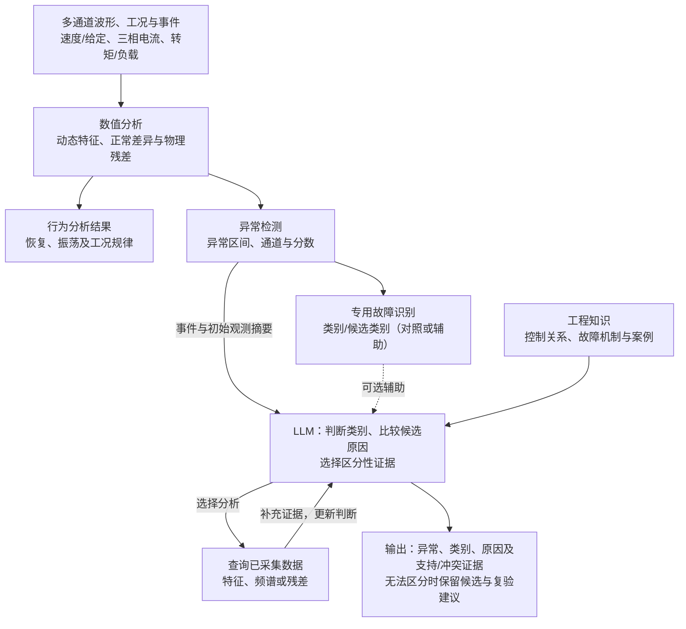

# 面向电机 HIL 的智能测试生成与数据分析

讨论稿 · 编制于 2026-11-11，修订于 2026-11-12。面向师兄、导师与工程人员，用于快速理解研究问题、LLM 的具体作用及首批工作。方法设计见[完整方案](technical-selection.md)，实现和复现细节见[参考附录](implementation-reference.md)。

## 1. 研究目标与核心任务

研究目标：**在有限测试预算内扩大有效测试覆盖，发现人工设计容易遗漏的失效；从测试数据中提取更多有用信息，刻画动态行为、发现异常、区分原因并总结工况规律。**

以永磁同步电机（PMSM）控制系统为对象，先在 Typhoon 软件闭环中比较方法，再验证向 TLE9877 控制板 HIL 的迁移。首批聚焦两个决策问题：

| 核心任务 | 典型困难 | LLM 的具体作用 |
|---|---|---|
| 任务一：智能测试生成与失效搜索 | 调速和加负载分别通过，特定幅值、间隔或次序却可能导致恢复超时或振荡 | 结合需求、物理含义和真实反馈，提出测试假设并调整下一工况 |
| 任务二：数据分析与故障诊断 | 相似速度跌落可能来自正常负载、反馈异常或执行异常 | 比较候选原因，选择有区分力的证据，随工具结果更新判断 |

数值搜索、信号处理和物理分析提供基础。研究要回答的是：LLM 在测试决策与诊断决策中，能否增加有效信息、改善效果或减少人工与总成本。

LLM 在测试之间选择和分析，控制器、仿真器及工具承担实时控制、采集与计算。两项任务具备各自输入后可以分别推进。

## 2. 任务一：智能测试生成与失效搜索

**主路线：借鉴 LLM-Falsifier，让模型提出测试、工具返回真实响应、模型继续调整。**

例如，模型提出“调速尚未完成时叠加负载可能延长恢复”，选择两事件的间隔进行验证。工具返回恢复和电流响应后，模型可以细化间隔、改变次序或转向另一组工况。需求裕度表示距离要求还有多少余量，负值表示违反需求。

混合方式由 LLM 选择值得搜索的事件模式或区域，再由数值优化器（如 Dual Annealing）细化参数。比较对象包括固定工程启发式、随机/Sobol 采样和数值优化。组合较多时，再用 PICT 帮助组织覆盖。

**重点看：在相同预算下，是否找到更多失效，或用更少测试和总成本找到失效。** 已有速度/负载实验可用于原型；正式比较再检查场景难度，依据真实需求固定问题。未发现反例时，保留结果并比较覆盖和最佳裕度；局部边界需要相邻满足与违反样本支持。

## 3. 任务二：数据分析与故障诊断

先从完整波形提取动态特征、同工况正常差异和可用物理残差，开展行为分析与异常检测；再由 LLM 结合机理知识比较原因。主路线借鉴 S2S-FDD 的信号语义组织和 TraceBench 的工具辅助分析。

首批异常检测以数值和专用时序方法为主，故障识别比较专用分类器与 LLM 的类别判断，LLM 的研究重点是原因比较和证据选择。专用分类器预测作为辅助输入时，另评价融合增益；直接让 LLM 检测波形按后续结果安排。

例如，同样是速度跌落，模型需要判断负载事件是否先发生、相电流是否出现不对称，或在独立观测可用时检查反馈一致性。每次查询都应针对候选之间的差异，返回后更新支持与冲突证据。

**任务二首批查询已经采集、尚未提供给诊断器的数据。** 现有观测不足时，输出缺失信息与复验建议；选择并执行新 HIL 实验作为后续扩展。

原型先用正常数据联调分析工具，再完成一个真实影响闭环的故障及正常对照。正式原因区分比较需有“初始症状相似、补充查询可区分”的机制，并检查观测缺失、证据冲突及确实不可辨识的情况。

传统对照既包括固定诊断流程，也包括自适应策略：根据候选机制的预期响应差异和调用成本选择下一查询。这样才能判断 LLM 是否更会选择证据，或在相当效果下减少规则建模与人工排查投入。动态行为与工况规律同时作为分析结果保留。

## 4. LLM 贡献验证与评价设计

| 要验证的贡献 | 怎样比较 | 重点观察 |
|---|---|---|
| 测试工况选择 | 用工程启发式或自适应数值策略替换 LLM，保持执行器、评分和预算一致 | 失效发现、有效覆盖及完整成本 |
| 诊断证据选择 | 用相同知识和工具的固定、自适应诊断策略替换 LLM | 原因区分、有效查询、判断更新及排查成本 |
| 知识和反馈 | 分别减少工程知识、变量语义或历史响应，再比较结果 | 收益来自哪些信息，LLM 是否有效使用它们 |

固定提供同等信息时检验判断能力；相同权限与预算下按需取证时检验选择能力。正式评价使用独立运行，场景、模型、提示和知识库事先固定，故障真值由评价器保管，计入失败调用与人工审核。

给定故障区间的分类效果与从完整波形开始的诊断效果分别检查，同时关注误报、漏检、超时和不当确定结论。充分比较后的无稳定增益结果，也能帮助保留更低成本的传统方法并明确适用范围。

## 5. 实施路径与资源安排

**先取得一份搜索实例和一份诊断实例，再根据效果完善对照与模型选择。** 原型开发和正式场景准备可以交替推进。

| 阶段 | 首批工作 | 得到什么 |
|---|---|---|
| 跑通实例 | 复用速度/负载事件、采集与分析，接一个模型；完成真实反馈和诊断更新 | 可查看的输入、运行结果、决策变化与成本 |
| 核心初比 | 检查搜索场景难度；补相似故障机制及自适应取证对照；做小批模型初筛 | 初步增益、错误和下一步投入依据 |
| 正式选型 | 固定方法与模型，完成强基线、独立测试和必要重复 | 有适用范围的推荐组合或无稳定增益结论 |

模型先按任务能力筛选，再确定部署和算力；两项任务可以分别选模型。沿用以下候选与资源规划：

| 研究角色 | 候选与参数规模 | 推理资源安排 |
|---|---|---|
| 能力参照，先择一 | Qwen3.8-27B（语言部分 27B）；或 DeepSeek-V4.1-Flash-1017 服务 | 按可用 GPU 承载条件或 API 接入条件选择，测完整任务时延与成本 |
| 主要成本候选 | Qwen3.5-9B（语言部分 9B） | 若本地运行：4-bit，暂按 24 GB 显存、64 GB 主机内存预留 |
| 较低资源对照 | Qwen3.5-4B（语言部分 4B） | 若本地运行：4-bit，暂按 12—16 GB 显存、32 GB 主机内存预留 |
| 跨家族复核 | Gemma 4 12B IT（11.95B） | 关键结果形成后按需接入，资源依据实际负载测量 |

4B/9B 的资源预留针对单模型、并发 1、短文本输入约 6K token 以内、总序列约 8K token 的负载。以上是候选与规划值，任务效果、峰值资源和完整任务时延由实测确定；样例初筛后再做完整搜索和诊断比较。筛选依据见[完整方案 §5](technical-selection.md#5-模型选型部署与训练适配)，资源细节见[附录 C.3](implementation-reference.md#c3-部署与资源预留)。

工作量按两项任务汇总，包含各自的原型与核心初步比较：

| 工作范围 | 主要模块 | 工作量初估 |
|---|---|---|
| 任务一：测试生成与失效搜索 | 提案与反馈、混合搜索、策略与信息作用比较、局部复验 | 10—17 人日 |
| 任务二：数据分析与故障诊断 | 特征与检测、故障及观测准备、知识诊断、工具调用与自适应对照 | 23—39 人日 |
| 共用准备与首个模型接入 | 需求/评分和信号核对、必要记录关联、首个模型调用 | 4—6 人日 |
| 多模型初筛增量 | 共用审核样例、模型适配、调用与错误复核 | 5—13 人日 |
| 合计 | 两项任务、共用准备与多模型初筛，共用工作计一次 | **42—75 人日** |

合计约单人全职等效 **9—15 个工作周**。正式独立验证、额外场景/环境开发和外部等待另计，用首周、首个故障和首次多模型运行校准；详细拆分见[附录 C.5](implementation-reference.md#c5-工作量拆分与后续扩展)。需要协调的是需求与允许操作、故障路径和必要观测、一个可用模型的推理资源。

新需求适配、特征与规律发现，以及主动复验、直接时序/图像理解和训练适配，在核心结果基础上另行安排。实体迁移在“LIN 指令 → 控制板 → 六路栅极驱动 → HIL 模型 → 采样反馈 → 控制板”的正常闭环和采集条件齐备后开展，软件与实体结果分别评价。
