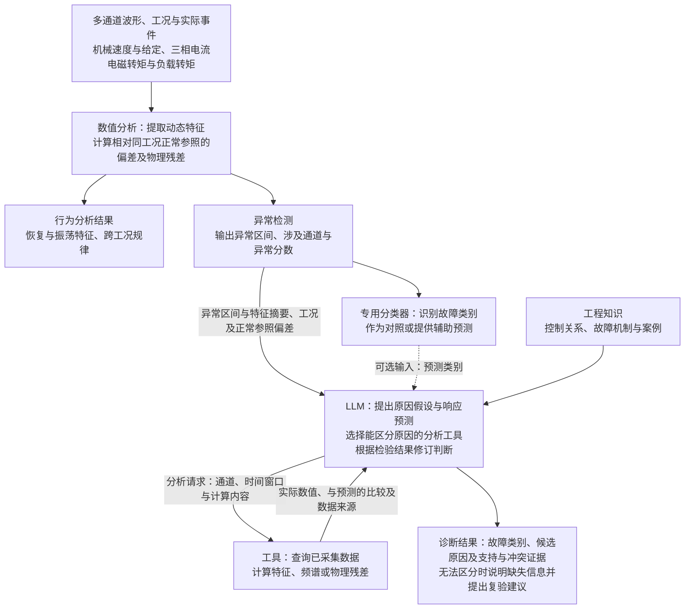

# 面向电机 HIL 的智能测试生成与数据分析

讨论稿 · 编制于 2026-11-11，修订于 2026-11-13。面向师兄、导师与工程人员，用于快速理解研究问题、大语言模型（LLM）的具体作用及首批工作。方法设计见[完整方案](technical-selection.md)，实现和复现细节见[参考附录](implementation-reference.md)，本轮文献依据与取舍见[大模型方法深化调研](../2026-11-13-llm-method-deepening/research-report.md)。

## 1. 研究目标与核心任务

研究目标：**在有限测试预算内扩大有效测试覆盖，发现人工设计容易遗漏的失效；从测试数据中提取更多有用信息，刻画动态行为、发现异常、区分原因并总结工况规律。**

以永磁同步电机（PMSM）控制系统为对象，先在 Typhoon 的电机控制闭环仿真中比较方法，再验证向 TLE9877 控制板 HIL 的迁移。首批聚焦两个决策问题：

| 核心任务 | 典型困难 | LLM 的具体作用 |
|---|---|---|
| 任务一：智能测试生成与失效搜索 | 调速和加负载分别通过，特定幅值、间隔或次序却可能导致恢复超时或振荡 | 结合需求、物理含义和真实反馈，提出测试假设并调整下一工况 |
| 任务二：数据分析与故障诊断 | 相似速度跌落可能来自正常负载、反馈异常或执行异常 | 比较候选原因，选择有区分力的证据，随工具结果更新判断 |

在测试生成中，LLM 根据需求与历史响应选择下一轮工况，工具负责校验、执行和评分；在故障诊断中，信号处理与物理分析提供观测证据，LLM 据此比较候选原因，并选择进一步的分析工具。通过与传统搜索和诊断策略对照，评价 LLM 是否提高失效发现与原因区分的效果，以及能否降低人工投入和总成本。两项任务的关系如下图所示。

这里的“失效”指违反已定义的功能或性能要求；“反例”指使该要求不成立的测试工况及其运行结果。“电机控制闭环”指控制器、电机与反馈构成的控制关系；LLM 参与的测试反馈和诊断更新分别构成迭代循环。

工况生成需要明确性能要求、允许操作和变量关系，原因诊断需要了解控制结构、故障机制及其可能引起的响应。因此，两项任务需要将相关工程资料整理为可供 LLM 使用的测试约束和机理知识，具体资料、用途及提供方如下。

| 所需资料 | 用途 | 提供或确认方 |
|---|---|---|
| 性能需求、允许操作、正常范围和保护逻辑 | 定义测试目标、合法工况和判断依据 | 测试与控制负责人 |
| 仿真模型接口、信号表、单位及采样条件 | 连接测试提案、执行配置和数据分析 | 仿真建模/平台负责人 |
| 控制框图、相关原理图、反馈/执行路径、参数及正常样本 | 建立变量关系、正常参照和物理残差 | 固件/硬件及建模人员 |
| 已知故障、维修案例与专家经验 | 整理“机制—症状—区分证据”条目 | 测试/维修工程师，研究侧整理核验 |

研究侧将上述资料整理为测试规约（测试目标、允许操作与判定规则）、信号说明和故障机理条目，经相关工程人员确认后，用于工况生成与诊断分析。物理残差指将观测量代入物理关系后得到的偏差，例如机械转矩平衡关系的偏差，其正常范围由正常运行数据标定。

## 2. 任务一：智能测试生成与失效搜索

**主路线：把失效发现转化为工况搜索，以性能指标距限值的余量作为评分，由 LLM 结合变量含义与历史响应选择下一轮工况。**

[LLM-Falsifier](https://arxiv.org/html/2609.20752v1)将寻找违反要求的系统行为转化为一个优化问题：LLM 根据测试要求、输入范围及历次“测试输入—仿真结果—评分”记录生成下一组输入，仿真器执行后，由监测程序计算 STL（信号时序逻辑）鲁棒度。该评分量化信号满足或违反时序逻辑要求的程度，搜索以降低评分、找到负值对应的反例为目标。方法还向 LLM 提供变量的物理名称、输出随时间的变化，以及决定评分的关键时刻，帮助它根据工况与响应的关系调整搜索方向。

[LLAMBO（ICLR 2024）](https://proceedings.iclr.cc/paper_files/paper/2024/hash/84b8d9fcb4e262fcd429544697e1e720-Abstract-Conference.html)进一步把 LLM 的作用拆到搜索的具体环节：**先从哪里试、下一步提出哪些候选、怎样预测候选表现。** 本方案先研究初始工况与后续候选的选择，分别替换这些环节，检查工程语义和历史响应究竟在哪里带来收益。

本方案将这套机制用于电机测试：工程人员先确定性能要求、允许操作和参数范围；LLM 结合变量含义、相关机理知识及历史结果，提出可能导致性能退化的测试假设，并选定速度给定、负载幅值、事件次序和间隔。工具负责校验提案、执行 Typhoon 仿真，并返回评分及恢复、振荡、电流等响应特征。LLM 据此判断原假设是否得到支持，再决定细化某一参数、改变事件次序或探索另一组工况。首批采用下文定义的恢复时间余量评分，研究重点是这一选点过程能否比人工启发式、随机采样和数值搜索更有效地发现失效。

工具计算性能指标及其与限值的差值，作为下一轮选点的依据。以速度恢复为例，本文定义**恢复时间余量 = 允许恢复时间 − 实际恢复时间**。要求不超过 100 ms 时，80 ms 的实际恢复时间对应 +20 ms 余量，120 ms 对应 −20 ms，表示超时；零值表示恰好达到限值且满足要求。搜索目标是找到余量更小、甚至为负的工况，结果报告本轮有效测试中的最小余量。不同指标分别约定单位、差值方向和判定规则。

例如，针对“调速尚未完成时叠加负载可能延长恢复”的假设，LLM 可先选择一组事件间隔。如果实际反馈显示恢复变慢、余量减小，它可进一步选择邻近间隔检查这一趋势；如果响应未支持假设，则结合实际事件与电流变化调整假设或转向其他组合。这是待验证的决策过程，具体选点及其收益由真实运行记录和对照实验评价。各环节的输入与输出如下。

| 环节 | 具体输入 → 输出 |
|---|---|
| LLM 决策 | 需求、速度/负载范围、工程知识及历史响应 → 测试假设、事件次序/时刻、速度给定（rpm）与负载转矩（N·m） |
| 工具执行与反馈 | 经范围、时间网格和窗口校验的提案 → 实际事件、波形、指标距限值的余量、恢复与电流特征；错误返回具体原因 |
| 搜索交付 | 历次真实结果 → 反例或预算内未发现、模式、覆盖、本轮最小余量及成本 |

具体比较分两步：先固定后续数值搜索，比较 LLM、工程启发式与随机/Sobol 生成的同等数量初始点；再比较 LLM 直接选下一工况，以及 LLM 选择事件模式或参数区域、数值优化器（如 Dual Annealing）细化连续参数的混合方式。各组匹配总预算，并分别检查仅反馈评分、增加响应特征和关键时刻的影响。候选优劣由真实执行评分判断；若后续让 LLM 预测评分与不确定性，再单独验证预测准确性和选点收益。离散因素组合较多时，使用 PICT 组织组合覆盖。

评价重点是在相同预算下发现更多失效，或以更少测试和总成本发现失效。预算内未发现反例时，报告工况组合、事件次序与预先划分的参数区域覆盖，以及本轮最小余量。覆盖比例按已完成有效测试的不同组合、次序或区域数量计算，重复测试不增加相应覆盖数，分母和划分方式在比较前固定；获得相邻的满足与违反样本后，再进一步刻画局部失效边界。

## 3. 任务二：数据分析与故障诊断

任务二以动态行为分析和异常检测为基础，当前重点研究 LLM 在故障原因区分与自适应证据选择中的作用。基于已有特征的跨工况比较和规律总结同步开展，LLM 辅助的新特征与规律发现作为后续扩展。

当前数据来自 100 kSa/s、0.8 s 的七通道记录，包括机械速度与给定（rad/s）、Ia/Ib/Ic（A）、电磁转矩与负载（N·m），以及采样时间、实际事件和配置。分析工具从完整波形中提取动态特征、相对同工况正常参照的偏差及可用物理残差，形成行为分析结果和异常事件，再将相关摘要交给 LLM 比较候选原因。

**主路线：让 LLM 把候选原因写成可检验的响应预测，由工具检查预测与观测是否相符，再根据证据修订判断和下一步分析。**

[BoxLM（ICML 2024）](https://proceedings.mlr.press/v235/li24v.html)的核心是**把 LLM 提出的解释变成能用数据检验的模型，再依据检验结果改进解释**。原方法让 LLM 生成概率程序，由数值工具拟合、评价，并把预测偏差反馈给 LLM。本方案先在工程确认的候选机制内采用这一假设检验方式：明确每种原因预期出现什么响应、什么观测会与它冲突，再调用已有分析工具检查。

[S2S-FDD](https://arxiv.org/html/2603.08048v1)用于组织“信号发生了什么变化”，将趋势、正常偏差和测点含义交给 LLM；[TraceBench](https://arxiv.org/html/2608.27182v1)用于评测设计，帮助检查给定观测是否足以区分原因，以及背景知识和工具条件怎样影响结果。

具体实施时，初始摘要保留工况、异常区间、测点含义、数值、单位及正常参照偏差。LLM 在读取补充结果前给出候选原因的响应预测，并选择有助于区分它们的通道、窗口和工具。工具返回数值及比较结果后，LLM 更新支持与冲突证据，决定继续查询或输出诊断。研究重点是显式预测与反馈修订能否改善原因区分，并减少无效查询和人工排查投入。整体流程如下。

在这一流程中，异常检测以数值和专用时序方法为主，故障识别比较专用分类器与 LLM 的类别判断，原因分析重点比较候选机制及其区分证据。专用分类器预测作为 LLM 的辅助输入时，单独评价融合增益；直接利用 LLM 检测波形的路线根据后续结果安排。

例如，针对速度跌落，LLM 提出“正常负载响应”假设，并预测跌落应发生在实际负载变化之后，幅值和恢复应处于同工况正常范围。工具检查这些预测；若仍有超出正常范围的偏差，LLM 继续检查反馈偏置或执行通道异常，依据实际结构提出独立速度与反馈差异、电流或执行状态的预测。正常范围由开发数据标定，缺少对应观测时保留未决候选；单项预测相符仍需检查其他原因能否产生相同现象。

首批补充查询面向已采集但尚未提供给诊断器的数据。当前尚缺 dq 电流、保护/限幅状态及独立速度反馈，需根据选定机制补充。现有观测仍不足以区分原因时，保留候选集合，说明缺失信息并提出补充观测或复验建议；新增 HIL 实验的选择与执行作为后续扩展。

为检验证据选择的价值，传统对照同时包括固定诊断流程和自适应策略。后者根据候选机制的预期响应差异及调用成本选择下一查询，与 LLM 使用相同的知识、初始观测和工具权限，比较原因区分效果、有效查询次数及规则建模与人工排查投入。

## 4. LLM 贡献验证与评价设计

前两节分别说明了 LLM 如何选择测试工况和诊断证据。为判断效果变化分别来自决策策略、工程知识还是响应反馈，设置以下对照。

| 验证内容 | 对照设计 | 评价重点 |
|---|---|---|
| 测试工况选择 | 用工程启发式或自适应数值策略替换 LLM，保持执行器、评分和预算一致 | 失效发现、工况组合/事件次序/参数区域覆盖及完整成本 |
| 诊断证据选择 | 用相同知识和工具的固定、自适应诊断策略替换 LLM | 原因区分、有效查询、判断更新及排查成本 |
| 假设检验与反馈修订 | 比较同一 LLM 直接诊断与先提出响应预测、再按工具结果修订；匹配知识、初始观测及预算 | 预测是否可检验、冲突后是否正确更新、原因区分及不当确定结论 |
| 知识和反馈 | 分别减少工程知识、变量语义或历史响应，再比较结果 | 收益来自哪些信息，LLM 是否有效使用它们 |

诊断评价分别考察信息利用与证据选择：向各方法固定提供同等信息，比较其判断能力；在相同初始信息、工具权限和预算下允许按需查询，比较其选择查询与分析工具的能力。正式评价使用独立运行数据，预先固定场景、LLM 版本、提示和知识库，并由评价器保管故障真值。失败调用与人工审核计入总成本。

给定故障区间的分类效果与从完整波形开始的诊断效果分别检查，同时关注误报、漏检、超时和不当确定结论。充分比较后的无稳定增益结果，也能帮助保留更低成本的传统方法并明确适用范围。

## 5. 实施路径与资源安排

实施首先复用现有电机仿真模型、速度/负载事件、采集和分析能力，接入一个可用的 LLM，分别完成搜索反馈与诊断更新实例。两项任务按各自输入条件推进：测试搜索先检查提案、执行和真实评分能否连续反馈；数据分析先用正常数据联调工具，再通过一个真实影响电机控制闭环的故障及正常对照检查诊断更新。原型开发与正式场景准备交替推进，主要阶段如下。

| 阶段 | 主要工作 | 阶段成果 |
|---|---|---|
| 跑通实例 | 复用速度/负载事件、采集与分析，接入一个 LLM；完成真实反馈和诊断更新 | 可查看的输入、运行结果、决策变化与成本 |
| 初步对比实验 | 检查搜索场景难度；补产生相似症状的不同故障机制及自适应查询与分析对照；开展 LLM 初筛 | 初步增益、错误和下一步投入依据 |
| 正式选型 | 固定方法与 LLM 版本，与经过合理配置和调优的代表性方法比较，完成独立测试和必要重复 | 有适用范围的推荐组合或无稳定增益结论 |

流程原型首先接入一个可用的 LLM，再通过任务样例与连续运行筛选后续候选。测试搜索重点检查合法提案、反馈利用和连续选点，故障诊断重点检查知识使用、工具选择和证据更新；两项任务可以分别选择 LLM。候选及推理资源规划如下。

| 研究角色 | 候选与参数规模 | 推理资源安排 |
|---|---|---|
| 能力参照，先择一 | Qwen3.8-27B（语言部分 27B）；或 DeepSeek-V4.1-Flash-1017 服务 | 按可用 GPU 承载条件或 API 接入条件选择，测完整任务时延与成本 |
| 主要成本候选 | Qwen3.5-9B（语言部分 9B） | 若本地运行：4-bit，暂按 24 GB 显存、64 GB 主机内存预留 |
| 较低资源对照 | Qwen3.5-4B（语言部分 4B） | 若本地运行：4-bit，暂按 12—16 GB 显存、32 GB 主机内存预留 |
| 跨模型家族复核 | Gemma 4 12B IT（11.95B） | 关键结果形成后按需接入，资源依据实际负载测量 |

4B/9B 的资源预留针对单个 LLM、并发 1、短文本输入约 6K token 以内、总序列约 8K token 的负载。以上是候选与规划值，任务效果、峰值资源和完整任务时延由实测确定；样例初筛后再做完整搜索和诊断比较。筛选依据见[完整方案 §5](technical-selection.md#5-模型选型部署与训练适配)，资源细节见[附录 C.3](implementation-reference.md#c3-部署与资源预留)。

工作量按两项任务汇总，包含各自的原型与核心初步比较：

| 工作范围 | 模块与前置依赖 | 工作量初估 |
|---|---|---|
| 共用准备与首个 LLM 接入 | 需求/评分和信号核对、必要记录关联、首个 LLM 调用 | 4—6 人日 |
| 任务一：基本搜索 | 共用准备后，接提案、执行与真实反馈 | 5—8 人日 |
| 任务一：初步对比实验 | 基本搜索及场景预试后，比较混合策略、信息作用并作局部复验 | 5—9 人日；任务一合计 **10—17** |
| 任务二：特征与检测 | 现有正常波形支持特征、正常参照及检测工具联调 | 4—7 人日 |
| 任务二：首个故障 | 确认可修改的注入路径和观测后，做故障及正常对照 | 3—5 人日，条件性估计 |
| 任务二：知识与假设检验诊断 | 工程知识和工具就绪后，接原因预测、工具检验和反馈修订 | 6—10 人日 |
| 任务二：不同机制产生相似症状的数据 | 首个故障后补机制和区分观测，核验可辨识性 | 4—7 人日，条件性估计 |
| 任务二：初步对比实验 | 不同机制产生相似症状的数据就绪后，建立自适应对照并作分层/完整流程初比 | 6—10 人日；任务二合计 **23—39** |
| 多款 LLM 初筛增量 | 共用审核样例、LLM 适配、调用与错误复核 | 5—13 人日 |
| 合计 | 两项任务、共用准备与多款 LLM 初筛，共用工作计一次 | **42—75 人日** |

估算假定熟悉代码的人员全时投入、电机仿真模型可复用、资料与推理资源可取得、故障路径可修改，合计约单人全职等效 **9—15 个工作周**。正式独立验证、额外场景/环境开发和外部等待另计，实际日历排期按人员和依赖确定，用首周、首个故障和首次多款 LLM 运行校准。执行与仿真建模人员负责工况/故障和采集，分析人员负责评分/特征，LLM 人员负责提案/诊断和 LLM 接入，工程人员确认需求与机理；角色可由同一人承担。模块产物和分工见完整方案 §2.4、§3.4、§6。

核心流程形成初步结果后，再根据数据和效果安排新需求适配、LLM 辅助的特征与规律发现、主动复验、直接时序/图像理解及训练适配。

方法深化有三项后续候选：BoxLM/BMD 的可计算模型与实验选择、用信息增益奖励训练 LLM 的查询策略、DiagLLM 的信号与机理知识对齐。分别在模型可检验、查询奖励可信或现有摘要遗漏关键信息时启动，依据见[本轮调研](../2026-11-13-llm-method-deepening/research-report.md)。当前工时仍为受限候选、已有工具和分环节比较的初估；完整概率建模、代理评分与新增训练工作单独估算。

实体迁移需补齐板卡与固件版本、实际反馈接口和时钟信息，确认目标链路“LIN 指令 → 控制板 → 六路栅极驱动 → HIL 电机模型 → 采样反馈 → 控制板”的正常电机控制闭环及采集条件。迁移后按实际可读取信号重新校准分析与诊断方法，分别评价软件域和实体域的效果及成本。
