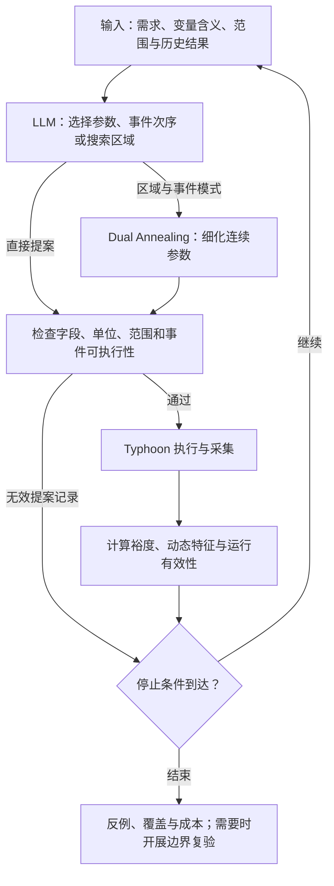
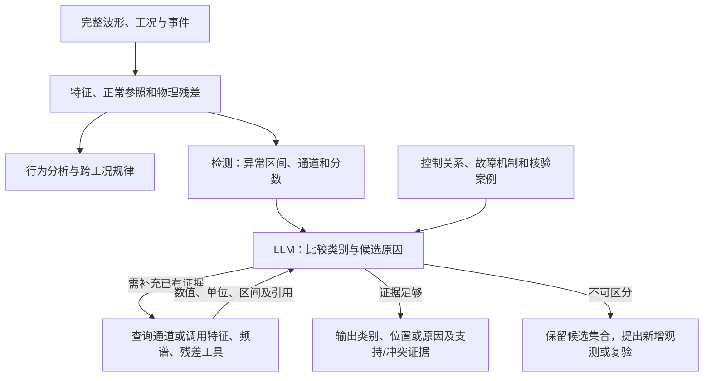

# 面向电机 HIL 的智能测试生成与数据分析

讨论稿 · 2026-11-11。用于与师兄、导师及工程人员讨论研究主线、核心实现和投入安排。模块设计、示例、方法依据和验证细节见[完整技术选型方案](technical-selection.md)。

## 1. 研究目标与整体思路

研究目标：**在有限测试预算内扩大有效测试覆盖，发现人工设计容易遗漏的系统失效；从测试数据中提取更多有用信息，刻画动态行为、发现异常、识别故障、定位原因并总结跨工况规律。**

以永磁同步电机（PMSM）控制系统为验证对象，先在 Typhoon 软件闭环中比较方法，再迁移到 TLE9877 控制板 HIL。首批用“调速与负载交互”和“相似速度跌落的不同原因”说明与验证方法，随后按需求、阶段和机制扩展。

| 任务 | 需要解决的问题 | 大模型的核心作用 | 交付结果 |
|---|---|---|---|
| 测试生成与失效边界搜索 | 大量工况中，哪些参数和事件次序更容易触发需求违反？ | 结合工程知识与历史响应选择下一工况，或选择区域交数值优化细化 | 可执行测试、反例、不同失效模式与局部边界 |
| 数据分析与故障诊断 | 波形反映了什么动态行为？相似异常如何区分原因？ | 综合信号和机理判断故障，选择补充分析，提出待验证特征、规律与复验 | 动态特征、异常区间、类别、原因集合及复验建议 |

这里的“失效”指违反已定义的功能或性能需求，例如恢复超时；“边界”需由相邻满足与违反条件的测试支持。异常检测给出偏离正常行为的区间，故障识别给出类别，原因分析进一步比较机制与作用位置。

LLM 在测试之间选择和分析，控制器、仿真器和执行工具负责实时控制、采集及数值计算。两项任务具备各自输入后可以分别推进，随后通过复验连接。

## 2. 技术路线与实现

### 2.1 任务一：大模型怎样选择测试工况

首先由工程人员确认需求、允许的速度/负载范围、事件及判据，研究侧整理成测试规约。已有配置可直接复用，自然语言需求可经模板或 LLM 转换。首批重点是根据执行反馈选择下一工况。

**主路线借鉴 LLM-Falsifier：模型提出输入，仿真计算评分，再把真实结果送回模型继续搜索。** 评分使用需求满足裕度，例如 `允许恢复时间 − 实际恢复时间`，负值表示恢复超时；同时反馈恢复、振荡、电流等响应特征和相关时刻。

| 环节 | 具体做法 | 输出 |
|---|---|---|
| 组织输入 | 固定需求与接口知识，加入历史参数、评分和响应；首批可保留最近十次记录 | 大模型可读取的测试问题与反馈 |
| 提出工况 | LLM 输出事件和参数，并说明依据哪些历史响应作选择 | 可校验的结构化提案 |
| 混合细化 | LLM 选择事件模式、参数上下界；优化器在给定额度内运行并返回真实最优点 | 连续参数、最佳裕度和全部执行记录 |
| 更新搜索 | 根据实际评分改变参数、次序或区域；预算和停止规则由程序控制 | 下一提案或本轮搜索结果 |

例如，调速之后加负载出现恢复裕度接近零，模型可提出改变事件间隔，以检验两者叠加的影响；混合方式让优化器在该间隔范围内细化。找到反例后，可再验证附近哪些条件满足需求，形成声明范围内的局部边界。

比较方法包括人工设计（固定工程启发式）、随机/Sobol 采样、Dual Annealing 数值搜索，以及 LLM 直接搜索和混合搜索。离散因素较多时使用 PICT 组织合法组合。**重点检验语义与响应反馈是否帮助发现额外失效，或减少发现所需的测试和总成本。**

### 2.2 任务二：大模型怎样读取证据并诊断

任务二先提取动态行为并检测异常，再做故障识别和原因分析。首批主路线采用“数值分析/检测＋知识与工具辅助的 LLM 诊断”，直接 LLM 检测作为独立候选比较。

当前软件预演可提供速度、速度给定、三相电流、电磁转矩、负载及事件记录。程序计算恢复时间、振荡、电流不平衡、同工况正常偏差和可用物理残差，将其连同单位、窗口、工况与引用交给模型。dq 电流、限幅/保护状态和独立反馈观测按诊断问题补充。

**主路线借鉴 S2S-FDD 的信号语义与知识组织，以及 TraceBench 的工具辅助分析。** 大模型先比较候选原因，再选择能够区分它们的查询，由工具返回真实数值。

诊断内部依次完成：组织观测事实 → 检索适用知识 → 建立候选及区分证据 → 调用分析工具 → 更新判断。每次调用明确通道、时间区间和计算参数；数据不足或预算到达时输出未决项。查询已有数据与新增实验分别记录。

例如，速度跌落可能来自正常负载变化、反馈偏置或执行异常。LLM 先结合负载事件和电流响应比较解释，随后根据可用观测检查反馈一致性或执行状态。首批将原因定位到有限机制和作用通道，更多根因深度由观测与复验支持。

| 分析环节 | 具体候选 | 作用与比较重点 |
|---|---|---|
| 行为分析 | 时域/时频特征、条件化正常参照、物理残差 | 提取反转、振荡、恢复及跨通道关系，分析工况规律 |
| 异常检测 | 条件化统计检测、IForest、TimeRCD | 检查短异常、持续异常和正常切换误报 |
| 故障识别 | 物理特征分类器、MiniRocket、MantisV2 冻结表示＋分类头 | 比较工程特征、时序形状和预训练表示 |
| 原因分析 | 残差响应模式、知识与工具辅助的 LLM | 检验相似症状区分、补充信息选择与定位 |

同时保留分析发现：参考 Argos，让 LLM 在开发数据中提出并修订特征或规则，冻结后用独立运行验证其价值。直接序列/图像理解参考 LLM-TSAD 或 VLM4TS，按问题选一个小试点。**重点是从数据中取得更多有效信息，并验证其对分析和诊断的实际贡献。**

### 2.3 工程知识与协作资料

| 需要的资料 | 形成的内容 | 对两项任务的用途 |
|---|---|---|
| 需求、阈值、正常范围和保护条件 | 测试规约及合法动作 | 定义搜索目标，区分正常瞬态与需求违反 |
| 模型接口、测点、单位、采样与时间信息 | 信号和工具字典 | 执行工况、计算特征及关联事件 |
| 控制框图、反馈/执行路径、电机参数 | 物理关系和机制条目 | 构造参照、残差及候选原因 |
| 已知故障、维修经验、正常/异常样本 | 机制—症状—区分证据—复验动作 | 知识检索与可辨识性验证 |

合作方和工程负责人确认物理含义、范围与版本，研究侧整理规约、知识库和工具。每条知识保留适用条件及来源；诊断输入保留可用观测，当前测试隐藏的故障真值用于评价。

### 2.4 本地模型与算力选择

前述路线明确了模型的职责：任务一需要理解需求与事件关系、利用反馈调整工况；任务二需要结合机理比较原因、选择工具并根据新证据更新判断；分析发现需要提出可验证的特征或规则。先据此确定输入模态、上下文长度、调用轮数、效果与时延要求，再用代表性样例筛选模型，最后选择部署方式和算力。两项任务可以选用不同模型。

候选按任务能力覆盖不同规模，必要时加入更强模型作为参照，再比较效果与成本。结合数据使用条件、网络、复现及资源要求，选择外部模型服务、内网服务或本地运行。下表列出已有资料中的本地部署候选，供该分支试测与估算资源。

| 模型候选 | 参数规模与位置 | 本地试测资源估算 |
|---|---|---|
| Qwen3.5-9B | 语言部分 9B，本地部署分支的候选 | 4-bit 短文本推理，单卡 24 GB 显存、64 GB 主机内存 |
| Qwen3.5-4B | 语言部分 4B，较低资源下的能力与成本对照 | 4-bit 短文本推理，12—16 GB 显存、32 GB 主机内存 |
| Qwen3-8B | 8.2B，文本与部署参照 | 4-bit 预留 12—16 GB；BF16 预留 24 GB 显存 |
| Phi-4-mini-instruct | 3.8B，关键结论的跨家族复核候选 | BF16 预留 16 GB 显存、32 GB 主机内存 |

模型需求、规格与官方来源见[完整方案 §6](technical-selection.md#6-模型选型部署方式与训练适配)。Qwen3.5 的规模为语言部分，整包还包含视觉组件。表中资源是在选择对应本地候选后的规划预留，按并发 1、输入约 6K、总序列约 8K token 的示例负载估计，尚未实测；实际负载由任务样例确定，复杂思考、视觉及长上下文另测。非思考与思考设置分别评价，保留输出截断和未完成记录。

比较合法提案、有效分析调用、诊断与搜索收益、完整任务耗时和费用；自部署时增加显存、内存与维护投入。先测原有权重配合提示、知识与工具，再根据错误分析比较更强模型、输入调整和 LoRA/QLoRA 适配。若开展文本 QLoRA，4B 先预留 24 GB、8—9B 预留 24—48 GB 显存，并核验结构和训练库兼容性；时序—语言对齐、蒸馏和规则生成按表示需求与成本收益决定。

## 3. 评价与选型依据

| 方面 | 如何比较 |
|---|---|
| 任务一 | 人工/数值方法、LLM、混合方式在相同执行次数及相同总时间/费用下，比较失效发现率、首次发现成本、不同模式和覆盖 |
| 任务二 | 比较专用方法、同特征 LLM、加知识、加工具；分别检验检测、分类/定位、完整流程及跨工况表现 |
| 信息贡献 | 同信息对照检验判别能力；知识与工具的额外收益，与规则/案例检索和固定提供同等信息的方式比较 |
| 采用条件 | 独立数据上取得有效增益，或相当效果下减少标签、人工、实验与运行成本，并检查关键故障及最差工况 |

端到端检出并正确识别率为“规定时限内检出且正确识别的已知故障事件数／全部真实已知故障事件数”，漏检、错分类和超时均留在分母；未知机制另报检出与拒识。行为规律用独立运行与未见工况检查，训练、提示、知识和阈值按完整运行分组，避免测试信息进入开发过程。

先用合理基线与核心候选开展小规模试验，再完善强基线、独立测试和必要消融。充分比较后的无稳定增益结论、失败边界和更低成本组合也属于选型成果。

## 4. 实施路径、周期与预期成果

复用现有速度/负载事件、七通道采集和结果记录，补充搜索、分析工具、故障注入、知识及模型调用接口。下面为一名熟悉代码的开发者全时投入、软件模型可复用、资料与所需模型服务或算力可取得时的工作量初估。

| 阶段/任务 | 工作模块 | 工作量初估 | 阶段交付 |
|---|---|---|---|
| 共用准备 | 规约、信号/知识、模型需求与候选试测、采集核验 | 3—5 人日 | 可用输入与一轮调用 |
| 任务一 | 提案校验、执行反馈和基本搜索 | 5—8 人日 | LLM 与基线可重复运行 |
| 任务一 | 混合搜索、局部复验和初步比较 | 4—6 人日 | 预算、边界样例及初步效果 |
| 任务二 | 特征、正常参照与检测 | 4—7 人日 | 可核对的分析与事件对象 |
| 任务二 | 两类闭环故障与区分观测扩展 | 5—8 人日 | 注入、真值与可辨识性记录 |
| 任务二 | 知识诊断与工具调用 | 6—10 人日 | 诊断循环及未决出口 |
| 任务二 | 分层和完整流程试测 | 4—7 人日 | 分类/定位、端到端与错误分析 |
| 首轮合计 | 两条原型及初步比较 | 31—51 人日 | 一人约 7—11 个工作周 |

正式独立验证与选型另估 10—20 人日。一个文本适配试点另估 8—15 人日，主动复验问题另估 5—10 人日；实体正常闭环及采集验收后，方法迁移另估 10—20 人日，硬件/固件整改和外部等待单列。首周试做后修正估计，具备输入的模块可并行分工。

预期形成可运行的失效搜索与诊断方法、基准数据、动态行为和跨工况规律、性能与成本对照、失败案例，以及模型选择依据、接入配置、知识版本、实测成本与部署说明；采用自部署或训练适配时补充权重版本和实测资源。实体迁移沿“LIN 指令—控制板—六路栅极驱动—HIL 模型—采样反馈”完成正常闭环准备后开展，软件域与实体域分别评价。

本轮讨论重点是首批需求与诊断机制、工程资料和观测的可获得性，以及模型能力需求、可用服务或算力和人员投入；这些条件确定后，优先形成每项任务一个可复核的完整实例。
