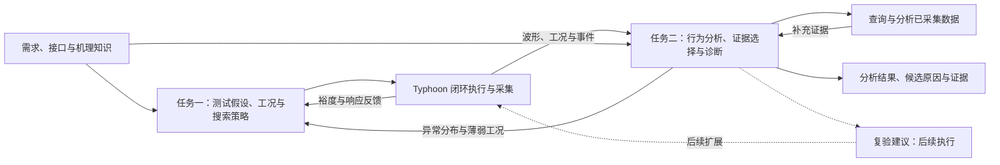
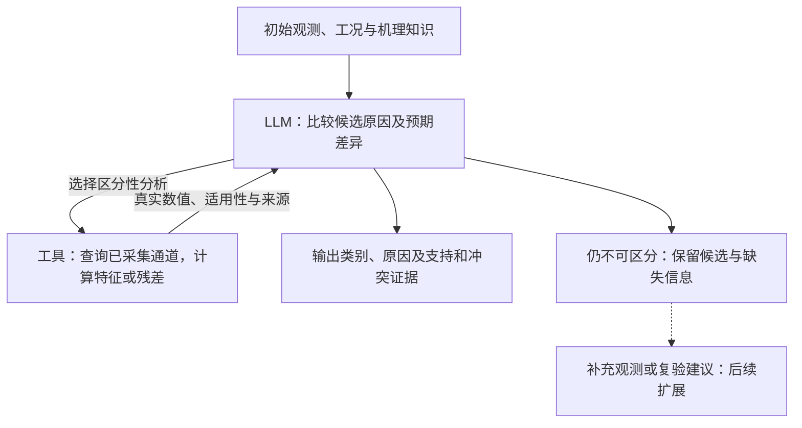

# 面向电机 HIL 的智能测试生成与数据分析：技术选型方案

编制日期：2026-11-11；最近修订：2026-11-12。本文面向具有控制与测试基础的研究人员，用于评审研究路线、开展原型和安排方法比较。[讨论稿](discussion-brief.md)用于快速交流；[工程与实验参考附录](implementation-reference.md)供实现和复现时按需查阅。方法证据见[LLM 专题调研](../2026-11-09-llm-core-methods/research-report.md)，前期讨论见[讨论梳理](../2026-11-09-hil-ai-selection/discussion-review-2026-11-11.md)。

## 1. 研究目标与总体思路

### 1.1 两项任务与研究问题

研究目标：**在有限测试预算内扩大有效测试覆盖，发现人工设计容易遗漏的系统失效；从测试数据中提取更多有用信息，刻画动态行为、发现异常、识别故障、定位原因并总结跨工况规律。**

以永磁同步电机（PMSM）控制系统为验证对象，先在 Typhoon 电机软件闭环中研究方法，再验证向 TLE9877 控制板 HIL 的迁移。启动、调速、负载扰动、零速响应及反馈和执行异常构成问题范围，首批从调速与负载交互、相似速度跌落诊断切入。

| 核心任务 | LLM 作出的决策 | 研究问题 | 希望得到的结果 |
|---|---|---|---|
| 任务一：智能测试生成与失效搜索 | 结合需求、变量含义和历史响应，选择下一工况、事件模式或搜索区域 | 语义与响应反馈能否改善测试决策，提高失效发现效率或有效覆盖？ | 可执行测试、需求违反条件、不同失效模式及局部边界 |
| 任务二：数据分析与故障诊断 | 结合机理知识比较候选原因，选择区分性证据，并根据工具结果更新判断 | 自适应证据选择能否改善原因区分，或减少分析与人工排查成本？ | 动态特征、异常区间、故障类别、原因集合及支持和冲突证据 |

任务一主要借鉴 LLM-Falsifier 的反馈搜索；任务二主要借鉴 S2S-FDD 的信号语义组织和 TraceBench 的工具辅助分析。数值搜索、信号处理和物理分析既提供执行基础，也是检验 LLM 增量价值的对照。

首批聚焦测试工况选择与诊断证据选择。**新需求适配、特征与规律发现作为辅助研究**；基础动态特征、正常参照和异常检测随核心任务准备。诊断阶段的主动复验、直接时序/图像理解、领域训练和蒸馏按后续结果安排。

### 1.2 实施原则

实施以最小流程、真实反馈和核心对照为主线：

1. **先取得两个真实实例。** 用一个可用模型完成“提案—执行—反馈”和“观测—查询—诊断更新”，根据运行结果决定下一步改进。
2. **复用已有能力。** 优先使用现有 Typhoon 模型、执行入口、采集与分析脚本；新增能力围绕当前问题采用简单函数或文件交换，重复使用后再整理公共接口。
3. **分开推进原型与正式比较。** 接口、激励和结果可核验后即可联调。场景难度、相似机制数据和强基线在后续比较中逐步完善，研究效果由满足相应条件的实验判断。
4. **按用途使用实现参考。** 公平对照、统一判据、真值隔离、真实成本和执行范围关系到结论可信度；字段、文件组织、历史窗口、工具轮数及缓存方式可随实现调整。附录中的示例与候选实现用于起步，采用更简单且满足研究目的的方式时，记录影响实验解释的变化即可。

两项任务具备各自输入后可以分别推进。当前只实现正在验证的问题所需能力，后续扩展由错误、数据和成本证据触发。

### 1.3 总体流程与任务衔接

**任务二首批的补充查询面向已经采集、尚未提供给诊断器的数据。** 现有数据不足时，输出候选集合和补充观测或复验建议；新增 HIL 实验的选择与执行在后续单独研究。任务一则持续执行新工况，以发现需求违反为目标。

这里的“失效”指违反已定义的功能或性能需求；“异常”指结合工况偏离正常行为；原因诊断进一步比较机制与作用位置。例如正常负载阶跃也会造成速度下降，恢复是否超时与是否存在故障分别判断。局部失效边界由相邻满足和违反条件的样本及复验支持。

## 2. 任务一：智能测试生成与失效边界搜索

### 2.1 测试问题与反馈搜索

先选一项含义和判据明确的需求，例如调速与负载扰动后的速度恢复。工程人员确认允许操作、参数范围和阈值来源，研究侧复用已有配置，形成模型可读取的测试问题。测试点可表示为“事件模式＋连续参数”，如调速后加负载，以及目标速度、负载幅值和事件间隔。

LLM 利用需求含义、变量的物理关系和历史响应提出测试假设，工具执行并计算真实结果，再由 LLM 调整下一选择：

评分用需求满足裕度表达，例如“允许恢复时间 − 实际恢复时间”，负值表示恢复超时。工具还可反馈速度跌落、振荡、电流响应和相关时刻，帮助模型判断原假设是否得到支持。各方法共用评分器；恢复定义与截尾处理见[附录 A](implementation-reference.md#a-评分数据与实验口径)。

例如，模型可提出“调速尚未完成时叠加负载可能延长恢复”，选择事件间隔进行验证，再依据实际响应细化间隔或改变次序。这是决策机制示意，具体收益由连续执行和对照实验确定。

### 2.2 搜索方法与混合策略

| 方法 | 输入与机制 | 主要回答的问题 |
|---|---|---|
| 工程启发式与数值搜索 | 固定工程启发式、随机、Sobol、Dual Annealing，各自报告 | 已有经验与数值搜索能达到什么效果？ |
| LLM 反馈搜索 | 需求与变量语义、历史参数和裕度 → 下一工况 | 语义反馈搜索是否有增益？ |
| 响应信息增强搜索 | 在 LLM 反馈搜索中增加动态特征、压缩响应和关键时刻 | 更丰富的响应是否改善选择？ |
| LLM 与数值混合搜索 | LLM 选择事件模式和区域，Dual Annealing 细化连续参数 | 语义探索与数值优化是否互补？ |

原型先选适合当前空间的一项工程启发式或数值搜索方法，与 LLM 反馈搜索或响应信息增强搜索跑通反馈循环。研究混合方式时，再加入 LLM 与数值混合搜索：外层根据历史选择模式或参数子域，内层优化后返回真实最优点及响应，外层据此继续调整。

解释 LLM 与数值混合搜索的收益时，用工程启发式、固定分配或自适应数值策略替换外层，保持内层优化器、可用信息和总预算一致。同时比较独立优化器，观察完整系统成本。单次仿真昂贵且代理建模有价值时，再考虑贝叶斯优化。

离散因素较多时用 PICT 组织合法组合，少因素可全枚举；参数组合、事件次序与连续边界分别评价。多时序规格确有统一管理需要时，再接入 PSY-TaLiRo。

### 2.3 场景预试与原型验证

现有 PMSM 速度/负载事件、波形和分析记录可支撑搜索原型。已有实验的所测点尚未出现恢复超时，后续用小规模预试检查裕度变化、简单基线成功率、首次发现成本和重复性，选择有区分度的正式问题。当前能力与实测依据见[附录 A.1](implementation-reference.md#a1-当前基础与观测范围)。

预试用于开发问题与校准预算。正式比较依据真实需求预先确定场景，保留选择依据和不同难度的问题。未发现反例时，报告覆盖、最佳裕度和预算内未发现结果；已有相邻满足/违反样本后，再评价局部边界。

局部边界刻画时，固定事件模式和其余参数，选定一维参数切片，通过区间收缩或局部加密搜索定位满足与违反条件之间的过渡区间，并复验邻近样本。有单调性依据的切片可用二分收缩；非单调响应采用分段采样或局部搜索，分别记录发现的各个过渡区间，结果适用于该切片与已测分辨率。

## 3. 任务二：动态分析、异常检测与故障诊断

### 3.1 动态分析与诊断输入

原始多通道波形进入分析工具，形成有单位和时间范围的动态特征、正常参照差异及可用物理残差。先用这些信息描述行为、发现异常，再向 LLM 提供初始观测和适用机理知识。LLM 比较候选原因，决定下一项分析，工具负责数值计算。

| 分析环节 | 优先方法与候选 | 用途 |
|---|---|---|
| 行为分析 | 时域特征、STFT/小波、按工况建立的正常参照、物理残差 | 提取反转、振荡、恢复退化及跨通道关系，分析工况规律 |
| 异常检测 | 条件化统计检测、Isolation Forest（IForest）、TimeRCD | 检查正常切换误报、短异常与持续异常 |
| 故障识别 | 物理/动态特征分类器、MiniRocket、MantisV2 冻结表示＋分类头 | 比较工程特征、时序形状和预训练表示；分类头使用本任务标签 |
| 原因分析 | 正常偏差与残差响应模式、知识与工具辅助的 LLM | 区分相似症状的机制和作用通道 |

首批从条件化统计检测和物理特征方法起步，按问题加入相关候选。正常但复杂的启动、调速和负载响应同时进入数据，检验误报与误诊。

### 3.2 诊断循环与相似症状示例

以速度跌落为例，候选解释可能包括正常负载响应、速度反馈偏置和执行通道异常。首轮给出共同症状与有限摘要，其余已采集数据通过工具查询：检查负载事件先后、相电流关系，或在独立速度/执行状态确实可读时检查反馈一致性和执行状态。模型根据支持与冲突证据保留、排除或调整候选。

这些是待验证的实验设计。先实现一个真实影响闭环的故障，形成正常对照、实际注入和观测记录，用来联调检测与诊断。正式原因区分比较再核验至少一组“初始观测相似、合法补充查询能够区分”的机制，实测补充证据的区分作用，并纳入缺失观测、证据冲突和确实不可辨识的样例。

初始证据与工具权限对各方法一致。故障标签、隐藏注入信息及未开放真值由评价器保管；模型可查询的仿真器状态预先声明。观测仍支持多个解释时，候选集合就是相应的诊断结果。

### 3.3 非 LLM 自适应取证策略

除固定诊断流程外，建立使用相同知识和工具的自适应参照：整理“候选机制—工具—预期观测”表，根据当前候选对同一查询的预测差异及调用成本选择下一工具，结果返回后用证据规则更新候选。

这样既比较最终判断，也比较谁更有效地获得区分性证据。建表、标定和工程审核的投入计入人工成本；若效果接近，LLM 是否减少这些投入也具有选型价值。具备可靠的先验、观测预测分布和噪声模型后，再研究贝叶斯更新或预期信息增益。

## 4. LLM 贡献验证与实验评价

### 4.1 贡献分离与对照设计

测试搜索方法的比较见 §2。故障诊断按下表区分相同信息的判断、知识增加及按需取证的作用：

| 方法 | 输入与机制 | 比较目的 |
|---|---|---|
| 专用方法与传统诊断策略 | 相关专用方法，以及使用相同知识和工具的固定/自适应诊断策略 | 建立检测分类与原因分析的非 LLM 参照 |
| LLM 特征诊断 | 与特征基线相同的特征和工况交给 LLM | 检验相同信息的利用能力 |
| 知识增强诊断 | 在 LLM 特征诊断中加入正常参照、控制关系与故障机制 | 与相同知识的规则/案例检索比较，区分知识与模型贡献 |
| 工具辅助诊断 | 在知识增强诊断中加入按需分析工具 | 与相同权限的固定/自适应策略比较证据选择，再用固定提供同等信息的方式检查判断能力 |

测试搜索分别比较知识、语义与反馈的作用：无历史、参数/裕度反馈、增加动态响应；额外工程知识有/无；完整变量语义与语义遮蔽。语义遮蔽保持实际变量映射、执行校验和评分一致，仅改变提供给模型的名称与说明，具体做法见[附录 A.4](implementation-reference.md#a4-贡献验证的具体口径)。结果用于解释显式输入的作用。

首批按研究主张选择有限组合，逐步补齐相关强基线。融合专用模型预测时，同时比较简单规则融合和最强单组件。新需求适配、特征与规律发现和跨家族复核另列范围和投入。

### 4.2 数据划分与公平比较

- **统一问题与判据。** 各方法使用相同需求、合法测试空间和评分。阈值依据需求在运行前确认，场景调整保留依据。
- **分开开发与正式评价。** 按完整运行、配置族、工况和机制分组后再切窗。预试用于开发；正式评测前固定场景、方法与模型版本、提示、知识库、预算和评价规则，保留全部预定场景的结果。
- **隔离测试真值。** 正常参照、阈值和知识条目从训练/开发资料获得，测试标签与隐藏真值留给评价器。外部时间轴依据时钟或触发证据关联。
- **匹配信息条件。** 固定信息对照使用相同观测；自适应取证对照使用相同初始证据、权限和预算，允许取得不同证据，并计算获取成本。
- **保留真实成本与未决情况。** 初始化、无效提案、重复、失败、模型调用和人工审核均进入相应成本。执行或数据错误与需求违反分开，未知与不可辨识情况按其证据报告。

### 4.3 评价指标与采用依据

| 评价对象 | 主要看什么 |
|---|---|
| 测试搜索 | 同执行次数、同总时间/费用下的失效发现率、首次发现成本、不同模式数、最佳裕度和有效覆盖 |
| 动态分析与检测 | 特征及规律的重复性、未见工况表现、正常运行误报、事件召回与延迟 |
| 故障诊断 | 原因区分、分类/定位、证据更新正确性、有效分析次数、未决与不当确定比例、人工排查时间 |
| 完整流程 | 从原始波形开始的检出并正确识别率、误报、总延迟及全部成本 |

给定真实故障区间的分类效果与完整流程效果分别报告。正式预算、重复次数及有实际意义的收益门槛根据预试和应用要求确定，用独立运行或配置族给出不确定性，并检查关键故障与最差工况。指标分母和计费细节见[附录 A.5](implementation-reference.md#a5-指标与成本明细)。

采用依据是独立数据中的有效增益，或相当效果下标签、人工、实验和运行成本的降低。机理知识有用而 LLM 没有额外收益时，可保留相应规则或专用方法；充分比较后的无稳定增益结论和适用边界同样属于选型成果。

## 5. 模型选型、部署与训练适配

### 5.1 模型能力需求与候选选择

先按测试搜索的反馈决策、故障诊断的证据综合与工具选择确定模型能力，再通过样例和完整任务测量效果、输入长度、调用轮数及成本，最后选择部署与算力。两项任务可以采用不同模型。

| 研究角色 | 沿用候选 | 选择理由与要验证的问题 |
|---|---|---|
| 能力参照，先择一 | Qwen3.8-27B；或 DeepSeek-V4.1-Flash-1017 服务 | 检查较高能力是否改善反馈决策和证据更新，帮助判断方法潜力 |
| 主要成本候选 | Qwen3.5-9B | 检查能否以较低成本保留任务效果 |
| 较低资源对照 | Qwen3.5-4B | 检查更低资源下的实际能力变化 |
| 跨家族复核 | Gemma 4 12B IT | 关键结果形成后，检查方法结论对模型家族的依赖 |

候选名单用于组织试验。原型可先接一个现有可用模型；有初批样例后，再安排一个能力参照与一至两个成本候选初筛。官方依据、已有历史候选和资源资料见[附录 C](implementation-reference.md#c-模型资源工作量与来源)，公开基准用于初筛，最终取舍依据 HIL 任务表现。

### 5.2 模型筛选与部署选择

第一阶段用工程审核样例检查合法提案、变量与单位理解、反馈调整、候选原因更新及工具错误处理。搜索可有多个合理下一工况，诊断可有多个有效查询或未决候选集合。固定历史回放用于能力筛查。

第二阶段把候选接入连续搜索与完整诊断，测真实决策收益和总成本。先固定模型比较方法，再固定方法比较模型，关键结论按需跨模型复核。研究模型用于检验方法与能力限制；部署模型在实际用途明确后确定效果、可靠性、时延与成本门槛，用独立数据验收后再比较费用和维护。

部署可选择外部服务、内网服务或本地运行，取决于任务效果、数据使用条件、网络和算力。服务调用追踪日期及可取得的版本信息，自部署固定权重和环境；显存、延迟和费用用完整任务实测。已有资源估算供预留，详见附录 C。

### 5.3 模型适配与改进路径

先测原有权重配合提示、知识和工具的效果。知识缺失时补资料，调用错误时检查工具与模板，持续能力不足时比较更强模型和输入改进，再决定是否开展 LoRA/QLoRA。时序—语言对齐、蒸馏及离线规则生成分别服务于波形信息利用、资源降低和分析发现，按相应数据与收益安排。

## 6. 实施计划与阶段交付

### 6.1 原型验证与正式实验条件

| 任务 | 原型可检查的结果 | 正式研究还需具备的条件 |
|---|---|---|
| 测试生成与失效搜索 | LLM 提出合法工况，Typhoon 执行，真实评分与响应影响下一轮提案 | 有区分度的搜索问题、统一判据与预算、相关强基线、独立重复比较 |
| 数据分析与故障诊断 | 分析波形、检测异常、调用工具并更新候选；先完成一个闭环故障与正常对照 | 初始症状相似且补充查询可区分的机制、同权限固定与自适应策略、独立测试及不可辨识样例 |

正式比较条件按实验需要补齐，最小原型与场景准备可以交替进行。正常数据可先用于分析和工具联调，首个故障用于诊断流程；相似机制数据用于后续原因区分评价。

### 6.2 实施阶段与工作量

| 阶段 | 主要工作 | 阶段成果 |
|---|---|---|
| 跑通实例 | 复用执行与采集，选一个模型，完成一次搜索反馈和一次诊断更新 | 可复核的搜索实例与诊断实例、实际错误和成本 |
| 完善核心比较 | 测试搜索检查场景难度并比较策略、知识、语义与反馈的作用；故障诊断补相似机制与自适应取证参照；开展小批模型初筛 | 两项任务的初步增益或无增益证据，明确下一步数据与方法投入 |
| 形成正式选型 | 固定场景、方法和模型，完成独立测试、必要重复、强基线及成本比较 | 推荐组合、失败边界和适用条件 |
| 验证实体迁移 | 正常控制板闭环与采集条件齐备后，按实际观测重新校准和比较 | 单独的实体域结果与迁移成本 |

沿用工作量初估：流程原型 **22—36 人日**，多模型初筛追加 **5—13 人日**，核心初比追加 **15—26 人日**，已列范围合计 **42—75 人日**，约单人全职等效 **9—15 个工作周**。正式独立验证、额外场景与环境开发、专家排期及算力/批次等待另计。拆分与假设保留在[附录 C.5](implementation-reference.md#c5-工作量拆分与后续扩展)，用首周、首个故障和首次多模型运行校准。

首批需要协调三类输入：工程人员确认的需求与允许操作；可修改的故障路径及必要观测；一个可用模型的推理资源和资料。取得每项任务的首个完整实例后，用真实运行结果决定继续完善、补数据或调整路线。

### 6.3 后续扩展与成果

| 扩展 | 研究内容 | 开展时机 |
|---|---|---|
| 新需求适配 | 同一 PMSM 对象上比较人工与 LLM 辅助修改规约/策略的正确性、效果及总人工投入 | 核心流程可复用后 |
| 特征与规律发现 | 借鉴 Argos 提出并修订特征或规则，冻结后用独立运行检查规律与诊断增益 | 开发数据和基础分析具备后 |
| 主动复验 | 选择并执行新增工况，用候选响应分歧或信息增益与 LLM 比较 | 候选原因及可区分动作已验证后 |
| 表示与训练适配 | 直接序列/波形图、时序—语言对齐、LoRA/QLoRA 或蒸馏 | 已识别信息缺口、能力错误或资源问题后 |

实体目标链路为“LIN 指令 → 控制板 → 六路栅极驱动 → HIL 电机模型 → 采样反馈 → 控制板”。接线、固件、反馈、正常闭环和停止条件按[现有接口准备](../../../configs/tle9877_hil_contract.json)落实，迁移按实际可读取信号评价；软件域与实体域分别报告。

最终形成可运行方法、基准数据与划分、动态行为和跨工况分析、效果与成本对照、失败案例，以及有证据支撑的模型与部署选择。附录提供实现参考和来源，后续设计随这些结果更新。
