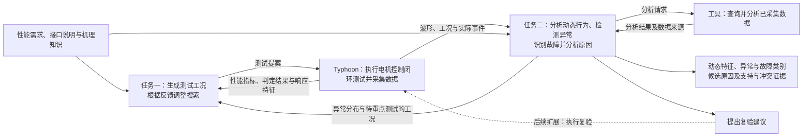
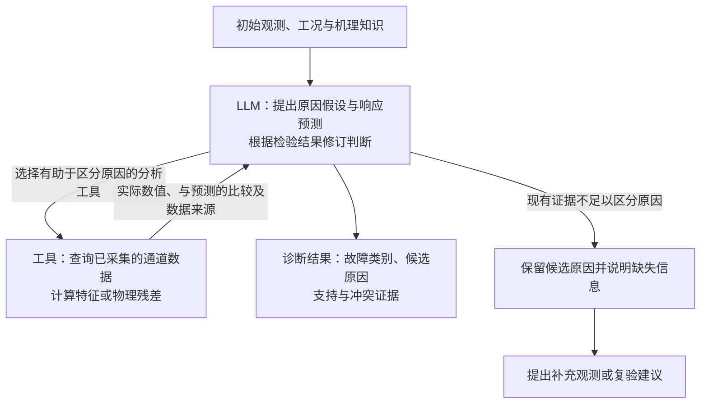

# 面向电机 HIL 的智能测试生成与数据分析：技术选型方案

编制日期：2026-11-11；最近修订：2026-11-13。本文面向具有控制与测试基础的研究人员，用于评审研究路线、开展原型和安排方法比较。[讨论稿](discussion-brief.md)用于快速交流；[工程与实验参考附录](implementation-reference.md)供实现和复现时按需查阅。方法证据见[LLM 专题调研](../2026-11-09-llm-core-methods/research-report.md)，前期讨论见[讨论梳理](../2026-11-09-hil-ai-selection/discussion-review-2026-11-11.md)。

## 1. 研究目标与总体思路

### 1.1 两项任务与研究问题

研究目标：**在有限测试预算内扩大有效测试覆盖，发现人工设计容易遗漏的系统失效；从测试数据中提取更多有用信息，刻画动态行为、发现异常、识别故障、定位原因并总结跨工况规律。**

以永磁同步电机（PMSM）控制系统为验证对象，先在 Typhoon 的电机控制闭环仿真中研究方法，再验证向 TLE9877 控制板 HIL 的迁移。启动、调速、负载扰动、零速响应及反馈和执行异常构成问题范围，首批从调速与负载交互、相似速度跌落诊断切入。

| 核心任务 | LLM 作出的决策 | 研究问题 | 希望得到的结果 |
|---|---|---|---|
| 任务一：智能测试生成与失效搜索 | 结合需求、变量含义和历史响应，选择下一工况、事件模式或搜索区域 | 语义与响应反馈能否改善测试决策，提高失效发现效率或扩大工况覆盖？ | 可执行测试、需求违反条件、不同失效模式及局部边界 |
| 任务二：数据分析与故障诊断 | 结合机理知识比较候选原因，选择区分性证据，并根据工具结果更新判断 | 自适应证据选择能否改善原因区分，或减少分析与人工排查成本？ | 动态特征、异常区间、故障类别、原因集合及支持和冲突证据 |

任务一以 LLM-Falsifier 的语义反馈搜索为基础，结合 LLAMBO 对初始化、候选生成和评分预测的分环节研究，明确 LLM 在选点中的作用。任务二借鉴 BoxLM 的“提出可检验模型—计算检验—反馈修订”，将候选原因表达为可检查的响应预测；S2S-FDD 用于组织信号与知识，TraceBench 用于设计信息条件和可区分性评测。原论文机制、迁移取舍及阅读范围见[2026-11-13 大模型方法深化调研](../2026-11-13-llm-method-deepening/research-report.md)。数值搜索、信号处理和物理分析提供执行与检验基础，也构成评价 LLM 增量价值的对照。

首批聚焦测试工况选择与诊断证据选择。**新需求适配、特征与规律发现作为辅助研究**；基础动态特征、正常参照和异常检测随核心任务准备。诊断阶段的主动复验、直接时序/图像理解、领域训练和蒸馏按后续结果安排。

### 1.2 实施原则

实施以最小流程、真实反馈和核心对照为主线：

1. **先取得两个真实实例。** 用一个可用模型完成“提案—执行—反馈”和“观测—查询—诊断更新”，根据运行结果决定下一步改进。
2. **复用已有能力。** 优先使用现有 Typhoon 模型、执行入口、采集与分析脚本；新增能力围绕当前问题采用简单函数或文件交换，重复使用后再整理公共接口。
3. **分开推进原型与正式比较。** 接口、激励和结果可核验后即可联调。后续逐步校准场景难度、补充不同机制产生相似症状的数据，并完善代表性对照方法（比较基线）。对照方法需合理配置和调优，研究效果由满足相应条件的实验判断。
4. **按用途使用实现参考。** 公平对照、统一判据、真值隔离、真实成本和执行范围关系到结论可信度；字段、文件组织、历史窗口、工具轮数及缓存方式可随实现调整。附录中的示例与候选实现用于起步，采用更简单且满足研究目的的方式时，记录影响实验解释的变化即可。

两项任务具备各自输入后可以分别推进。当前只实现正在验证的问题所需能力，后续扩展由错误、数据和成本证据触发。

### 1.3 总体流程与任务衔接

**任务二首批的补充查询面向已经采集、尚未提供给诊断器的数据。** 现有数据不足时，输出候选集合和补充观测或复验建议；新增 HIL 实验的选择与执行在后续单独研究。任务一则持续执行新工况，以发现需求违反为目标。

这里的“失效”指违反已定义的功能或性能需求；“反例”指使该要求不成立的测试工况及其运行结果；“异常”指结合工况偏离正常行为。原因诊断进一步比较机制与作用位置。例如正常负载阶跃也会造成速度下降，恢复是否超时与是否存在故障分别判断。局部失效边界由相邻满足和违反条件的样本及复验支持。

本文用“电机控制闭环”描述控制器、被控电机与反馈之间的关系；LLM 的迭代过程分别称为“测试生成—执行—反馈循环”和“诊断查询与更新循环”。

### 1.4 工程知识与协作输入

工程人员确认需求和物理含义，研究侧将资料整理为测试规约（测试目标、允许操作与判定规则）、机制条目和分析工具。首批围绕速度恢复和选定故障收集以下资料：

| 需要的资料 | 在两项任务中的用途 | 提供或确认角色 |
|---|---|---|
| 性能需求、正常范围、保护逻辑、允许操作 | 定义搜索目标、阈值、合法工况及正常/异常的判断依据 | 合作方测试与控制负责人 |
| 模型接口、信号表、单位、采样和执行限制 | 将测试提案转换为配置，确定可用观测和分析窗口 | 模型/平台负责人 |
| 控制框图、相关原理图、反馈与执行路径 | 解释变量关系，形成“机制—症状—区分证据”条目 | 固件/硬件工程师 |
| 电机与控制参数、正常样本 | 建立正常参照、物理残差及正常波动范围 | 建模与控制人员 |
| 已知故障、维修案例和专家经验 | 确定首批机制、相似症状及可核验的区分方法 | 测试/维修工程师，研究侧整理 |
| 板卡与固件版本、驱动反馈接口、时钟信息 | 确定实体迁移时可读取的信号及时间关联条件 | 现场实验负责人，实体迁移前确认 |

表中的物理残差，是将观测量代入物理关系后得到的偏差，例如机械转矩平衡关系的偏差；其正常波动范围需要结合参数误差和测量噪声标定。

例如，反馈偏置条目需说明偏置作用在哪条反馈链、控制器可能怎样补偿、哪些独立观测能区分真实转速变化。研究侧按对象和运行阶段筛选相关条目，连同来源与适用条件提供给模型，并由工程人员核验。软件原型先用现有模型资料；涉及实体控制器的知识和观测在迁移前补齐。

## 2. 任务一：智能测试生成与失效边界搜索

### 2.1 测试问题与反馈搜索

先选一项含义和判据明确的需求，例如调速与负载扰动后的速度恢复。工程人员确认允许操作、参数范围和阈值来源，研究侧复用已有配置，形成模型可读取的测试问题。测试点可表示为“事件模式＋连续参数”，如调速后加负载，以及目标速度、负载幅值和事件间隔。

LLM 利用需求含义、变量的物理关系和历史响应提出测试假设，工具执行并计算真实结果，再由 LLM 调整下一选择：

每次测试后，工具计算性能指标并与预先确定的限值比较。以速度恢复为例，本文定义**恢复时间余量 = 允许恢复时间 − 实际恢复时间**，单位为 ms 或 s。要求恢复时间不超过 100 ms 时，实际恢复时间为 80 ms、100 ms、120 ms 分别对应 +20 ms、0 ms、−20 ms：正值表示尚有余量，零值表示恰好达到限值且满足要求，负值表示恢复超时。

失效搜索以该余量为评分，寻找余量更小、甚至为负的工况。因此，“本轮最小余量”指本轮有效测试中该评分的最小值。其他指标分别定义差值方向、单位和判定规则；多指标联合搜索前确定归一化与组合方式。工具同时反馈速度跌落、振荡、电流响应和相关时刻，帮助模型核验测试假设。各方法共用评分器；恢复定义与记录结束时仍无法确定恢复时间的处理见[附录 A](implementation-reference.md#a-评分数据与实验口径)。

LLM-Falsifier 使用按信号时序逻辑（STL）公式定义的鲁棒度（robustness degree）指导搜索。本方案借鉴其“提案—执行—反馈”机制，首批采用上述恢复时间余量；后续接入 STL 时，再按具体公式的定量语义计算鲁棒度。方法来源见[LLM-Falsifier 原文](https://arxiv.org/html/2609.20752v1)。

例如，模型可提出“调速尚未完成时叠加负载可能延长恢复”，选择事件间隔进行验证，再依据实际响应细化间隔或改变次序。这是决策机制示意，具体收益由连续执行和对照实验确定。

各模块的信息交接如下，LLM 的输出经程序校验后交给现有执行入口：

| 模块 | 输入 | 处理与输出 |
|---|---|---|
| 测试问题准备 | 需求、速度/负载范围、事件限制及工程知识 | 工程确认后形成目标、允许动作、评分定义和预算 |
| LLM 测试决策 | 测试问题、历史工况、实测指标距限值的余量与响应摘要 | 提出测试假设、事件次序/时刻和参数；混合搜索时给出模式及参数子域 |
| 校验与执行 | 提案及模型能力声明 | 校验范围、时间网格和评价窗口，经 `lab.ps1` 执行；返回运行标识、实际事件和波形，非法提案返回具体错误 |
| 评分与反馈 | 波形、实际事件、固定需求判据 | 计算指标距限值的余量、恢复/振荡/电流特征及有效性，提供给下一轮决策 |
| 搜索结果整理 | 全部提案、执行与评分记录 | 输出反例或预算内未发现、不同模式、本轮最小余量、覆盖与成本；有相邻样本后再刻画局部边界 |

首批可操作量是速度给定（rpm）、负载转矩（N·m）及事件时刻（s）。当前适配器每次最多支持三个事件，时间网格为 50 μs；密集交互事件采用 `event_group` 评价前置基线和末事件后的稳定段，恢复评分另按末实际事件计算。上述范围由现有软件能力确定，正式场景扩展时重新核验。

### 2.2 搜索方法与混合策略

| 方法 | 输入与机制 | 主要回答的问题 |
|---|---|---|
| 工程启发式与数值搜索 | 固定工程启发式、随机、Sobol、Dual Annealing，各自报告 | 已有经验与数值搜索能达到什么效果？ |
| LLM 反馈搜索 | 需求与变量语义、历史参数和余量 → 下一工况 | 语义反馈搜索是否有增益？ |
| 响应信息增强搜索 | 在 LLM 反馈搜索中增加动态特征、压缩响应和关键时刻 | 更丰富的响应是否改善选择？ |
| LLM 与数值混合搜索 | LLM 选择事件模式和区域，Dual Annealing 细化连续参数 | 语义探索与数值优化是否互补？ |

**具体方法研究分开考察初始工况、后续候选和反馈利用。** [LLAMBO（ICLR 2024）](https://proceedings.iclr.cc/paper_files/paper/2024/hash/84b8d9fcb4e262fcd429544697e1e720-Abstract-Conference.html)让 LLM 分别参与初始点选择、候选点生成及目标值预测，并检查各环节的作用。本方案先借鉴其模块化研究方式，按以下顺序开展比较：

| 环节 | LLM 的具体输出与使用方式 | 匹配的比较设计 |
|---|---|---|
| 初始工况 | 根据需求和变量关系生成固定数量的合法初始点 | 与工程启发式、随机/Sobol 初始点比较；后续使用相同数值搜索方法及预算 |
| 后续候选 | 根据历史评分和响应生成下一工况，或选择事件模式及参数子域 | 比较 LLM 直接选点与 LLM 外层＋数值内层；替换外层时保持内层算法和预算一致 |
| 反馈利用 | 在提出下一候选前说明预计哪个响应会恶化，依据实际评分与响应修订 | 固定模型和搜索接口，比较仅评分、增加动态响应及关键时刻的反馈 |

LLM 的预测用于提出候选，候选的实际评分由仿真和统一评分器给出。首批只要求可核验的响应方向或事件关系；若进一步采用 LLAMBO 的评分预测与不确定性估计模块，需单独检查未见工况上的预测误差、区间覆盖及选点收益，其提示采样产生的分散程度需经过校准才能作为不确定性依据。该扩展依赖足够的历史样本，具体配置由预试确定。

原型先选适合当前空间的一项工程启发式或数值搜索方法，与 LLM 反馈搜索或响应信息增强搜索跑通反馈循环。研究混合方式时，再加入 LLM 与数值混合搜索：外层根据历史选择模式或参数子域，内层优化后返回本轮实际测试中评分最低的工况及响应，外层据此继续调整。

解释 LLM 与数值混合搜索的收益时，用工程启发式、固定分配或自适应数值策略替换外层，保持内层优化器、可用信息和总预算一致。同时比较独立优化器，观察完整系统成本。单次仿真昂贵且代理建模有价值时，再考虑贝叶斯优化。

离散因素较多时用 PICT 组织合法组合，少因素可全枚举；参数组合、事件次序与连续边界分别评价。多时序规格确有统一管理需要时，再接入 PSY-TaLiRo。

### 2.3 场景预试与原型验证

现有 PMSM 速度/负载事件、波形和分析记录可支撑搜索原型。已有实验的所测点尚未出现恢复超时，后续用小规模预试检查余量变化、简单基线成功率、首次发现成本和重复性，选择有区分度的正式问题。当前能力与实测依据见[附录 A.1](implementation-reference.md#a1-当前基础与观测范围)。

预试用于开发问题与校准预算。正式比较依据真实需求预先确定场景，保留选择依据和不同难度的问题。未发现反例时，报告覆盖、本轮最小余量和预算内未发现结果；已有相邻满足/违反样本后，再评价局部边界。

局部边界刻画时，固定事件模式和其余参数，选定一维参数切片，通过区间收缩或局部加密搜索定位满足与违反条件之间的过渡区间，并复验邻近样本。有单调性依据的切片可用二分收缩；非单调响应采用分段采样或局部搜索，分别记录发现的各个过渡区间，结果适用于该切片与已测分辨率。

### 2.4 任务一工作安排

| 工作包 | 依赖与分工 | 工作量初估 | 交付物 |
|---|---|---|---|
| 提案、反馈与基本搜索 | 共用需求/评分及模型接入就绪；LLM 人员负责决策，执行/分析人员负责校验、运行和评分 | 5—8 人日 | 至少两轮真实提案与反馈、基本非 LLM 策略、可追溯的选点变化 |
| 混合策略、信息作用比较与局部复验 | 基本流程可运行，完成场景难度预试；搜索与实验人员共同推进 | 5—9 人日 | 外层策略替代及知识/语义/反馈作用初比，适用时给出局部边界复验 |
| 合计 | 共用准备和多模型初筛在 §6 统一计入 | **10—17 人日** | 搜索原型与初步对比实验 |

## 3. 任务二：动态分析、异常检测与故障诊断

### 3.1 动态分析与诊断输入

原始多通道波形进入分析工具，形成有单位和时间范围的动态特征、相对同工况正常参照的偏差及可用物理残差。先用这些信息描述行为、发现异常，再向 LLM 提供初始观测和适用机理知识。LLM 比较候选原因，决定下一项分析，工具负责数值计算。

当前软件预演采集七个物理通道，配置为 **100 kSa/s、0.8 s**。数据及其用途如下：

| 实际输入 | 单位与来源 | 用途 |
|---|---|---|
| 机械速度、速度给定 | rad/s，模型探针；换算 rpm 时乘以 30/π | 误差、跌落、反转和恢复 |
| 三相电流 Ia、Ib、Ic | A，三相探针 | 电流峰值、RMS、不平衡及瞬态关系 |
| 电磁转矩、负载转矩 | N·m，模型探针 | 扰动响应和具备参数条件时的机械残差 |
| 采样时间、指令与实际事件、模型及控制配置 | s 及执行记录 | 定位窗口、匹配正常工况、关联操作与响应 |

LLM 首批读取工况、异常区间、带单位的特征、相对同工况正常参照的偏差、机理条目及工具目录；工具持有完整波形，按查询返回数值和来源。当前尚无 dq 电流、限幅/保护状态和独立速度反馈，按选定机制补充；模型内部观测迁移到实体时逐项确认可获取性。字段和残差计算细节见[附录 A.3](implementation-reference.md#a3-波形特征与物理关系)。

| 分析环节 | 优先方法与候选 | 用途 |
|---|---|---|
| 行为分析 | 时域特征、STFT/小波、按工况建立的正常参照、物理残差 | 提取反转、振荡、恢复退化及跨通道关系，分析工况规律 |
| 异常检测 | 条件化统计检测、Isolation Forest（IForest）、TimeRCD | 检查正常切换误报、短异常与持续异常 |
| 故障识别 | 物理/动态特征分类器、MiniRocket、MantisV2 冻结表示＋分类头 | 比较工程特征、时序形状和预训练表示；冻结表示指保持预训练模型参数不变，仅用本任务标签训练分类头 |
| 原因分析 | 相对同工况正常参照的偏差与残差响应模式、知识与工具辅助的 LLM | 区分相似症状的机制和作用通道 |

首批从条件化统计检测和物理特征方法起步，按问题加入相关候选。正常但复杂的启动、调速和负载响应同时进入数据，检验误报与误诊。

模块输出逐步收敛：行为分析输出动态特征和工况规律；检测输出异常区间、通道与分数；故障识别输出类别或候选类别；原因分析输出候选机制、作用位置及支持/冲突证据。专用分类器预测可作为 LLM 的辅助输入，并单独比较其增益。每项判断关联相应运行、通道、时间窗口和分析结果。

### 3.2 诊断循环与相似症状示例

**主方法是由 LLM 提出可检验的原因假设，工具检查其预测，LLM 根据符合与冲突之处修订假设和下一步分析。** [BoxLM（ICML 2024）](https://proceedings.mlr.press/v235/li24v.html)将 LLM 的假设写成概率程序，由数值推断拟合、评价，再把预测偏差交给 LLM 改进模型。本方案采用其假设检验机制，将首批搜索范围限定在工程确认的候选机制和分析工具内；完整概率程序生成与自动统计建模留待数据条件具备后评估。

每个假设需说明机制及作用位置、适用工况、预期响应，以及什么观测会与它冲突。LLM 根据候选之间的预期差异选择通道、窗口和计算；工具返回实际数值、正常参照或已标定关系的比较结果。LLM 据此保留、排除或修改候选，并给出对应证据。响应预测在读取相应补充结果前记录，用于检查模型是否真正依据反馈调整判断。

首批使用能被现有工具检查的关系，例如事件先后、同工况正常范围及可用物理残差。预测区间和阈值来自开发数据或已核验模型；条件不足时保留定性预测并说明检验限制。若需要拟合参数，拟合数据和检查预测的数据分开；在同一段波形上拟合良好只能说明相容性，原因区分还需要候选之间有不同预测的观测。

[S2S-FDD](https://arxiv.org/html/2603.08048v1)提供信号趋势、正常偏差及测点含义的组织参考；[TraceBench](https://arxiv.org/html/2608.27182v1)提供背景知识、观测和任务可解性的受控评价参考。方法重点检验显式响应预测与数值反馈是否改善原因区分，而非以描述流畅度判断诊断质量。

以速度跌落为例，LLM 可提出“正常负载响应”假设，并预测跌落发生在实际负载变化之后、幅值和恢复处于同工况正常范围。工具查询负载事件并比较正常参照；超出范围时，该假设不足以解释全部观测。对于反馈偏置假设，先依据实际反馈结构说明预期的独立速度与控制器反馈差异，再在对应观测可用时检验；执行通道异常则依据作用位置提出电流或执行状态预测。模型记录哪些预测得到支持、哪些与数据冲突，据此调整候选和下一查询。单项响应相符时仍需检查其他候选能否产生相同现象。

这些是待验证的实验设计。先实现一个真实影响电机控制闭环的故障，形成正常对照、实际注入和观测记录，用来联调检测与诊断。正式原因区分比较再核验至少一组“初始观测相似、合法补充查询能够区分”的机制，实测补充证据的区分作用，并纳入缺失观测、证据冲突和确实不可辨识的样例。

初始证据与工具权限对各方法一致。故障标签、隐藏注入信息及未开放真值由评价器保管；模型可查询的仿真器状态预先声明。观测仍支持多个解释时，候选集合就是相应的诊断结果。

首批机制和观测按下表核验，表中区分证据是待验证的设计依据：

| 候选机制与作用位置 | 可能的共同症状 | 拟查询的区分证据 | 当前基础与下一步 |
|---|---|---|---|
| 正常负载变化：负载输入 | 速度跌落、恢复过程变化 | 实际负载事件、速度与三相电流响应的先后关系 | 已有事件与观测，用正常对照核验响应 |
| 速度反馈偏置：控制器实际使用的反馈链 | 速度或恢复异常 | 独立速度与反馈量的差异、控制补偿响应 | 尚需核对控制器所用反馈路径并实现注入、补充观测；首个故障据此选择 |
| 执行通道异常：控制输出至功率级的作用链 | 速度与电流异常 | 相电流关系、实际执行状态或驱动测点 | 已有相电流；注入位置、执行观测和区分能力待验证 |

原型阶段先完成其中一个影响电机控制闭环的故障及正常对照；正式原因区分比较前，再用实际数据确认相似症状与补充证据的区分作用。软件原型按模型真实控制结构选择注入位置，实体阶段按板卡的实际反馈和驱动链重新核验。

### 3.3 非 LLM 自适应查询与分析策略

这里的自适应查询与分析，是根据已有结果选择下一项数据查询或分析，首批使用已采集的数据。除固定诊断流程外，建立使用相同知识和工具的自适应对照方法：整理“候选机制—工具—预期观测”表，根据当前候选对同一查询的预测差异及调用成本选择下一工具，结果返回后用证据规则更新候选。

这样既比较最终判断，也比较谁更有效地获得区分性证据。建表、标定和工程审核的投入计入人工成本；若效果接近，LLM 是否减少这些投入也具有选型价值。具备可靠的先验、观测预测分布和噪声模型后，再研究贝叶斯更新或预期信息增益。

### 3.4 任务二工作安排

| 工作包 | 依赖与分工 | 工作量初估 | 交付物 |
|---|---|---|---|
| 特征、正常参照与检测 | 现有正常波形；信号分析人员负责 | 4—7 人日 | 可核验特征、正常复杂响应和异常事件结果 |
| 首个影响电机控制闭环的故障与观测 | 模型可修改，注入及观测路径经工程确认；模型/执行人员负责 | 3—5 人日，条件性估计 | 实际注入、正常对照及真值/观测核验 |
| 知识诊断与假设检验 | 工程条目、分析工具和首个模型；LLM 人员与工程人员协作 | 6—10 人日 | 原因假设与响应预测、工具检验及候选修订 |
| 不同机制的相似症状与区分证据数据 | 首个故障可复现，可补充机制和观测；模型/分析人员负责 | 4—7 人日，条件性估计 | 可区分、观测缺失/冲突及不可辨识样例 |
| 自适应基线及分层/完整流程初比 | 机制与证据数据可用；策略和实验人员负责 | 6—10 人日 | 同权限对照、有限留出运行及错误分析 |
| 合计 | 前三项构成原型，后两项用于初步对比实验 | **23—39 人日** | 分析与诊断原型、初步效果和成本依据 |

## 4. LLM 贡献验证与实验评价

### 4.1 贡献分离与对照设计

测试搜索方法的比较见 §2。故障诊断按下表区分相同信息的判断、知识增加及按需查询与分析的作用：

| 方法 | 输入与机制 | 比较目的 |
|---|---|---|
| 专用方法与传统诊断策略 | 相关专用方法，以及使用相同知识和工具的固定/自适应诊断策略 | 建立检测分类与原因分析的非 LLM 参照 |
| LLM 特征诊断 | 与特征基线相同的特征和工况交给 LLM | 检验相同信息的利用能力 |
| 知识增强诊断 | 在 LLM 特征诊断中加入正常参照、控制关系与故障机制 | 与相同知识的规则/案例检索比较，区分知识与模型贡献 |
| 工具辅助诊断 | 在知识增强诊断中加入按需分析工具 | 与相同权限的固定/自适应策略比较证据选择，再用固定提供同等信息的方式检查判断能力 |
| 显式假设检验诊断 | 工具辅助诊断中先记录候选的响应预测，再根据数值检验修订 | 与相同 LLM、知识和工具的直接诊断比较，检验预测约束与反馈修订是否增加收益 |

任务一分别替换初始化、外层候选选择和反馈内容，先确认收益发生在哪个环节，再比较完整搜索。任务二分别检查候选预测的正确性、查询对候选的区分作用，以及返回冲突证据后是否合理修订；工具计算的预测偏差与 LLM 对偏差的解释分别记录。固定信息实验比较判断能力，按需查询实验比较获得证据的能力。参照 TraceBench 的可解性检查，在开发阶段确认故障确实影响可见响应、是否存在其他机制产生相同观测；正式测试同时保留可区分和不可区分样例，评价适当的未决输出。

测试搜索分别比较知识、变量含义与反馈的作用：无历史、参数与距限值的余量反馈、增加动态响应；额外工程知识有/无；保留变量名称与物理含义，或在对照实验中将其隐藏。隐藏变量含义时，保持实际变量映射、执行校验和评分一致，仅改变提供给模型的名称与说明，具体做法见[附录 A.4](implementation-reference.md#a4-贡献验证的具体口径)。结果用于解释显式输入的作用。

首批按研究主张选择有限组合，逐步补齐代表性对照方法。融合专用模型预测时，同时比较简单规则融合和最强单组件。新需求适配、特征与规律发现和跨模型家族复核另列范围和投入。

### 4.2 数据划分与公平比较

- **统一问题与判据。** 各方法使用相同需求、合法测试空间和评分。阈值依据需求在运行前确认，场景调整保留依据。
- **分开开发与正式评价。** 按完整运行、配置族、工况和机制分组后再切窗。预试用于开发；正式评测前固定场景、方法与模型版本、提示、知识库、预算和评价规则，保留全部预定场景的结果。
- **隔离测试真值。** 正常参照、阈值和知识条目从训练/开发资料获得，测试标签与隐藏真值留给评价器。外部时间轴依据时钟或触发证据关联。
- **匹配信息条件。** 固定信息对照使用相同观测；自适应查询与分析对照使用相同初始证据、权限和预算，允许取得不同证据，并计算获取成本。
- **保留真实成本与未决情况。** 初始化、无效提案、重复、失败、模型调用和人工审核均进入相应成本。执行或数据错误与需求违反分开，未知与不可辨识情况按其证据报告。

### 4.3 评价指标与采用依据

| 评价对象 | 主要看什么 |
|---|---|
| 测试搜索 | 相同执行次数、相同总时间/费用下的失效发现率、首次发现成本、不同失效模式数、本轮最小余量及工况组合/事件次序/参数区域覆盖 |
| 动态分析与检测 | 特征及规律的重复性、未见工况表现、正常运行误报、事件召回与延迟 |
| 故障诊断 | 原因区分、分类/定位、证据更新正确性、有效分析次数、未决与不当确定比例、人工排查时间 |
| 完整流程 | 从原始波形开始的检出并正确识别率、误报、总延迟及全部成本 |

覆盖评价分别统计至少完成一次有效测试的合法工况组合、事件次序和预先划分的参数区域数量，以及它们占各自总数的比例。重复测试同一组合、次序或区域不增加相应覆盖数；分母、区域划分和有效测试条件在比较前固定。“本轮最小余量”按同一指标、单位和评分定义比较，并保留对应工况。

给定真实故障区间的分类效果与完整流程效果分别报告。正式预算、重复次数及有实际意义的收益门槛根据预试和应用要求确定，用独立运行或配置族给出不确定性，并检查关键故障与最差工况。指标分母和计费细节见[附录 A.5](implementation-reference.md#a5-指标与成本明细)。

采用依据是独立数据中的有效增益，或相当效果下标签、人工、实验和运行成本的降低。机理知识有用而 LLM 没有额外收益时，可保留相应规则或专用方法；充分比较后的无稳定增益结论和适用边界同样属于选型成果。

## 5. 模型选型、部署与训练适配

### 5.1 模型能力需求与候选选择

先按测试搜索的反馈决策、故障诊断的证据综合与工具选择确定模型能力，再通过样例和完整任务测量效果、输入长度、调用轮数及成本，最后选择部署与算力。两项任务可以采用不同模型。

| 研究角色 | 沿用候选 | 选择理由与要验证的问题 |
|---|---|---|
| 能力参照，先择一 | Qwen3.8-27B；或 DeepSeek-V4.1-Flash-1017 服务 | 检查较高能力是否改善反馈决策和证据更新，帮助判断方法潜力 |
| 主要成本候选 | Qwen3.5-9B | 检查能否以较低成本保留任务效果 |
| 较低资源对照 | Qwen3.5-4B | 检查更低资源下的实际能力变化 |
| 跨模型家族复核 | Gemma 4 12B IT | 关键结果形成后，检查方法结论对模型家族的依赖 |

候选名单用于组织试验。原型可先接一个现有可用模型；有初批样例后，再安排一个能力参照与一至两个成本候选初筛。官方依据、已有历史候选和资源资料见[附录 C](implementation-reference.md#c-模型资源工作量与来源)，公开基准用于初筛，最终取舍依据 HIL 任务表现。

### 5.2 模型筛选与部署选择

第一阶段用工程审核样例检查合法提案、变量与单位理解、反馈调整、候选原因更新及工具错误处理。搜索可有多个合理下一工况，诊断可有多个有效查询或未决候选集合。固定历史回放用于能力筛查。

第二阶段把候选接入连续搜索与完整诊断，测真实决策收益和总成本。先固定模型比较方法，再固定方法比较模型，关键结论按需跨模型复核。研究模型用于检验方法与能力限制；部署模型在实际用途明确后确定效果、可靠性、时延与成本门槛，用独立数据验收后再比较费用和维护。

部署可选择外部服务、内网服务或本地运行，取决于任务效果、数据使用条件、网络和算力。服务调用追踪日期及可取得的版本信息，自部署固定权重和环境；显存、延迟和费用用完整任务实测。

两项任务均以文本化工程信息和工具调用起步，首轮按单模型、并发 1、输入约 6K token 以内、总序列约 8K token 规划。搜索侧重点测历史反馈增长和连续提案，诊断侧重点测知识输入、查询轮数和完整分析延迟。沿用以下未经目标硬件实测的资源预留：

| 模型与用途 | 权重配置 | GPU 显存 / 主机内存规划 | 决策依据 |
|---|---|---|---|
| Qwen3.5-4B：两项任务的低资源试测 | 兼容的 4-bit | 12—16 GB / 32 GB | 合法提案、反馈利用、证据更新及完整任务成本 |
| Qwen3.5-9B：主要成本候选 | 兼容的 4-bit | 24 GB / 64 GB | 与能力参照比较效果损失及资源收益 |
| Qwen3.5-9B：量化效果参照 | BF16 | 32—48 GB / 64 GB | 核验量化对决策和工具使用的影响 |
| Qwen3.8-27B 或 DeepSeek 服务：能力参照 | 按现有承载或服务条件选择 | 自部署需加载试测；服务测费用与时延 | 判断小模型错误是否与能力有关，再选择后续投入 |
| Gemma 4 12B IT：跨模型家族复核 | 接入时核验兼容配置 | 按实际负载另测 | 检查关键方法结论的模型依赖 |

首轮优先利用可用资源或服务完成任务初筛，本地部署继续作为成本候选验证。扩大上下文、引入视觉或提高并发时重新估算；采购和长期部署依据目标负载的峰值显存、内存、完整任务 P50/P95 延迟、失败率与效果决定。推导、官方来源和训练资源预留见[附录 C.3](implementation-reference.md#c3-部署与资源预留)。

### 5.3 模型适配与改进路径

先测原有权重配合提示、知识和工具的效果。知识缺失时补资料，调用错误时检查工具与模板，持续能力不足时比较更强模型和输入改进，再决定是否开展 LoRA/QLoRA。时序—语言对齐、蒸馏及离线规则生成分别服务于波形信息利用、资源降低和分析发现，按相应数据与收益安排。

后续方法深化优先围绕已发现的瓶颈选择方向：

| 方向与文献依据 | 大模型承担的具体作用 | 启动条件 |
|---|---|---|
| BoxLM 的显式模型生成与 BMD 的实验选择 | LLM 提出可计算的模型形式；数值程序拟合、比较并反馈，具备新实验条件后按信息价值选实验 | 候选模型可计算、参数和噪声可估计，预测检验有效；新增实验另需验证合法动作与区分作用 |
| 信息增益训练（AR-BED） | 用查询减少不确定性的奖励训练 LLM 的推理与动作选择 | 有可核验的候选—查询—结果环境及可靠奖励模型，且现有策略的选证据能力成为瓶颈 |
| 多模态信号与知识对齐（DiagLLM） | 编码信号图像，与机理文本共同输入 LLM，通过投影层及 LoRA 学习对应关系 | 现有摘要确实遗漏诊断信息，具备适合本任务的信号表示、配对数据和独立验证集 |

上述文献的训练目标、原验证领域和局限见[方法深化调研](../2026-11-13-llm-method-deepening/research-report.md)。BMD 与 AR-BED 依据本轮读取的 2026 年预印本；其公开结果用于提出研究候选，HIL 效果需另行验证。

## 6. 实施计划与阶段交付

### 6.1 原型验证与正式实验条件

| 任务 | 原型可检查的结果 | 正式研究还需具备的条件 |
|---|---|---|
| 测试生成与失效搜索 | LLM 提出合法工况，Typhoon 执行，真实评分与响应影响下一轮提案 | 有区分度的搜索问题、统一判据与预算、代表性对照方法、独立重复比较 |
| 数据分析与故障诊断 | 分析波形、检测异常、调用工具并更新候选；先完成一个影响电机控制闭环的故障与正常对照 | 初始症状相似且补充查询可区分的机制、同权限固定与自适应策略、独立测试及不可辨识样例 |

正式比较条件按实验需要补齐，最小原型与场景准备可以交替进行。正常数据可先用于分析和工具联调，首个故障用于诊断流程；不同机制产生相似症状的数据用于后续原因区分评价。

### 6.2 实施阶段与工作量

| 阶段 | 主要工作与前置依赖 | 阶段成果 |
|---|---|---|
| 跑通实例 | 软件模型、需求和一个推理模型可用；搜索接真实评分，分析可先用正常数据联调，诊断更新依赖首个影响电机控制闭环的故障 | 可复核的搜索实例与诊断实例、实际错误和成本；两项任务分别交付 |
| 完善核心比较 | 各自原型可运行后推进：搜索完成难度预试；诊断补充产生相似症状的不同机制与可区分观测；已审核样例用于多模型初筛 | 两项任务的初步增益或无增益证据，明确下一步数据与方法投入 |
| 形成正式选型 | 相应问题、数据、代表性对照方法具备后固定场景、方法和模型，完成独立测试、必要重复及成本比较 | 推荐组合、失败边界和适用条件 |
| 验证实体迁移 | 依赖合作方模型、板卡、固件、反馈接口及正常电机控制闭环和采集条件；按实际观测重新校准和比较 | 单独的实体域结果与迁移成本 |

任务工作包见 §2.4、§3.4，共用工作由执行/分析与 LLM 人员协作：需求/评分和信号核对、必要记录关联及首个模型接入估 **4—6 人日**；多模型初筛包括共用审核样例 **3—5 人日**，以及每新增一个模型的适配、调用和错误复核 **2—4 人日**，总计 2—3 个模型时追加 **5—13 人日**。同一人员可承担多个角色，共用工作计一次。

按阶段合计：流程原型 **22—36 人日**，多模型初筛追加 **5—13 人日**，初步对比实验追加 **15—26 人日**，已列范围合计 **42—75 人日**，约单人全职等效 **9—15 个工作周**。估算假定熟悉代码的人员全时投入，软件电机控制闭环可复用，需求、工程资料、推理资源和可修改的故障路径可取得。正式独立验证、额外场景与环境开发、专家排期及算力/批次等待另计；实际日历排期在人员投入与外部条件明确后确定，用首周、首个故障和首次多模型运行校准。阶段汇算与扩展估计见[附录 C.5](implementation-reference.md#c5-工作量拆分与后续扩展)。

首批需要协调三类输入：工程人员确认的需求与允许操作；可修改的故障路径及必要观测；一个可用模型的推理资源和资料。取得每项任务的首个完整实例后，用真实运行结果决定继续完善、补数据或调整路线。

本轮方法深化将分环节搜索比较、受限候选的响应预测与工具检验纳入原有工作包，42—75 人日作为待首批实例校准的初估。完整概率建模、LLM 代理评分、信息增益强化学习和多模态训练属于新增扩展，需按数据准备、数值建模及训练成本单独估算。

### 6.3 后续扩展与成果

| 扩展 | 研究内容 | 开展时机 |
|---|---|---|
| 新需求适配 | 同一 PMSM 对象上比较人工与 LLM 辅助修改规约/策略的正确性、效果及总人工投入 | 核心流程可复用后 |
| 特征与规律发现 | 借鉴 Argos 提出并修订特征或规则，固定后用独立运行检查规律与诊断增益 | 开发数据和基础分析具备后 |
| 主动复验 | 选择并执行新增工况，用候选响应分歧或信息增益与 LLM 比较 | 候选原因及可区分动作已验证后 |
| 表示与训练适配 | 直接序列/波形图、时序—语言对齐、LoRA/QLoRA 或蒸馏 | 已识别信息缺口、能力错误或资源问题后 |

实体目标链路为“LIN 指令 → 控制板 → 六路栅极驱动 → HIL 电机模型 → 采样反馈 → 控制板”。接线、固件、反馈、正常电机控制闭环和停止条件按[现有接口准备](../../../configs/tle9877_hil_contract.json)落实，迁移按实际可读取信号评价；软件域与实体域分别报告。

最终形成可运行方法、基准数据与划分、动态行为和跨工况分析、效果与成本对照、失败案例，以及有证据支撑的模型与部署选择。附录提供实现参考和来源，后续设计随这些结果更新。
