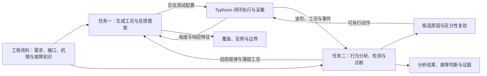
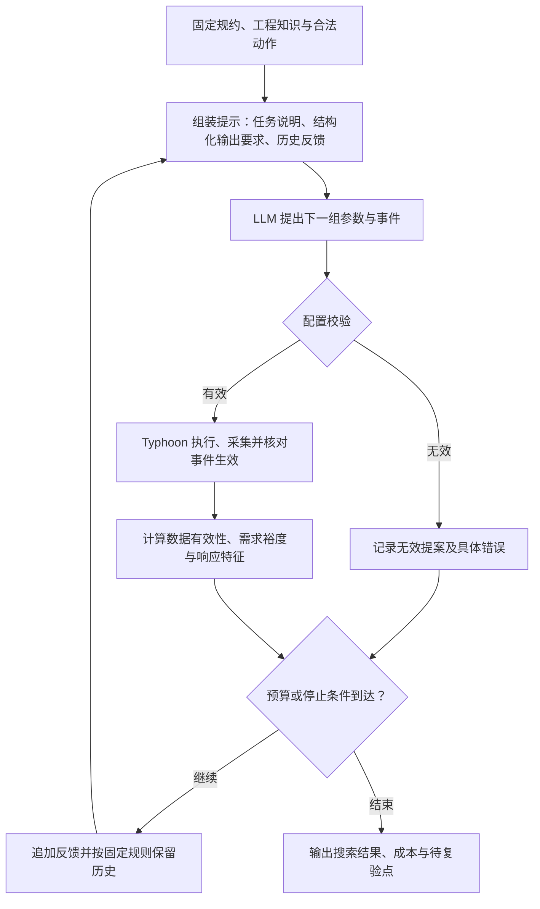
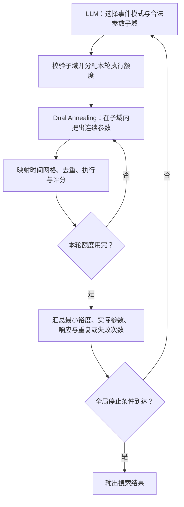
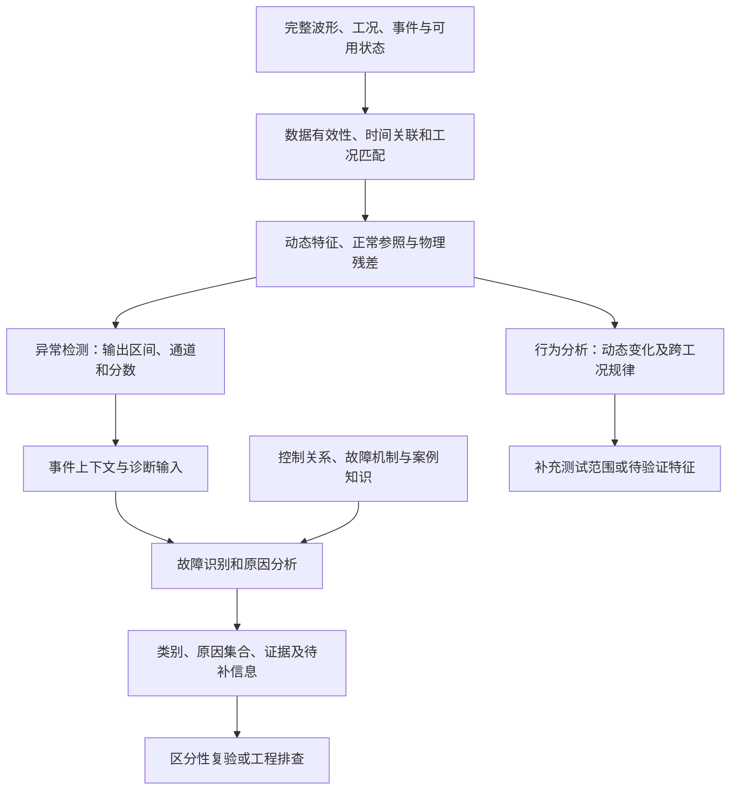
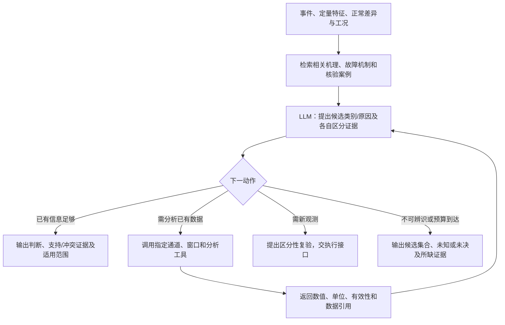

# 面向电机 HIL 的智能测试生成与数据分析：技术选型方案

编制日期：2026-11-11。本文供具有控制与测试基础的研究人员开展方案评审、方法实现和实验分工，说明两项任务的技术路线、大模型作用、输入输出、验证方式及投入安排。[讨论稿](discussion-brief.md)用于现场讲解；修订依据见[讨论梳理](../2026-11-09-hil-ai-selection/discussion-review-2026-11-11.md)，方法证据见[LLM 专题调研](../2026-11-09-llm-core-methods/research-report.md)。

## 1. 研究目标与任务概览

研究目标：**在有限测试预算内扩大有效测试覆盖，发现人工设计容易遗漏的系统失效；从测试数据中提取更多有用信息，刻画动态行为、发现异常、识别故障、定位原因并总结跨工况规律。**

以永磁同步电机（PMSM）控制系统为验证对象，先在 Typhoon 电机软件闭环中比较方法，再迁移到 TLE9877 控制板与实时电机模型组成的硬件在环（HIL）闭环。测试问题覆盖启动、调速、负载扰动、零速响应及可实现的反馈和执行异常。调速与负载交互、相似速度跌落诊断作为首批例子，后续按需求、运行阶段和机制扩展。

| 任务 | 首批主路线 | 大模型作出的核心决策 | 预期产出 |
|---|---|---|---|
| 测试生成与失效边界搜索 | LLM 语义反馈搜索，并与数值搜索组合 | 根据需求、工程知识和历史响应选择下一工况；混合方式选择事件模式与搜索区域 | 可执行测试、需求违反条件、失效模式和局部边界 |
| 数据分析与故障诊断 | 动态/物理分析与异常检测，连接知识和工具辅助的 LLM 诊断 | 综合信号与机理区分故障，选择补充分析，提出待验证特征、规律及复验动作 | 动态特征、异常区间、故障类别、原因集合、跨工况规律及复验建议 |

任务一主要借鉴 LLM-Falsifier 的定量反馈搜索；任务二主要借鉴 S2S-FDD 的信号语义组织和 TraceBench 的工具辅助原因分析。具体工程设计见 §3—§4，来源及阅读深度见 §9。

首先检验以下问题，再依据初步结果调整方法组合。

| 研究问题 | 增益假设 | 当前依据 | 改变选择的实验结果 |
|---|---|---|---|
| 语义与响应反馈是否帮助搜索？ | LLM 更有效地选择事件交互和高风险区域，数值优化细化连续参数 | CPS 反馈证伪研究；项目已有速度/负载事件接口 | 同预算下人工启发式或数值搜索相当或更好，且 LLM 未带来其他有效覆盖 |
| 机理知识与工具是否改善诊断？ | 同类症状可通过工况、物理关系和补充观测进一步区分 | 信号语义诊断和物理系统工具分析研究 | 增益只来自更多输入，或融合未超过取得相同信息的专用方法 |
| LLM 能否帮助提取新信息？ | 在开发数据中提出有用的动态特征或跨工况关系 | Argos 型规则生成及现有物理分析方法 | 独立运行不支持该规律，或新特征未改善分析/诊断且增加成本 |

## 2. 总体流程、能力边界与已有基础

### 2.1 两项任务如何衔接



测试搜索以发现需求违反为目标；诊断复验以区分当前候选原因、获得新信息为目标。两者共用执行能力，分别设置预算和评价指标。行为分析与跨工况规律也可独立开展。

| 概念 | 本方案的含义 | 对应输出 |
|---|---|---|
| 失效 | 违反已定义的功能或性能需求 | 违反哪项需求、在哪些条件下发生、满足裕度 |
| 失效边界 | 在声明的参数区域和分辨率下，满足与违反需求条件之间的分界 | 相邻满足/违反样本、局部切片或边界区间及复验结果 |
| 异常 | 结合运行阶段与工况，观测偏离预期正常行为 | 时间区间、通道、分数和上下文 |
| 故障识别 | 将观测归入已知故障类别，或识别为未知 | 类别及支持证据 |
| 原因分析与定位 | 比较能够解释观测的机制和作用位置 | 候选原因、可疑位置、冲突证据和未决项 |

例如，正常负载阶跃会引起速度瞬态；是否违反恢复要求由判据决定，是否存在故障还需结合更多观测。首批原因分析定位到有限机制及作用通道，进一步根因深度由可观测信息与复验结果支持。

### 2.2 软件验证与实体迁移

| 层级 | 工作内容 | 进入条件 |
|---|---|---|
| 电机软件闭环 | 工况搜索、正常行为分析、闭环故障注入与方法比较 | 模型有效范围、输入接口、采集和判据核验 |
| 实体控制板 HIL | 按实际可获取观测验证方法迁移、固件与接口相关行为 | 正常闭环联调、控制板/固件版本、驱动与反馈接口、采集和停止条件确认 |

实体目标链路为“LIN 指令 → 控制板 → 六路栅极驱动 → HIL 电机模型 → 采样反馈 → 控制板”。软件预演中的控制器、理想角度和参数假设分别登记；软件域与实体域分别报告结果。底层实时控制与信号采集由控制器、仿真器和执行工具承担，LLM 在测试之间进行提案和分析。

### 2.3 当前可复用能力与新增工作

对照当前 [PMSM 适配器](../../../src/typhoon_lab/pmsm_preview.py)和[预演配置](../../../configs/pmsm_software_preview.json)，可复用模型准备、速度/负载事件、七通道采集及结果记录。当前配置采样率为 100 kSa/s、时长 0.8 s；适配器允许每次最多三个速度/负载事件，具体范围和时间网格由其能力声明约束。这些是现有软件实现条件，正式研究场景可经验证后扩展。

新增工作包括：测试提案与历史反馈接口、搜索目标计算器、正常参照与特征工具、闭环故障注入及必要观测、知识检索、LLM 诊断和模型调用接口。当前七通道中尚无 dq 电流、限幅/保护状态和独立速度反馈通道；按诊断问题补充。实体接口仍需依据 [HIL 接口工作表](../../../configs/tle9877_hil_contract.json)完成确认。

## 3. 任务一：智能测试生成与失效边界搜索

### 3.1 输入准备与测试空间

将需求、接口资料和工程知识组织成一份固定测试规约。已有可执行配置直接复用；自然语言需求先通过模板或 LLM 转为规约，由工程人员确认需求含义、阈值和允许操作。需求映射参考 AutoHIL，首批重点放在反馈搜索。

| 输入 | 必备内容 | 由谁提供或计算 |
|---|---|---|
| 需求 | 需求 ID、观察对象、阈值、时间要求、判据来源 | 需求/测试负责人；探索性指标明确标为研究判据 |
| 系统与变量语义 | 控制阶段、变量含义、单位、作用路径、可观测信号 | 模型接口与工程资料，研究侧整理 |
| 合法操作 | 初始条件、参数范围、事件类型、时间网格、先后约束 | 平台能力与模型适用范围共同约束 |
| 历史反馈 | 实际执行输入、有效性、裕度、动态特征、关键时刻 | 固定执行与分析工具 |
| 搜索约定 | 执行预算、提案上限、总时间、停止规则和随机种子 | 实验配置，在比较前固定 |

测试点表示为“离散事件模式＋连续参数”。例如事件模式为调速后加负载，连续参数为目标速度、负载幅值和两事件间隔。PICT 用于组织已定义离散因素的合法成对组合；少因素可全枚举。连续边界由数值或 LLM 搜索处理，事件次序覆盖单独登记。覆盖分母采用比较前固定的合法组合/序列集合，分别报告设计覆盖和实际有效执行覆盖。

### 3.2 LLM 反馈搜索的具体机制

LLM-Falsifier 将大模型作为无梯度的候选输入生成器，仿真和 STL 监测器提供评分。已读正文的提示从参数—分数逐步加入规格与变量语义、压缩输出轨迹以及关键时刻，每轮一个候选，保留最近十次历史。[方法正文](https://arxiv.org/html/2609.20752v1)及[本地快照](../2026-11-09-llm-core-methods/evidence/llm-falsifier.txt)。

本项目采用以下搜索循环，并将提示、反馈格式和停止规则保存为实验配置。



每轮模型输入由四部分组成：测试目标和变量语义；经确认的约束及可用知识；最近若干次输入与实际评分；下一提案的字段说明。首轮历史为空，已有种子测试可作为另一初始化设置，初始化成本计入比较。先以最近十次历史为候选设置，长响应压缩成指标、事件附近采样和关键时间；需要改变保留策略时单独比较。

模型输出一个结构化提案，包含需求 ID、事件和参数、所用历史记录 ID、预期影响及简短选择依据。程序检查字段类型、单位、取值、时间网格、事件数量及可执行性，再合并固定模型参数生成执行配置。JSON 约束可减少格式错误，物理与业务约束由校验器检查；格式错误记为无效提案，保留原输出，后续新提案及其成本可追踪。

搜索目标首先采用可复算的**需求满足裕度**。恢复要求可定义为：最后一个相关扰动实际生效后，速度误差进入指定误差带并保持规定时长，恢复时间为到达该保持区间起点的时间；`ρ_rec = T_limit − T_recover`。`ρ_rec < 0` 表示违反该恢复要求，零值按预先确定的边界约定处理。其他需求分别给出速度跌落、振荡或电流限制的评分；多需求联合搜索的归一化在开发阶段固定。

记录结束前尚未恢复时，返回“已超过期限”或“观察时长不足”等状态，并按事先约定计算截尾评分或判为不可评价。执行失败、采样缺失和需求违反分别记录。采用正式 STL 表达时接入相应监测器；当前工程裕度按自身定义评价。

### 3.3 与数值搜索的交接

数值优化（首批考虑 Dual Annealing）根据定量裕度搜索连续参数；LLM 可以利用事件含义和响应差异提出值得搜索的子域。混合方式设计为两层循环：



外层提案字段为事件模式、每个连续参数的上下界和选择依据；内层接收固定模式、子域及剩余额度，返回真实最优点和全部调用记录。执行包装器在每次仿真前检查全局预算，优化器的内部迭代次数与物理执行次数分别计数。时间离散化在评分前统一完成，历史记录保存实际执行参数。

初步可按固定额度组织每轮局部搜索，例如总执行预算 50 次、每轮至多 10 次；该数值是开发设置示例，正式档位由预试成本确定。子域无改善时，外层获得完整反馈并可更换模式或扩展区域。实验也检查 LLM 是否反复缩小到同一区域，避免覆盖退化。该交接方式属于本项目设计，GLLMPro 提供约束候选生成的补充依据。

### 3.4 一轮搜索示例与停止条件

下面演示信息交接，**提案与反馈数值均为说明性示例，未运行该实验**。固定模板设置初始速度 1800 rpm、负载 0.01 N·m 和 0.8 s 采集；研究判据暂设恢复期限 0.10 s、速度误差带 ±50 rpm、保持 0.05 s。

```json
{
  "requirement_id": "RECOVERY_DEMO",
  "events": [
    {"at_s": 0.20, "target": "reference_speed_rpm", "value": 2400},
    {"at_s": 0.25, "target": "load_torque_nm", "value": 0.03}
  ],
  "expected_effect": "检查调速尚未完成时叠加负载是否延长恢复"
}
```

执行器转换配置、核对两事件生效后，分析器若测得恢复时间 0.12 s，则反馈裕度为 −0.02 s，并附恢复区间、速度最低点、三相电流特征和原始数据引用。首个反例模式在这里结束搜索；边界研究继续复验该点，并在相同模式下调整事件间隔，寻找相邻的满足与违反条件。若选择混合搜索，LLM 可提出间隔子域，优化器对该子域内实际参数评分。

| 搜索目的 | 停止条件 | 输出 |
|---|---|---|
| 首个反例 | 有效需求违反，或执行/提案/时间预算到达 | 反例或本轮未发现、最佳裕度及成本 |
| 失效模式发现 | 固定总预算到达 | 按需求、阶段和响应形态去重的模式及代表样本 |
| 局部边界刻画 | 已有相邻满足/违反点，达到指定分辨率或复验预算 | 对应参数切片的边界区间、重复性及未覆盖区域 |

### 3.5 方法比较与实施工作量

| 组别 | 具体方法 | 主要回答的问题 |
|---|---|---|
| A0 | 固定工程启发式、随机、Sobol、Dual Annealing；各自单列 | 已有经验和数值搜索能达到什么效果？ |
| A1 | LLM 使用需求、变量语义、历史参数与裕度 | 语义提案是否改善搜索？ |
| A2 | A1 加动态特征、压缩响应和关键时刻 | 响应信息是否有增益？ |
| A3 | LLM 选择模式/区域＋Dual Annealing 细化 | 两层搜索是否互补？ |

先选适合当前空间的 A0 与 A1 或 A2 做小试；研究混合机制时加入 A3。正式结论补齐相关强基线、信息匹配和必要消融。单次运行昂贵且代理建模有价值时再比较贝叶斯优化；多时序规格统一管理需要时引入 PSY-TaLiRo。

| 工作包 | 工作量初估 | 交付物 | 主要依赖 |
|---|---|---|---|
| 提案、校验、执行反馈及基本搜索 | 5—8 人日 | 可复核的一轮记录，LLM 与基线可重复运行 | 共用规约、模型与采集核验 |
| 混合搜索、局部复验与初步比较 | 4—6 人日 | 外层/内层交接、预算记录和初步效果 | 基本搜索可用 |
| 合计 | 9—14 人日 | 首轮原型与初步比较 | 工作量假设见 §8 |

## 4. 任务二：动态分析、异常检测与故障诊断

### 4.1 原始输入与模型输入

原始波形先进入固定分析程序，形成有单位、时间范围和物理含义的特征。首批 LLM 读取这些信息与知识条目，按需调用分析工具。直接数值序列或波形图作为表示路线另行比较。

| 数据层 | 当前字段或拟补字段 | 单位/来源 | 用途与获取条件 |
|---|---|---|---|
| 时间 | `t_relative_s`、`t_simulation_s` | s，采集记录 | 定位波形窗口及实际事件；外部日志需时钟或触发依据 |
| 速度 | `MechanicalSpeed_rad_s`、`Reference_rad_s` | rad/s，模型速度及给定探针 | 误差、反转、跌落与恢复；显示 rpm 时乘以 30/π |
| 电流 | `Ia_A`、`Ib_A`、`Ic_A` | A，三相采集 | RMS、不平衡、频带能量和瞬态关系 |
| 转矩与负载 | `ElectromagneticTorque_Nm`、`Load_Nm` | N·m，模型探针 | 机械关系与扰动响应；迁移时声明是否可读 |
| 事件和配置 | 指令与实际生效时刻、模型/控制参数、运行阶段 | 执行记录及事件探针 | 同工况参照、先后关系与版本核对 |
| 拟补观测 | dq 电流、控制限幅/保护状态、独立速度/反馈路径 | 按模型、固件和接口确认 | 进一步区分反馈、执行和正常负载效应 |

当前七个物理通道依据 §2.3 的适配器。模型内部真值、仿真器可读状态和目标板卡可读信号分别登记；主比较使用预先声明的观测集，受限观测迁移另做实验。

| 提供给 LLM 的信息 | 生成方法 | 保留的引用 |
|---|---|---|
| 动态特征 | 峰值、误差积分、恢复时间、振荡频率/衰减、电流特征 | 运行 ID、通道、窗口、单位、计算版本 |
| 正常参照差异 | 按速度、负载、运行阶段匹配正常运行，计算偏差和正常波动范围 | 正常参照版本、工况匹配质量 |
| 物理残差 | 在所需参数和观测具备时计算关系偏差 | 关系式、参数来源、正常误差标定 |
| 事件与状态 | 将已确认时钟关联的操作和状态变化加入上下文 | 时间依据、实际生效时刻 |
| 知识与工具目录 | 检索相关机制、测点和已核验案例，列出合法查询 | 知识 ID、适用条件及可用工具 |

采集尺度由物理过程确定：电流瞬态保留所需带宽，速度恢复覆盖事件前至完整恢复，持续异常覆盖足够长的控制阶段。在 100 kSa/s 下，5000 点仅为 50 ms。降采样前做抗混叠，原始采样用于高频特征，绘图保留单位和事件位置。

### 4.2 行为分析与异常检测



行为分析提取速度反转、恢复退化、振荡、相间关系等信息；按速度、负载、阶段和故障强度分析其变化。机械平衡残差可用 `r_m = J·dω/dt − (T_e − T_load − B·ω)`，参数误差、导数滤波及未测扰动通过正常数据标定。需要电气残差或 ARX/NARX 预测残差时，先核对相应信号和建模条件。

| 环节 | 方法名称 | 作用与比较重点 |
|---|---|---|
| 动态分析 | 时域特征、STFT/小波、条件化正常参照、物理残差 | 定量描述瞬态和跨通道关系，形成可检验的工况规律 |
| 异常检测 | 条件化统计检测、Isolation Forest（IForest）、TimeRCD | 比较正常切换误报、短异常和持续异常的检出 |
| 故障识别 | 物理/动态特征分类器、MiniRocket、MantisV2 冻结表示＋分类头 | 比较工程特征、时序形状、预训练表示及标签效率 |
| 原因定位 | 正常参照偏差、残差响应模式、LLM 知识与工具诊断 | 检查相似症状能否对应不同机制和作用通道 |

首批可先用条件化统计检测和物理特征分类器，与相关候选开展有限比较，随后完善强基线。检测器输出事件 ID、开始/结束时间、涉及通道、分数及上下文窗口；分类和原因分析共享事件对象，同时分别评价。正常但复杂的启动、调速和负载响应进入数据集。

### 4.3 LLM 诊断的内部逻辑

S2S-FDD 利用正常模式重构形成参照，将实测、重构及偏差组织成信号描述，检索故障知识，并通过补充查询已有信号表继续诊断。其已读实验使用前置故障区间，适合借鉴诊断输入和知识组织。[方法正文](https://arxiv.org/html/2603.08048v1)及[本地快照](../2026-11-09-llm-core-methods/evidence/s2s-fdd.txt)。本项目先使用可核对的正常参照、特征和残差；重构式参照需要时作为单独候选比较。



实施分四步：先由程序组织观测事实，必要时让 LLM 生成带引用的简短信号描述；再检索适用知识并提出有限候选原因；随后选择最能区分候选的查询或计算；最后根据新增证据更新判断，输出类别、位置/原因集合和证据。LLM 承担候选比较与下一分析选择，数值计算由工具完成。

每轮工具调用需给出运行 ID、通道、时间窗口和计算参数。控制器检查查询是否存在、窗口是否合法、所需数据是否齐全。首批以最多四轮工具查询作为开发起点，按实际任务测量后固定正式预算；相同查询返回缓存结果并记录成本。工具返回 `insufficient_data` 时，模型必须保留缺失信息。停止可以由证据规则、无新增信息或预算触发；模型自报置信度经独立校准后再用于阈值。

知识检索先按对象、控制阶段和允许机制过滤，再用 BM25 等关键词排序方法检索；资料增多或同义表达导致漏检时，加入向量检索并与关键词方式比较。返回完整机制条目及来源；固定条目数或 token 上限，避免省略适用条件。检索依据和返回内容保存到本轮记录。

### 4.4 相似速度跌落的诊断示例

以下为方法示意。候选包括正常负载响应、速度反馈偏置和执行通道异常；后两类需要先实现闭环注入与可区分观测。仅修改导出波形可用于输入处理检查，闭环诊断实验应让注入真实影响控制器或被控对象。

| 诊断步骤 | 当前证据与动作 | 更新的判断 |
|---|---|---|
| 输入事件 | 检测到速度跌落，给出负载事件、三相电流、恢复特征及参照差异 | LLM 建立候选集合，明确正常负载效应也可能解释症状 |
| 查询已有数据 | 调用速度误差、事件先后及相电流不平衡分析 | 将结果与各候选的预期响应比较，保留支持和冲突证据 |
| 查询区分证据 | 若独立速度观测存在，检查其与反馈值的一致性；若执行状态可读，查询对应状态 | 根据实际新结果进一步区分反馈链和执行链 |
| 形成结论 | 足够区分时输出类别及作用位置；观测不足时输出候选集合 | 给出最小补充观测或复验动作，保留工程排查项 |

建议诊断结果字段为 `event_id`、`fault_class`、`candidate_causes`、`supporting_evidence`、`conflicting_evidence`、`missing_information`、`next_action`。证据包含运行、通道、区间和工具记录 ID。已知机制知识允许进入输入，当前测试的故障标签、注入位置和未来数据由评价器持有。

### 4.5 分析发现、直接检测和主动复验

分析发现沿用 Argos 型方法：LLM 根据开发数据提出新特征或规则，生成受限分析程序，经执行反馈修订；随后冻结代码、提示和阈值，用独立运行检查。输出可以是“振荡能量随事件间隔变化的关系”或新的跨通道特征，分别评价规律重复性、诊断增益与人工成本。

直接检测可借鉴 LLM-TSAD 的统计分解与索引提示，或 VLM4TS 的候选区间加全局波形图。先选一种表示试点，比较原检测器、LLM 修订后结果及数值特征输入，明确定位误差和正常瞬态误报。时序编码器隐向量进入语言模型时需训练对齐层，ATTLLM/FD-LLM 作为后续适配参考。

当现有观测支持多个原因时，建立有限复验动作集，如改变负载、调整速度、改变事件间隔或增加观测。比较固定顺序、随机、候选模型响应分歧/预期信息增益、LLM 提案及混合方式。实际模拟或测量更新判断，读取已有数据与新增试验分别计费；候选集不完备或机制不可辨识时保留未知和未决出口。

### 4.6 方法比较与实施工作量

| 组别 | 输入与方法 | 比较目的 |
|---|---|---|
| B0 | 相关物理特征分类/定位方法及专用时序候选 | 建立强专用方法参照 |
| B1 | 与特征基线相同的特征、工况交给 LLM | 检验相同信息的利用能力 |
| B2 | B1 加正常参照、控制关系与故障机制 | 检验知识价值，同时与规则/案例检索比较 |
| B3 | B2 加按需分析工具 | 检验自适应信息获取，与固定提供同等信息比较 |

初步可按假设比较 B0/B1 或 B0/B2，再补解释贡献所需的消融。融合专用模型预测时，增加简单规则融合/选择器及最强单组件对照。诊断理由的可读性与诊断准确性分别评价。

| 工作包 | 工作量初估 | 交付物 | 主要依赖 |
|---|---|---|---|
| 特征、正常参照与检测 | 4—7 人日 | 可核对特征、事件对象、正常瞬态样例 | 共用采集、时间及工况核验 |
| 两类首批闭环故障与区分观测扩展 | 5—8 人日 | 注入机制、真值与可辨识性记录 | 模型可修改、机制与观测定义 |
| 知识诊断与工具调用 | 6—10 人日 | 知识条目、分析循环和未决出口 | 特征及工程知识，可先用正常数据联调 |
| 分层与完整流程试测 | 4—7 人日 | 分类/定位、端到端结果和错误分析 | 正常/故障运行及相关基线 |
| 合计 | 19—32 人日 | 首轮诊断原型与初步比较 | 工作量假设见 §8 |

## 5. 工程知识、公共工具与分工

### 5.1 需要取得的资料

工程人员负责确认对象、需求和物理含义，研究侧负责将资料整理为规约、知识条目和可调用工具。按首批问题收集资料，每条知识登记来源、对象/固件版本、适用条件和确认人。

| 资料 | 形成的输入 | 主要提供/确认角色 |
|---|---|---|
| 需求、正常工作范围、保护逻辑与性能要求 | 测试目标、阈值和允许动作 | 合作方测试与控制负责人 |
| 模型接口、信号表、单位、采样和执行限制 | 信号字典、动作原语和配置校验规则 | 模型/平台负责人 |
| 控制框图、相关原理图、反馈与执行路径 | 控制关系及“机制—症状—区分证据”条目 | 固件/硬件工程师 |
| 电机与控制参数、正常样本 | 正常参照、物理关系及参数误差范围 | 建模与控制人员 |
| 已知故障、维修记录、专家经验 | 故障知识、混淆案例和复验动作 | 测试/维修工程师，研究侧核验整理 |
| 板卡、固件、驱动反馈接口和时钟信息 | 实体观测集、版本及时间关联条件 | 现场实验负责人 |

机制条目采用统一结构：对象与运行阶段、机制、作用路径、预期响应、易混淆情况、区分观测、可执行复验、来源与版本。例如“反馈偏置”必须说明偏置施加在哪条链路、控制器如何补偿、哪些独立观测可区分真实转速变化。缺少关键知识时优先缩小诊断问题或补充资料。

### 5.2 模块接口与复用方式

下表是拟实现的逻辑接口，开发时映射到现有函数/文件协议；名称用于说明职责。

| 接口 | 主要输入 | 返回内容 | 对应责任 |
|---|---|---|---|
| `validate_test` | 结构化提案、冻结规约与能力声明 | 合法配置或逐项错误 | 执行集成人员 |
| `execute_test` | 已校验配置 | 运行 ID、执行状态、采集文件、实际事件 | Typhoon 执行人员 |
| `score_test` | 运行数据、需求与评分版本 | 裕度、关键时刻、有效性及引用 | 测试/分析人员 |
| `get_features` / `get_spectrum` | 运行、通道、窗口、计算参数 | 特征/频谱、单位、方法和引用 | 信号分析人员 |
| `compare_normal` / `get_residual` | 工况、参照/参数版本、观测 | 偏差/残差及适用性 | 控制/分析人员 |
| `retrieve_knowledge` | 对象、工况、观测描述 | 适用知识条目及来源 | 知识与 LLM 人员 |
| `propose_retest` | 候选原因、缺失信息、允许动作 | 区分性动作与预期差异 | LLM/策略模块，经执行接口校验 |

Typhoon 运行继续经 `lab.ps1` 使用安装配套环境；模型推理和第三方算法位于独立环境，通过结构化请求或文件交换。实验原型先实现上述最小接口，重复使用后再抽取公共能力，符合[项目路线图](../../roadmap.md)的案例接入与复用目标。原始波形、分析结果、模型输入输出和知识版本通过运行 ID 关联。

## 6. 模型选型、部署方式与训练适配

### 6.1 从任务职责确定模型需求

根据 §3—§5 的任务设计，先确定模型需要完成的决策、输入表示与调用流程，再用任务样例筛选模型，最后确定参数规模、部署方式和资源。任务一与任务二可以采用不同模型，按各自效果和成本选择。

| 已明确的任务职责 | 需要验证的模型能力 | 据此确定的选型条件 |
|---|---|---|
| 根据需求与历史反馈提出工况或搜索区域 | 理解变量、约束和事件关系，利用评分与响应调整提案 | 合法提案率、失效发现收益、历史长度与完整搜索耗时 |
| 结合知识比较原因并选择分析工具 | 使用机理知识，关联跨通道证据，多轮调用工具并更新判断 | 诊断/定位效果、有效调用率、所需查询轮数及完整诊断耗时 |
| 提出新特征、规律或分析规则 | 将控制与信号关系转为可执行、可验证的分析建议 | 独立运行中的分析增益、程序有效性与人工核验成本 |
| 直接理解波形图或时序表示（扩展路线） | 使用图像输入，或通过训练后的对齐层利用时序表示 | 输入模态、细节保留、定位效果及额外训练/推理成本 |

用代表性任务样例测量输入长度、推理轮数和时延，再确认可接受的效果、时间与费用；部署条件同时明确数据能否使用外部服务、网络可用性、复现要求和可用算力。先比较能够承担这些职责的模型，必要时加入更强模型作为能力参照，检查错误是否与模型能力有关。在满足任务要求的候选中选择成本合适的实现，部署方式可为外部模型服务、内网服务或本地运行。

### 6.2 候选范围与已有模型资料

主线采用文本化特征和工具输入，先检查结构化提案、知识使用和多轮工具能力；视觉路线再启用图像输入。候选范围随 §6.1 的需求确认和样例试测结果调整，较大模型及服务型模型也纳入相同的任务评价。下表汇总已核查的约 4B 和 8—9B 开放权重候选，供评估本地部署分支的效果与成本，具体规格的官方资料核查于 2026-11-11。

| 候选模型 | 参数规模与输入 | 本项目位置 | 首先检验什么 |
|---|---|---|---|
| [Qwen3.5-9B](https://huggingface.co/Qwen/Qwen3.5-9B) | 语言部分 9B，带视觉编码器；Apache-2.0 | 本地部署分支的候选，先用纯文本任务 | 能否利用反馈选择工况，并依据知识/工具结果更新诊断 |
| [Qwen3.5-4B](https://huggingface.co/Qwen/Qwen3.5-4B) | 语言部分 4B，带视觉编码器；Apache-2.0 | 较低资源下的能力与成本对照 | 较小模型在结构化输入下保留多少任务能力 |
| [Qwen3-8B](https://huggingface.co/Qwen/Qwen3-8B) | 8.2B，文本；Apache-2.0 | 同量级文本与部署参照 | 新候选收益是否值得额外接入和运行成本 |
| [Phi-4-mini-instruct](https://huggingface.co/microsoft/Phi-4-mini-instruct) | 3.8B，文本，提供函数调用格式；MIT | 关键结论的跨家族复核候选 | 方法收益能否迁移到不同模型，中文工程术语与调用是否可靠 |

首轮试测模型根据任务需求和可用接入条件确定。若上述候选的能力不足，补充更强候选，比较增加模型能力、调整输入表示或训练适配的效果与成本；小模型达到任务要求后，再评价其部署收益。自部署试运行固定权重 revision、分词器、模板、量化及推理框架版本；服务型模型记录模型标识、调用日期、配置与响应。Qwen3.5 的 4B/9B 是语言部分规模，整包权重还包括视觉等组件；资源估算按实际加载内容计算。

预期能力分为“合法生成、有效决策、完整任务收益”三层：模型首先应能输出可校验测试和工具请求，再检查提案是否激活目标工况、分析是否取得区分证据，最终比较失效发现和诊断效果。官方通用基准提供候选依据，本项目的准确率和收益通过 §7 实验确定。

### 6.3 部署路径与资源规划

依据任务试测结果和部署条件，在外部模型服务、内网服务与本地运行之间选择，统一通过 §5.2 的结构化接口与 Typhoon 交互。服务型方案测量完整调用的时延、费用、可用性与失败率；自部署方案进一步测量显存、内存及运行维护投入。

选择自部署时，将推理服务与 Typhoon 执行环境分离。具备 Linux GPU 环境时，可采用 vLLM 或 Transformers 推理服务；在目标系统上先验证模型加载、模板、工具解析和一次完整请求，再固定环境。[Qwen3.5 官方模型卡](https://huggingface.co/Qwen/Qwen3.5-9B)给出了服务、工具调用及纯文本模式；[vLLM 结构化输出文档](https://docs.vllm.ai/en/latest/features/structured_outputs/)提供 JSON Schema 约束方式。

为估算已有候选的本地资源，下表采用一组短文本试测负载：并发 1、输入至多约 6K token、总序列预算约 8K token。实际输入与推理预算由任务样例确定，记录推理内容和最终输出的用量。非思考与思考模式分别评价。Qwen3.5 官方建议复杂思考任务保持至少 128K 的上下文配置，因此短预算试验应以自身效果评价；需要长推理时另测较大上下文、显存与耗时，并保存截断和未完成情况。

**下表仅用于选择相应本地候选后的资源预留，尚未经目标硬件实测。** 数值按单模型顺序运行、上述短文本负载估计；视觉输入、较长上下文和并发需重新测量。GPU 算力以完整任务时延和吞吐评估，显存容量用于判断能否承载工作负载。

| 工作负载 | 权重配置 | GPU 显存规划 | 主机内存规划 | 用途 |
|---|---|---|---|---|
| Qwen3.5-4B 短文本推理 | 经兼容性核验的 4-bit | 12—16 GB | 32 GB | 较低资源下的提案和诊断试测 |
| Qwen3.5-9B 短文本推理 | 经兼容性核验的 4-bit | 24 GB | 64 GB | 该候选的任务试测，并留工具服务空间 |
| Qwen3.5-9B 精度参照 | BF16 | 32—48 GB | 64 GB | 比较量化影响和增加输入预算 |
| Qwen3-8B 文本推理 | 4-bit / BF16 | 12—16 / 24 GB | 32—64 GB | 文本与部署参照 |
| Phi-4-mini-instruct 文本推理 | BF16 | 16 GB | 32 GB | 跨家族复核 |
| 4B / 8—9B 文本 QLoRA 试点 | 4-bit 基座，低秩适配 | 24 / 24—48 GB | 64 GB | 短序列、微批量 1、梯度检查点下的训练预留 |

基础估算采用“参数数量 × 每参数位数 ÷ 8”，所得为权重存储近似下界，还需加入量化元数据、缓存、运行时、中间张量及视觉组件。训练另有适配参数、梯度、优化器和激活。量化格式须与具体权重及推理引擎兼容。

可核对的参考是 [Qwen 官方速度与显存表](https://qwen.readthedocs.io/en/latest/getting_started/speed_benchmark.html)：在其 H20、Transformers、批量 1、输入 6144 token、生成 2048 token 设置下，Qwen3-8B 的 BF16/AWQ-INT4 显存分别报告为 16811/7113 MB。该表支持资源量级判断；本表的预留值包含工程余量，Qwen3.5 的资源需独立测量。

确定本地候选后，按实测资源安排试运行；现有硬件不足以承载满足任务要求的模型时，比较其他服务或增加算力的成本。采购或长期部署前测量加载峰值、稳定运行峰值、单轮及完整任务 P50/P95 延迟、CPU/内存、输入输出量、失败率和量化前后效果。

### 6.4 训练数据、适配方法与触发条件

先测原有权重配合提示、知识和工具的效果，再从错误类型选择改进方式。知识缺失优先补资料，字段与调用错误先检查约束和模板；持续出现的任务能力不足，在比较更强模型与输入调整后，决定是否开展监督微调试点。

| 路线 | 数据与实施方式 | 希望改善的能力 |
|---|---|---|
| 领域/工具 SFT，LoRA 或 QLoRA | 测试规约—历史反馈—有效提案；诊断观测—知识—工具调用—核验结果 | 结构化提案、有效工具选择、基于证据的判断 |
| 时序—语言对齐 | 波形或时序表示与属性、事件、机制描述配对；训练映射层 | 特征输入遗漏的波形信息利用 |
| 知识蒸馏 | 较强教师的提案/判断经执行和真值核对后训练小模型；或向专用时序模型迁移 | 较低资源下保留已验证能力 |
| 离线规则/程序生成 | 开发数据反馈下生成特征/规则，冻结后部署普通分析程序 | 动态关系发现、降低逐次在线推理成本 |

QLoRA 可按 [PEFT 官方量化训练说明](https://huggingface.co/docs/peft/main/developer_guides/quantization)采用 4-bit 基座和低秩适配。首个文本试点可从序列长度 2048、微批量 1、梯度累积和检查点开始；适配层按模型实际结构确认。Qwen3.5 的混合结构及视觉组件需要额外检查训练库兼容性，首批冻结视觉部分，必要时在 Qwen3-8B 上先核验训练流程。

样本同时包含正常情况、相似症状、缺失观测、未知机制和错误调用的正确处理。教师输出需经过程序和工程核验。按完整运行与配置族划分训练/开发/测试，一次运行派生的多轮对话保持同一分组。先用小批核验样本跑通训练，再依据学习曲线决定样本量，记录独立运行数和派生对话数。

训练比较原权重、适配权重和量化版本的任务效果及成本；思考模式、提示、知识和工具条件分别固定。训练工时、数据标注和 GPU 小时单列，达到任务收益或资源收益再扩大。

## 7. 实验评价与方法采用

### 7.1 数据与公平比较

正常数据覆盖启动、调速、负载变化、零速与稳态；故障数据登记机制、注入位置、指令时刻、实际生效和症状起点。首先检查候选机制在声明观测集下是否可辨识，再安排故障分类/定位实验。

按完整运行、配置族、工况和机制分组后切窗。正常参照、阈值、提示示例、知识库和生成程序由训练/开发数据确定；测试标签与未来观测留给评价器。分别设置同分布、未见工况、未见幅值、未知机制和后续实体域结果。外部信号只在时钟或触发证据支持的精度上对齐。

同信息对照用于解释算法贡献，增加知识或工具后的系统效果另行比较。A1/A2/A3 固定模型、推理和预算；B1/B2/B3 分离判别、知识和工具作用。合理基线与候选方法可以迭代完善，正式采用前完成相关强基线和独立测试。

### 7.2 指标与成本

| 对象 | 主要指标 | 必须保留的情况 |
|---|---|---|
| 工况生成 | 可执行率、有效激励率、人工修订时间、组合/序列覆盖 | 非法、重复、执行后未激活目标的提案 |
| 失效搜索 | 固定预算内发现率、首次发现成本、唯一模式数、最佳裕度 | 未发现运行、初始化、失败执行和模型开销 |
| 边界刻画 | 边界区间/分辨率、邻近复验一致性、覆盖范围 | 无满足点或无违反点、不可评价点 |
| 行为与规律 | 特征误差、重复性、独立工况趋势/预测质量 | 失配区域、正常复杂响应及规律失效条件 |
| 异常检测 | 正常运行单位时间误报、事件召回、检测延迟和区间质量 | 正常瞬态、短异常、持续异常和漏检 |
| 独立分类/定位 | 给定真实区间的宏 F1、混淆矩阵、位置 Top-1/Top-k | 未知、未决、错分类和误定位 |
| 完整诊断 | 规定时限内检出并正确识别率、误报、总延迟 | 漏检、错分类和超时 |
| 主动复验 | 固定预算正确定位率、新增实验成本与未决比例 | 不能区分、未知机制、无故障和失败实验 |

**已知故障端到端检出并正确识别率 = 规定时限内检出且正确识别的已知故障事件数 ÷ 全部真实已知故障事件数。** 漏检、错分类和超时留在分母；未知机制单列“检出且正确拒识”，并统计已知类的错误拒识。事件匹配、合并、阈值及延迟在测试前固定。

搜索同时给出相同闭环执行次数、相同总时间/费用两套预算结果，并另报有效执行数。首次发现成本保留未成功运行的截尾情况；重复失败与新模式分别计数。局部边界复验成本单列，并计入完整边界获取成本。

正式重复次数、预算档位和实际有意义的收益门槛由预试方差、执行成本及应用要求确定。按独立运行或配置族给出不确定区间，报告关键故障与最差工况；模型和搜索随机性通过固定配置多次运行衡量。

### 7.3 采用与调整依据

优先采用在独立数据上改善失效发现、诊断、信息提取，或以相当效果减少标签、人工、实验及运行成本的组合。机理知识有效但 LLM 没有额外收益时，可保留相应规则或专用方法；工具辅助只改善裸 LLM 时，继续与最强专用方法比较。充分比较后的无稳定增益结论、失败边界和适用条件也构成选型成果。

## 8. 实施周期与阶段交付

### 8.1 工作量及依赖

以下为规划初估，假设一名熟悉现有代码的开发者全时投入、软件闭环可复用、资料与所需模型服务或算力可取得；工程负责人参与需求与机制确认。首周用真实接口和样例校准工作量。人日表示工作投入，外部等待和排队另计。

| 阶段 | 工作量初估 | 完成后可检查的产物 |
|---|---|---|
| 共用准备 | 3—5 人日 | 规约、信号/知识清单、模型需求与候选试测、一次完整采集核验与模型调用 |
| 任务一原型及初比 | 9—14 人日 | 合法提案、反馈搜索、混合交接、基线与成本记录 |
| 任务二原型及初比 | 19—32 人日 | 两类闭环注入、区分观测、检测/诊断工具链和错误分析 |
| 首轮合计 | 31—51 人日 | 两条可运行路线及初步比较，一人约 7—11 个工作周 |
| 正式独立验证与选型 | 另 10—20 人日 | 冻结配置、强基线、独立数据、重复试验、资源实测与选型结论 |

任务一与任务二具备各自输入后可以交替或分工推进；并行可缩短日历时间，但共享执行设备和 GPU 的排队需计入。两类闭环故障注入与区分观测已单列计入任务二，诊断进度以该项完成为依赖。

| 后续扩展 | 进入条件 | 追加工作量初估 |
|---|---|---|
| 一个本地模型的文本 LoRA/QLoRA 试点 | 错误类型明确，核验样本及训练环境具备 | 数据整理、训练和对照约 8—15 人日；新增采集另计 |
| 一个主动复验问题 | 有限候选原因和可区分动作已验证 | 约 5—10 人日 |
| 实体迁移 | 正常 C-HIL 闭环及采集条件验收 | 方法接入、校准和小批比较约 10—20 人日；硬件/固件整改及外部等待单独估算 |

### 8.2 交付与下一阶段决策

首批交付一份搜索实例和一份诊断实例：输入资料、配置、模型版本、调用记录、波形、计算结果和判断能够对应。依据初步效果决定增加响应信息、调整知识、扩展观测或试做训练。

正式交付包含基准数据与划分、可运行方法、动态行为和跨工况分析、性能与成本对照、失败案例和推荐组合；部署部分交付模型选择依据、接入配置、知识版本、运行环境及实测成本，采用自部署或训练适配时补充权重版本和实测资源。实体条件满足后形成单独的迁移结果和适用范围。

## 9. 方法与资源依据

文献阅读深度沿用已有专题调研，本版进一步将已核查机制转为工程设计；模型和部署资料于 2026-11-11 在线核查。文献结果、规划估计和本项目实测分别记录。本次修订未执行模型推理、训练或 HIL 实验。

| 来源 | 支持的设计与证据范围 |
|---|---|
| [LLM-Falsifier](https://arxiv.org/html/2609.20752v1) | 已读相关正文：定量反馈、语义和关键时刻；公开比较的预算条件不同，本项目重设同预算实验 |
| [AutoHIL](https://conf.researchr.org/details/issta-2026/issta-2026-research-papers/64/AutoHIL-LLM-Based-ECU-Functional-Test-Generation-through-Domain-Knowledge-Augmentati)、[GLLMPro](https://doi.org/10.1145/3832139) | 现有证据主要为官方摘要及工件说明：需求映射、约束候选生成；核心实现细节需按使用范围补读 |
| [S2S-FDD](https://arxiv.org/html/2603.08048v1)、[TraceBench](https://arxiv.org/html/2608.27182v1) | 已读相关正文：信号语义、知识和已有数据上的工具分析；S2S-FDD 前置区间与 TraceBench 数据条件在迁移时另验 |
| [When LLMs Sit Above Diagnostic Tools](https://arxiv.org/html/2610.05031v1) | 已读相关正文：融合未稳定超过最强组件，支持强基线和信息匹配对照 |
| [TimeRCD](https://arxiv.org/html/2509.21190v2)、[MiniRocket](https://github.com/angus924/minirocket)、[MantisV2](https://arxiv.org/html/2602.17868v1) | 专用检测、时序形状及预训练表示候选；输入窗口、标签与跨工况性能按本任务验证 |
| [Argos](https://arxiv.org/html/2501.14170v1)、[作者代码](https://github.com/microsoft/argos) | 已读相关正文与代码说明：开发数据反馈下生成分析规则 |
| [LLM-TSAD](https://github.com/junwoopark92/LLM-TSAD)、[VLM4TS](https://arxiv.org/html/2506.06836v1) | 前者依据摘要与代码入口，后者已读方法：直接序列/图像检测；采用固定工作点评价 |
| [ATTLLM](https://ieeexplore.ieee.org/abstract/document/11701917/)、[FD-LLM](https://arxiv.org/html/2412.01218v1) | 时序语言对齐及领域适配候选；ATTLLM 依据摘要，FD-LLM 依据已读相关正文 |
| [PICT](https://github.com/microsoft/pict/blob/main/doc/pict.md)、[PSY-TaLiRo](https://github.com/cpslab-asu/psy-taliro) | 合法组合覆盖与时序规格搜索工具；按问题需要接入 |
| §6 所列官方模型卡、Qwen 资源表、vLLM 与 PEFT 文档 | 候选规模、输入与工具支持、部署及适配机制；硬件预留和工作量为本项目规划估计 |

前版存档：[2026-11-09 完整方案](../2026-11-09-hil-ai-selection/technical-selection.md)、[讨论稿](../2026-11-09-hil-ai-selection/discussion-brief.md)。

