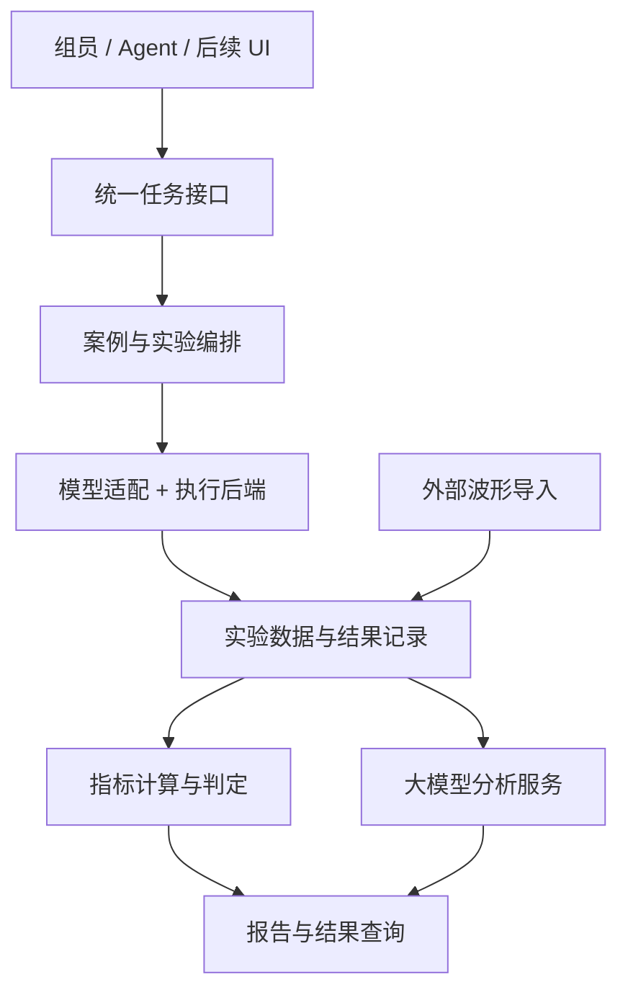

# 项目能力准备与长期发展规划

本文供课题组成员、项目维护者及参与开发的 Agent 使用，用于安排 lab-workflow 后续工作、判断扩展范围和保持项目方向一致。规划依据包括项目讨论、筹建计划、当前代码与文档，以及汉象水泵控制器 HIL 技术方案。

## 项目定位与规划使用

近期目标是形成课题组可复用的实验能力：接到测试实例后，能够理解模型、明确实验问题、完成运行和分析，并把方法交给其他组员。长期逐步发展为可由 Agent、界面和其他系统调用的实验执行与结果管理组件。

“熟悉 Typhoon、接入 Agent、汇总公开案例、让组员会用”是近期切入点。后续扩展方向对接筹建计划中王教授负责的软件熟悉、原理样机调试、推理模型选型、系统集成分析和环境部署等任务。本规划暂不展开共同任务。

本页维护建设方向、优先级和扩展触发条件。各项建议按具体任务逐步实施；长期规划不代表现有能力，也不要求现在全部实现。当前可用能力与实测结论以[验证状态](validation.md)为准，具体实现要求见[项目实现约定](../PROJECT_SPEC.md)。

## 面向真实案例的三个工作方向

汉象方案为水泵控制器测试提供了具体需求来源。项目围绕需求接收、模型与数据接入、实验执行、结果分析及记录复核继续推进；具体对象、缺失材料和下一步安排见[水泵控制器 HIL 需求与接入准备](pump-hil-intake.md)。

| 方向 | 需要形成的内容 | 完成依据 |
|---|---|---|
| 把技术方案转为案例接入需求 | 明确被测控制器、模型、输入数据、工况、预期判定、软硬件依赖与缺失资源，选择配置复用、适配器扩展或新增适配器 | 能说明哪些工作可以开始、哪些依赖待补；模型、配置与判据齐备后登记可执行案例 |
| 验证现有工作流能承接自动化测试 | 对应模型加载、信号发现、测试执行、波形捕获、结果判定及统一输出，复用已有软件证据并补充变化部分的实验 | 新案例形成实际数据、事件生效证据、报告与复核结果；真实电压注入和硬件接口按实体设备条件另行验证 |
| 为后续大模型接入明确职责 | Agent 负责需求理解、用例编排、参数选择、工具调用和辅助分析；执行系统负责确定性执行、采集、计算与记录 | 调用请求、执行配置与实际结果可关联；实时闭环、时序敏感控制和底层保护由仿真器、控制器及测试执行系统承担 |

工程目标是让新电机、控制器或故障条件尽量复用稳定的执行、采集、记录和复核流程，将变化集中在模型接口、实验配置与分析方法中。具体适配按真实案例推进，既有接口约定随实际需求扩展。

## 前期能力准备

已有基础包括模型适配器、案例目录、批次运行、JSON 返回和可追溯结果。下一步重点是补齐从“运行已有项目”到“接手新任务”的能力，普通示例数量的增加应服从具体学习或测试需求。

| 补充或优化项 | 已有基础与需要加强的部分 | 建议交付与完成依据 |
|---|---|---|
| 自主建模与修改模型的学习路径 | [自建 RLC 练习](modeling-practice.md)已完成从空白原理图的 API 建模、改参、增加测量点、编译、采集和脚本复核；真人 GUI 重做待验 | 让组员在 Schematic Editor 中独立重做，并解释模型改动、接口变化与结果差异，按[交接流程](handoff.md)记录卡点 |
| 陌生测试实例接入演练 | [1000 rpm 受控演练](../cases/im_mid_speed_intake/README.md)已验证不完整需求的缺口整理和配置复用；[水泵控制器需求记录](pump-hil-intake.md)已形成，模型与接口材料待补 | 补齐模型来源、接口、参考数据与验收要求，选择接入路径并完成正常基准和一个异常的最小实验及交付 |
| 面向组员的学习验收 | 已有交接文档和 Agent 验证；真人、跨电脑能力分别验收 | 将学习任务分为运行已有案例、修改实验条件、接入新实例三个层次。人员条件具备时记录卡点和解释能力，据此修改教程 |
| 有代表性的电机动态实验 | [转速参考阶跃案例](../cases/im_speed_step/README.md)已在同一次 Virtual HIL 运行中完成事件施加、生效证据、动态指标与报告，实测见[验证状态](validation.md) | 真实测试实例到来时核对其模型、负载与验收规范；需要负载扰动时再按实际任务扩展 |
| 面向任务的资源选择指南 | [资源导航的任务选型](resources.md#把测试要求映射到案例)已列出任务输入、适合解决的测试问题、可复用部分、实施路径与验证边界 | 组员可据此说明所选案例、关键条件缺口和配置复用或适配器接入路径；人员实际使用效果按[交接流程](handoff.md)另行验收 |

自主建模和陌生实例接入最直接回应“新实例来了，能够跑通并知道怎么做”。人员学习验收用于确认课题组形成了可复用能力。电机转速阶跃提供固定事件的教学范例；真实实例仍需按其条件和判据接收。

现有材料入口：[首次实验](first-experiment.md)、[模型接入方法](model-integration.md)、[交接流程](handoff.md)、[电机启动案例](../cases/im_speed_tracking/README.md)、[电机阶跃案例](../cases/im_speed_step/README.md)、[资源导航](resources.md)。

## 工程结构优化

近期以小范围整理和扩展约定为主。新需求到来时，应能识别需要修改的模块，并尽量复用已经验证的公共流程。

| 整理位置 | 规划形成时的观察 | 建议方向 |
|---|---|---|
| 公共业务能力与命令行入口 | JSON 返回已统一；复核函数已移至 [records.py](../src/typhoon_lab/records.py)，CLI、案例编排和离线比较共用；现有 CLI 与旧记录回归已核对，报告操作仍主要在 cli.py | 新调用入口实际出现时，再按同样方式抽取报告与运行操作，核对历史记录和 CLI 协议兼容性 |
| 适配器接口与能力描述 | 显式注册、事件与信号声明已接入；`validate-case` 可查询字段类型、单位、当前范围、设置阶段、信号与事件能力，数值范围与校验器共用定义 | 后续新增参数时同步补充能力描述及跨字段约束；用配置校验确认具体任务可执行，能力声明不替代实际运行证据 |
| 通用机制与模型专属逻辑 | 单次分析已有适配器分派；扫描、比较及部分复核仍含模型专属路径 | 先明确各类扩展所属模块；出现第二个相似需求时再提取公共机制，保留模型特有的物理含义与判据 |
| 结果记录的版本与兼容性 | 新记录已区分配置结构、结果格式和分析方法版本；旧清单仍可按历史格式读取，未知版本明确拒绝复算或重建 | 后续方法变更时明确升级方法版本；在副本上复核、重建或重新分析旧记录，并记录新旧方法及结论 |
| 能力限制的来源 | 运行器和适配器有教学范围内的采样数、时长和参数限制 | 标明限制来自设备/API、模型有效范围还是当前验证范围；按对应依据验证扩展，避免将教学配置当作永久能力上限 |

优先考虑公共操作从 CLI 分离、补充能力描述、明确结果版本。这些工作直接服务未来 Agent 工具、界面和分析模块的接入，宜按模块逐步改进并核对既有行为与记录兼容性。

能力描述声明的是当前实现支持的操作；具体环境是否可运行、某次实验是否达标仍需各自的验证证据。新的参数、事件、指标和模型可以按任务扩展，验证深度遵循实际交付范围。

相关实现入口：[CLI](../src/typhoon_lab/cli.py)、[JSON 协议](../src/typhoon_lab/protocol.py)、[运行器](../src/typhoon_lab/runtime.py)、[适配器注册](../src/typhoon_lab/adapters/__init__.py)。具体操作和接口在所属文档维护，本页不复制其实现细节。

## 长期职责与扩展空间

长期按职责组织能力，使 lab-workflow 在整体实验室项目中承担实验编排、执行、数据与结果管理的明确角色。以下关系包含未来的服务接口、外部数据入口和实体设备适配：

### 模型来源

现有准备流程以官方安装示例及哈希核对为基础。后续接收供应商模型和自建模型时，应登记来源、版本、依赖和派生关系，再进入统一实验流程。近期先明确接收与登记约定，具体支持随真实模型接入推进。

### 执行后端

当前运行器直接调用 Typhoon API，并显式选择 Virtual HIL。实体 HIL 接入时，集中处理设备选择、连接、资源占用、启停和采集差异，同时保留不同后端的能力与限制。近期明确职责边界；设备、控制器和接口确定后再实施具体适配。

模型适配解决被控对象的参数、信号、初始化和实验含义；执行后端处理运行环境与设备操作。两者的边界应结合真实接入需求逐步细化。

### 数据输入

后续分析可能使用供应商或设备采集的波形。分析入口应能够接收带有来源、单位、时间轴、采样条件和标签的数据集。外部数据不一定具备仿真模型和编译记录，需要适用的数据来源与完整性检查规则。

近期保留原始数据及采集元信息；获得真实数据格式后，再实现导入和映射。测试判据、识别标签及标签依据分别记录。

### 分析方法

保留确定性的指标计算和判据，同时允许增加异常识别、波形分类和大模型解释。新增分析生成独立结果，关联原数据、分析方法或模型版本、输入配置和判断依据，支持方法比较与结论复查。

Agent 负责理解需求、组织用例和参数、调用工具和辅助解释。lab-workflow 提供可复现的执行、采集、计算、记录和结果接口。实时仿真闭环、时序敏感控制和底层安全保护由确定性的仿真器、控制器及测试执行系统承担。大模型服务的更换及本地或线上部署变化，应尽量通过分析与调用接口处理。

### 调用入口

自然语言、CLI、未来 UI 和服务接口复用相同业务操作。出现远程调用或多人使用需求时，再增加任务编号、进度查询、取消、排队及设备占用管理，并以实际部署条件验证。

教学材料继续面向组员组织，程序接口面向工具与系统调用组织，两者共享案例和结果依据。

## 分阶段推进与启动条件

阶段按实际需求和依赖条件推进；本页不预设缺乏依据的完成日期。

| 阶段 | 主要目标 | 启动或推进条件 |
|---|---|---|
| 当前：能力准备 | 补齐自主建模、实例接入、学习验收；整理公共操作、能力描述和结果约定 | 利用现有软件与案例开展；以能稳定接收并交付新实例、其他组员能够复用作为阶段完成依据 |
| 真实实例接入 | 以水泵控制器需求推进供应商模型、数据及接口接收，完成最小自动化案例 | 需求记录已建立；模型、接口、参考数据及判据补齐后推进实验，缺失项见[接入准备](pump-hil-intake.md) |
| 系统集成 | 增加外部波形导入、分析接口和界面原型，接入选定的大模型服务 | 数据格式、模型任务及相关接口已经确定 |
| 设备与部署 | 增加实体执行后端、远程任务管理及环境部署 | 设备、控制器、服务器和操作职责明确 |

近期工作安排：

1. 自主建模到脚本接入的程序练习已形成；真人 GUI 重做按[练习步骤](modeling-practice.md)验收。
2. 水泵控制器需求记录已形成；下一步收集最小模型、IO/Pin 表、脚本与判据，并行整理四组波形的来源、时间轴、标签及用途。
3. 根据材料选择正常基准和一个异常，复用已有流程并验证新增接口与机制；形成实际数据、报告和复核结果。
4. 公共复核接口已完成小范围整理；结合最小案例需要，逐步落实模型来源、数据输入、执行后端、分析输出及版本兼容约定。

本页给出扩展方向。具体接口约定在任务实施时融入 PROJECT_SPEC、model-integration、case-interface 等所属文档，保持一个权威定义。电机转速阶跃已形成教学范例；人员、跨机及真实任务验收结合实例与条件安排。

## 后续任务安排与维护

安排新工作时，先说明它补足哪项近期能力，或由什么真实需求触发长期扩展，再确定交付及验收范围。明确可复用的现有能力、需要新增的模块、依赖条件和兼容影响，避免因规划中出现某项能力就提前实现整套系统。

规划不限制合理的任务级探索：可以先检查模型、验证接口或试验候选方法，再根据证据决定是否纳入公共能力。新的用户要求和实际任务可调整优先级，并同步本页对应章节。

本页维护规划；操作步骤放在教程与接口文档；当前能力维护在 validation；按日期的结果和证据放在 validation-history。完成规划项后，在对应条目说明已落实内容并链接当前文档与验证依据，不将本页改为实验日志或不断追加的版本补丁。

## 依据与范围

- [验证试验筹建计划](../../docs/验证试验筹建计划2026年10月11日.xlsx)：王教授负责的软件熟悉、原理样机调试、推理模型选型、系统集成分析和环境部署任务；共同任务暂不展开。
- [任务讨论记录](../../docs/任务讨论记录.txt)：近期以软件熟悉、Agent 接入、案例资源和组员学习为切入点。
- [实验室基本定位](../../docs/智算芯测融合创新联合实验室基本定位.txt)：算法、芯片、软件与场景的一体化验证背景。
- [汉象技术方案](<../../docs/电机硬件在环（HIL）及自动化测试 - 技术方案.pdf>)：水泵控制器测试对象、系统架构、故障类型及自动化路线；版本与待确认项见[接入准备](pump-hil-intake.md)。
- 本项目当前文档与代码检查，以及关于能力准备、工程结构、长期规划和三个工作方向的项目讨论。

上级 docs 中的来源材料属于工作区资料，独立分发 lab-workflow 时需按实际交付范围另附。需求事实与供应商能力声明以原始方案及后续确认材料为依据，项目已验证能力以实际记录为依据。
