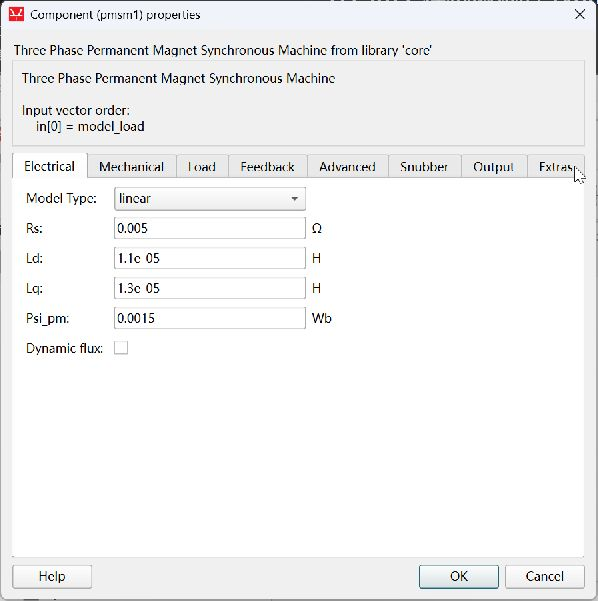
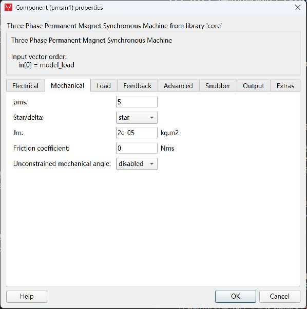
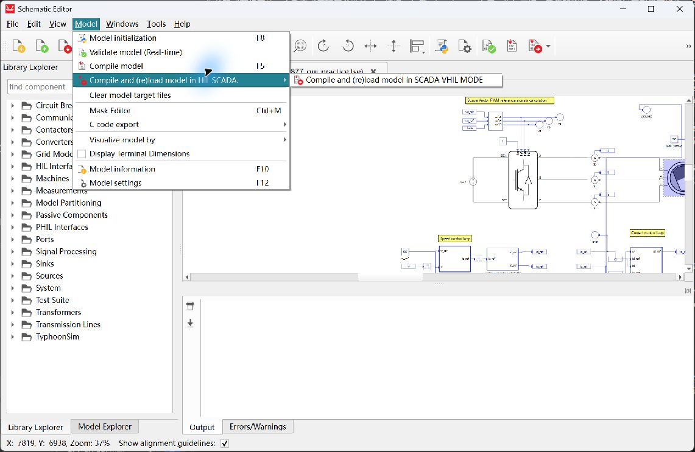
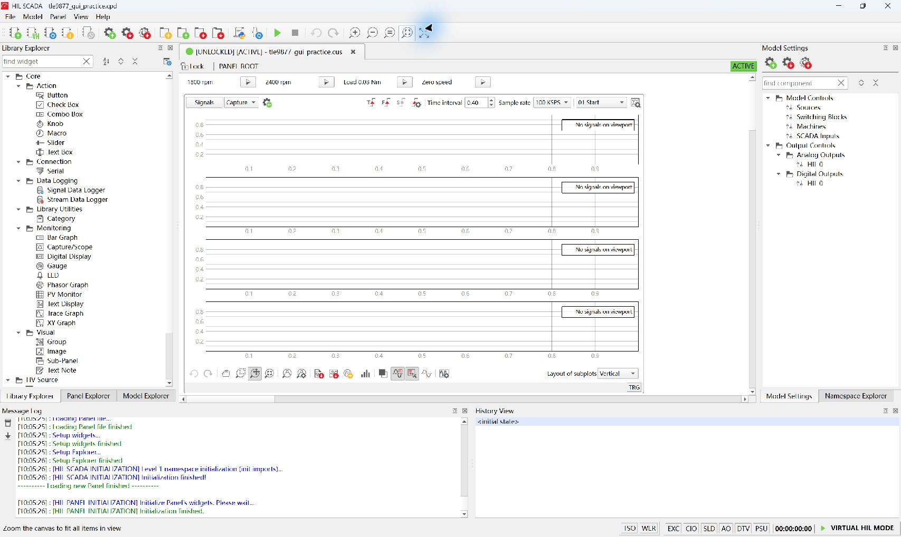
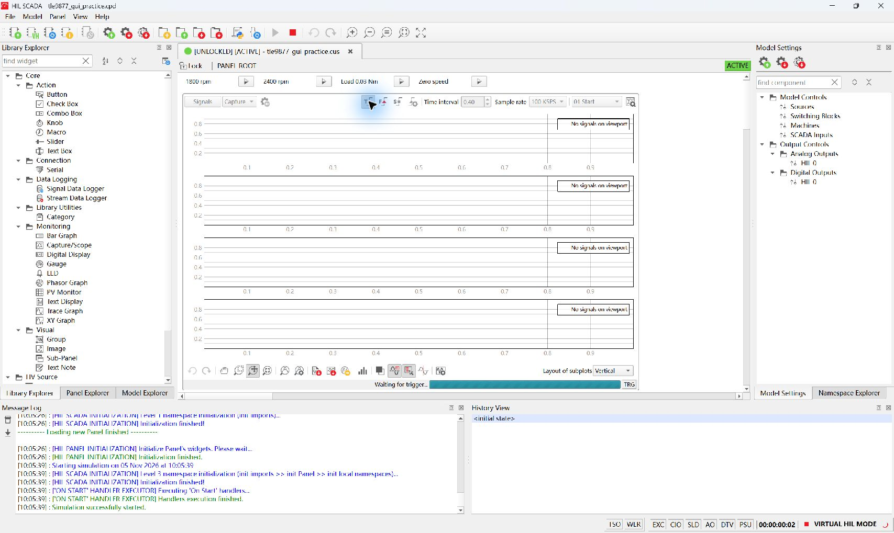
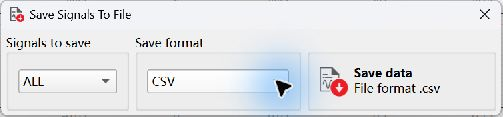
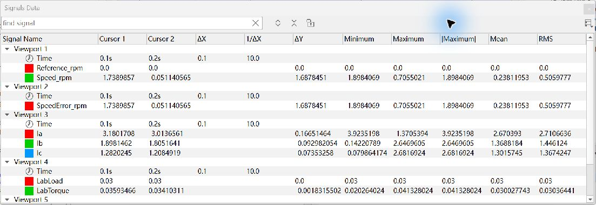
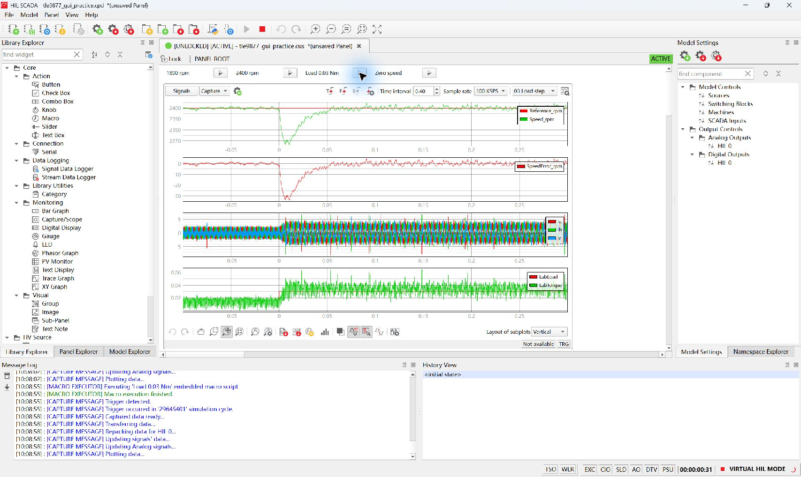
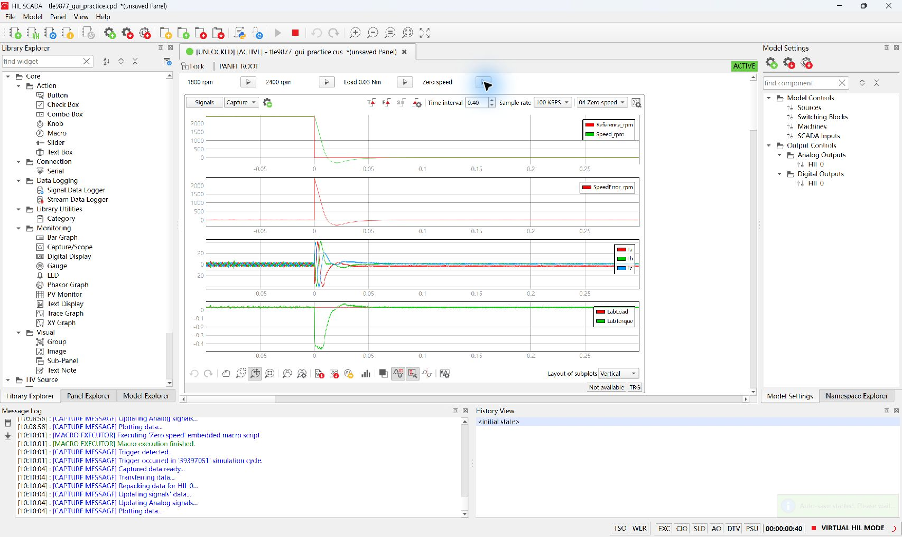

# TLE9877 样机测试的 Typhoon 图形界面预演

这次练习从现成的 9 V 电机模型和 SCADA 面板开始。你将亲手编译并启动 Virtual HIL，依次给出启转、升速、加负载和零速命令，抓取四次变化的前后波形，再依据采样数据判定转速跟踪。练习主线只用资源管理器和 Typhoon 图形界面。

## 1. 这次模拟了哪一段

| 环节 | 样机资料提供的依据 | 本次练习的设置 |
| --- | --- | --- |
| 供电 | 引线表「引脚分配」`E2` 建议 BAT 输入 9 V、上限 10 V。会议纪要也记有早期 12 V 场景和后续降至 9 V 的讨论 | `V_dc = 9 V` 是模型内的直流母线 |
| 电机 | 电机方案图为 Δ 接 PMSM。参数截图给出 5 mΩ、11 µH、5 极对及最大转速设置 5700 rpm | `pmsm1` 采用等效星形假设，暂取 `Rs = 0.005 Ω`、`Ld = 11 µH`、5 极对。练习最高给定为 2400 rpm |
| 缺失参数 | R/L 的测量口径与 Δ 接法的对应关系、`Lq`、磁链、惯量和负载待确认 | `Lq = 13 µH`、磁链 `0.0015 Wb`、惯量 `2 × 10⁻⁵ kg·m²`、摩擦系数 0。负载为手动给定的恒转矩 |
| 调速入口 | `LIN.ldf` 定义 ECU 向 EWP 发布 `ControlLIN`，`ControlSetspeed` 的分辨率为 22.4 rpm/code | SCADA 直接改变模型的转速给定。例如实际总线 `0x50` 对应 1792 rpm，本练习按钮直接施加 1800 rpm |
| 控制与反馈 | 典型电路图与引线表描述六路栅极驱动、三相节点和单分流采样。引线表记录样机采用无位置传感器方案 | 模型内控制器以理想角度和内部电流为反馈，驱动模型内三相逆变器。保留正负转矩调节，开关频率 20 kHz，控制周期 50 µs |

附件提供系统设计和工况背景。实体板的供电、接线、LIN、无感启动、单分流注入及关断行为由[样机现场联调](tle9877-field-commissioning.md)另行验收。练习中的 5 mΩ 是电机相电阻设定，现场资料中的 0.5 mΩ 是分流电阻设计值。[原始资料索引](../data/tle9877/README.md) · [样机接入记录](tle9877-hil-intake.md) · [LIN.ldf](../data/tle9877/LIN.ldf)

## 2. 复制、看图、编译和启动

1. 在资源管理器打开 `D:\Typhoon\lab-workflow\models`，选中 `tle9877_gui_practice.tse` 和 `tle9877_gui_practice.cus`，一起复制到项目 `results\gui-practice` 下新建的本次练习目录。`.tse` 是原理图，`.cus` 是面板。编译和导出产生的文件都收在这次目录。
2. 打开 **Typhoon HIL Control Center 2026.3 → Schematic Editor**。用 **File → Open** 打开刚复制的 `.tse`。如果画布显示不全，先最大化窗口，再点工具栏的 **Zoom to fit**。从 `V_dc` 沿三相逆变器到圆形的 `pmsm1`，找出三相电流测点 `Ia`、`Ib`、`Ic`。在图的下半部分找到速度环和电流环。
3. 双击 `pmsm1`。**Electrical** 页核对 `Rs`、`Ld`、`Lq`、`Psi_pm`，**Mechanical** 页核对 `pms`、`Star/delta`、`Jm` 和 `Friction coefficient`。核对完成点 **Cancel** 回到原理图。





4. 选择 **Model → Compile and (re)load model in HIL SCADA → Compile and (re)load model in SCADA VHIL MODE**。如果走工具栏的通用加载入口并出现设备选择框，选择 **Load Model to Virtual HIL (VHIL)**。等待编译结束，核对 HIL SCADA 状态为 **VIRTUAL HIL MODE**。



5. 在 SCADA 欢迎页的 **Panels files found in Model directory** 里选同名 `.cus`，也可通过 **Open Panel** 选择。核对上方的 **1800 rpm**、**2400 rpm**、**Load 0.03 Nm**、**Zero speed**，每个名称右侧的小三角执行这条命令。下方是 **Capture/Scope**。如果文字很小，最大化窗口后点主工具栏的 **Zoom the canvas to fit all items in view**。
6. 点击主工具栏的绿色三角 **Start the simulation**。等消息区显示 **Simulation successfully started**。在右侧 **Model Settings → Model Controls** 双击 **Sources** 查看 `V_dc = 9 V`，双击 **SCADA Inputs** 查看 `w_ref = 0 rad/s` 和 `load_torque = 0.01 N·m`。每次启动时面板都设置这三个初值。[9 V 设置](assets/gui/tle9877-10-source-9v.jpg) · [给定初值](assets/gui/tle9877-11-restart-inputs.jpg)



## 3. 一次只施加一个变化

保持同一次仿真运行，按顺序做四段。每段在 **Capture** 工具栏右端选择预设，再点 **Enable trigger**（`T` 与红色箭头图标），看到 **Waiting for trigger…** 即已布防。给触发前缓冲留出至少 0.1 s 的仿真时间。如果右下角计时只显示到秒，可等它跳两次，再点对应名称右侧的小三角一次。等波形出现，先保存再切下一段。[预设下拉框](assets/gui/tle9877-08-presets.jpg) · [Trigger settings 参数](assets/gui/tle9877-05-trigger-settings.jpg)



| 预设 | 先核对的条件 | 点面板按钮 | 触发依据 | 文件名建议 |
| --- | --- | --- | --- | --- |
| `01 Start` | 0 rpm，0.01 N·m | **1800 rpm** | `Reference_rpm` 上升越过 900 rpm | `01-start` |
| `02 Speed step` | 1800 rpm，0.01 N·m | **2400 rpm** | `Reference_rpm` 上升越过 2100 rpm | `02-speed` |
| `03 Load step` | 2400 rpm，0.01 N·m | **Load 0.03 Nm** | `LabLoad` 上升越过 0.02 N·m | `03-load` |
| `04 Zero speed` | 2400 rpm，0.03 N·m | **Zero speed** | `Reference_rpm` 下降越过 1200 rpm | `04-zero` |

预设使用 100 kSa/s、0.4 s 窗口和 25% 触发前偏移。CSV 的 `Time` 单位为秒，完整一段应有 40,000 点，样点间隔 10 µs，时间约从 −0.1 s 到 0.3 s。四次采集各有自己的触发时间轴。

在波形区底部工具栏点击 **Save signals to file**，选择 **All → CSV → Save data**。同名 `.svc` 保存信号和视口配置，可随 CSV 一起留存。旁边的 **Save image** 导出 PNG。把文件保存在本次练习目录，用表里的名称区分四段。



若点完按钮仍在等待，先用 **Stop capture process** 解除布防，再检查预设的触发源、方向以及当前给定。把给定恢复到表中的起点，等速度稳定，再重新布防和点击。转速用面板对应按钮恢复。恢复低负载时，在 **Model Settings → Model Controls → SCADA Inputs** 中将 `load_torque` 设为 `0.01`，按 Enter 确认。重采用新文件名，例如 `03-load-retry1.csv`。

## 4. 看波形、填记录、停止

从上到下四个视口分别是转速给定和反馈（rpm）、实际减给定的转速误差（rpm）、三相电流（A）、负载命令和电磁转矩（N·m）。用游标先核对给定阶跃两侧的电平，再看响应。加负载一段重点对照 `Reference_rpm` 保持、`LabLoad` 上升、速度短暂下跌以及电流和转矩变化。零速段仍有负载，控制器会继续调节转矩。

以**给定实际变到新电平的第一个样点**为 `t₀`。对四段都检查 `t₀ + 0.100 s` 至 `t₀ + 0.200 s`（含边界）内的 `|SpeedError_rpm|` 最大值。最大值 **≤ 50 rpm** 为该段通过，超过为未通过。给定阶跃缺失、窗口覆盖不完整或记录丢点时填“证据不足”。

先看阶跃两侧的给定，核对 CSV 中 `t₀`。加负载段用 `LabLoad` 定位，其余三段用 `Reference_rpm`。然后在图上右键 **Add cursor at value…** 两次，分别输入 `t₀ + 0.100` 和 `t₀ + 0.200` 的数值。在 **Signals Data** 窗口读取 `SpeedError_rpm` 行的 **|Maximum|**。窗口关闭后，可在图上右键 **Show signal data window** 重新打开。



复算时可以在表格软件中打开 CSV 的分析副本，新增一列 `ABS(该行 SpeedError_rpm)`，按 `Time` 筛选上述区间，再对该区间的绝对值求最大值。`t₀ = 0` 时，标准 100 kSa/s 导出在 0.100–0.200 s 内应有 10,001 点。原始 CSV 单独保留。四段都通过才填本次练习判据通过。

| 工况 | CSV 文件 | `t₀`（s） | 窗口最大误差（rpm） | 电流或转矩观察 | 判定 |
| --- | --- | --- | --- | --- | --- |
| 启转 |  |  |  |  |  |
| 升速 |  |  |  |  |  |
| 加负载 |  |  |  |  |  |
| 零速给定 |  |  |  |  |  |

保存最后一段后，点 SCADA 主工具栏的方形 **Stop the simulation**，确认消息区显示 **Simulation successfully stopped**，再关闭本次 SCADA。若切换预设使 SCADA 询问是否保存面板，选择 **No** 即可保留面板初始预设，导出的数据和图已单独保存。把编译、运行、采集和停止是否完成记在表外，四段数值判定各自记录。**Zero speed** 改的是控制目标，**Stop the simulation** 结束的是模型计算。

## 5. 本机实跑对照

2026-11-05 的四段采集均完整，实测最大绝对转速误差依次为 **3.78、2.61、3.76、1.90 rpm**。加负载时模型转速最低约 2366 rpm，随后回到 2400 rpm 附近。零速给定后有负转矩制动，速度短暂越过零，约至 −305 rpm，再回到零速附近。练习的误差窗口从事件后 100 ms 开始，因此应另外记录这段瞬态。可对照[本次验收记录和原始数据](../results/gui-practice/20261105-gui-validation/summary.md)。





## 维护者准备文件

练习文件由 `scripts/prepare_tle9877_gui.py` 从本机 THCC 2026.3 安装源构建。脚本核对官方 `.tse` 和 `.cus` 的 SHA-256，复用 PMSM 软件预演的模型设置，生成一对本机文件。若需要重建，先移出 `models` 中已有的同名练习文件，再从项目根目录用 THCC 配套解释器执行。构建和练习分别进行。

Typhoon 保存原理图时会重写示例中禁用的损耗表相对路径。比较重建文件时，SHA-256 用于识别当次文件，模型参数与连线可按本教程核对。

```powershell
$typhoonInstall = 'D:\Typhoon\Typhoon HIL Control Center 2026.3'
$env:TYPHOON_LAB_INSTALL = $typhoonInstall
& "$typhoonInstall\python3_portable\python.exe" -B -X utf8 scripts/prepare_tle9877_gui.py
```
